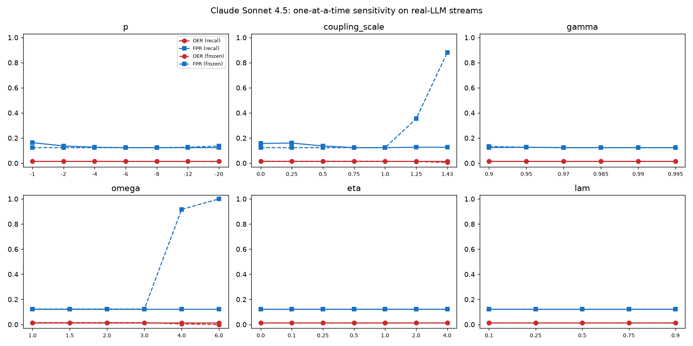
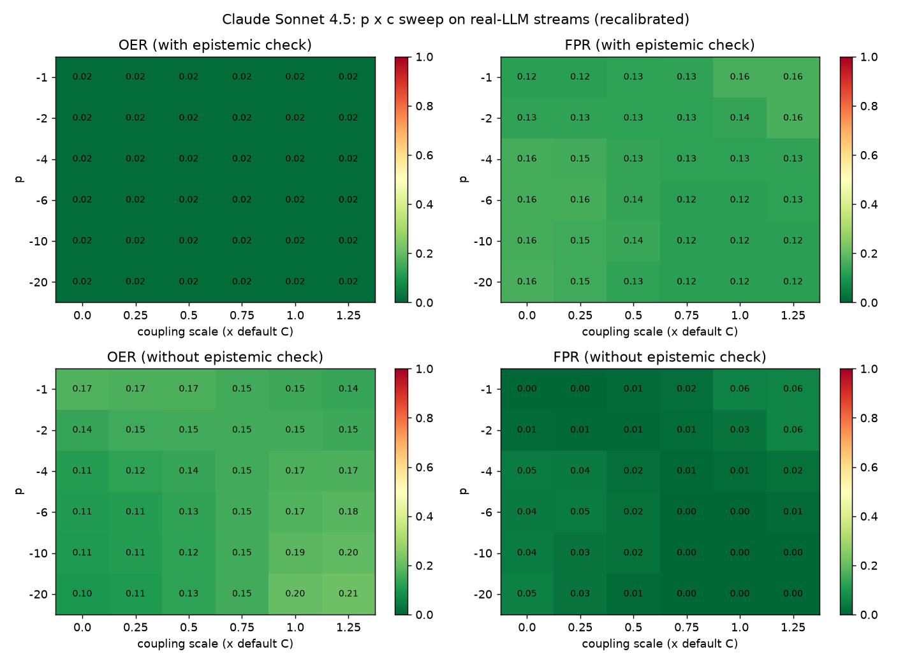
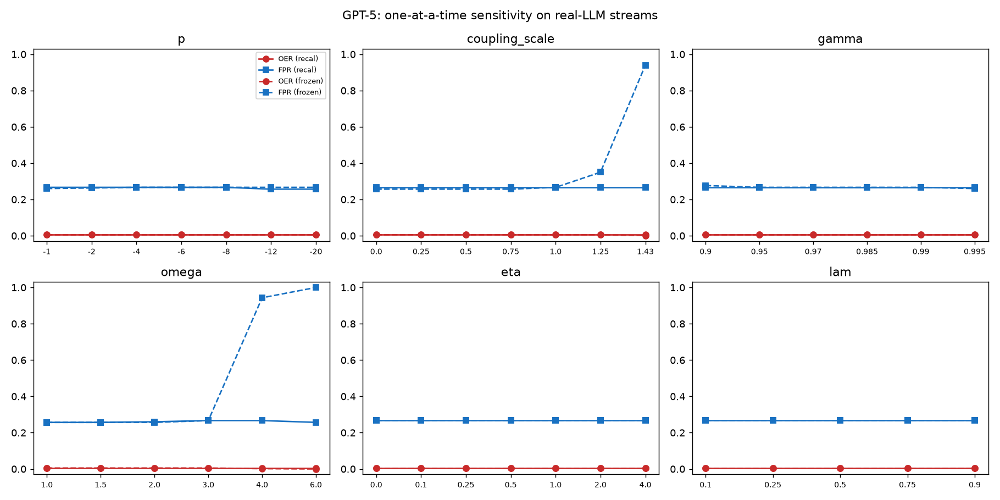
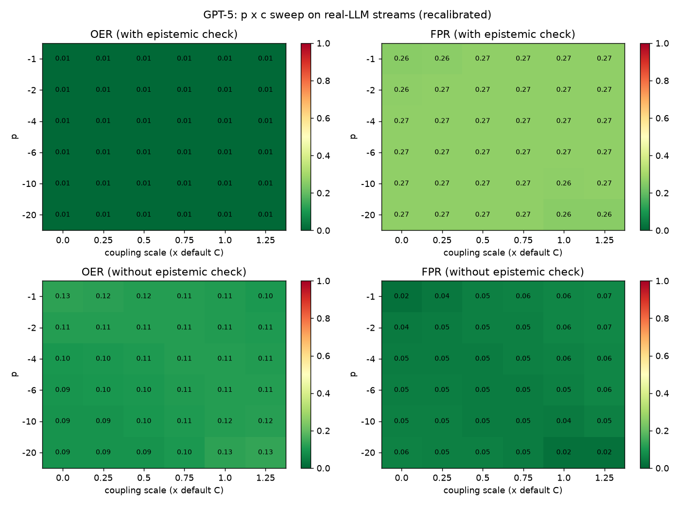

# Parameter sensitivity and structure misspecification on real-LLM streams

## Method
15 independent E1 episodes per model. One-at-a-time sweeps of p, coupling
scale, gamma, omega, eta (Hedge learning rate), lambda (EWMA decay); a
p x coupling heatmap on the real streams with and without the epistemic check;
26 coupling matrices (default, zero, uniform, chain-only, full, reversed
order, 20 random lower-triangular); and permuted layer orders.
(a) recalibrated: Algorithm 2 re-run for each setting; (b) frozen: thresholds of the
nominal setting.

## Results
### Claude Sonnet 4.5
Nominal (p=-6, C=default, gamma=0.985, omega=3, eta=0.5, lambda=0.5): OER 0.02 [0.01, 0.02], FPR 0.12 [0.05, 0.21].

**One-at-a-time** (a = recalibrated, b = frozen thresholds)

| Param | Value | OER (a) | FPR (a) | OER (b) | FPR (b) |
|---|---|---|---|---|---|
| p | -1 | 0.02 [0.01, 0.02] | 0.16 [0.05, 0.32] | 0.02 [0.01, 0.02] | 0.12 [0.05, 0.21] |
| p | -2 | 0.02 [0.01, 0.02] | 0.14 [0.05, 0.24] | 0.02 [0.01, 0.02] | 0.12 [0.05, 0.21] |
| p | -4 | 0.02 [0.01, 0.02] | 0.13 [0.05, 0.22] | 0.02 [0.01, 0.02] | 0.12 [0.05, 0.21] |
| p | -6 | 0.02 [0.01, 0.02] | 0.12 [0.05, 0.21] | 0.02 [0.01, 0.02] | 0.12 [0.05, 0.21] |
| p | -8 | 0.02 [0.01, 0.02] | 0.12 [0.05, 0.21] | 0.02 [0.01, 0.02] | 0.12 [0.05, 0.21] |
| p | -12 | 0.02 [0.01, 0.02] | 0.12 [0.05, 0.21] | 0.02 [0.01, 0.02] | 0.13 [0.05, 0.22] |
| p | -20 | 0.02 [0.01, 0.02] | 0.12 [0.05, 0.21] | 0.02 [0.01, 0.02] | 0.14 [0.05, 0.24] |
| coupling_scale | 0.0 | 0.02 [0.01, 0.02] | 0.16 [0.05, 0.30] | 0.02 [0.01, 0.02] | 0.12 [0.05, 0.21] |
| coupling_scale | 0.25 | 0.02 [0.01, 0.02] | 0.16 [0.05, 0.31] | 0.02 [0.01, 0.02] | 0.12 [0.05, 0.21] |
| coupling_scale | 0.5 | 0.02 [0.01, 0.02] | 0.14 [0.05, 0.24] | 0.02 [0.01, 0.02] | 0.12 [0.05, 0.21] |
| coupling_scale | 0.75 | 0.02 [0.01, 0.02] | 0.12 [0.05, 0.21] | 0.02 [0.01, 0.02] | 0.12 [0.05, 0.21] |
| coupling_scale | 1.0 | 0.02 [0.01, 0.02] | 0.12 [0.05, 0.21] | 0.02 [0.01, 0.02] | 0.12 [0.05, 0.21] |
| coupling_scale | 1.25 | 0.02 [0.01, 0.02] | 0.13 [0.05, 0.22] | 0.01 [0.01, 0.02] | 0.35 [0.19, 0.54] |
| coupling_scale | 1.43 | 0.02 [0.01, 0.02] | 0.13 [0.05, 0.22] | 0.01 [0.00, 0.01] | 0.88 [0.79, 0.96] |
| gamma | 0.9 | 0.02 [0.01, 0.02] | 0.12 [0.05, 0.21] | 0.02 [0.01, 0.02] | 0.13 [0.05, 0.23] |
| gamma | 0.95 | 0.02 [0.01, 0.02] | 0.13 [0.05, 0.22] | 0.02 [0.01, 0.02] | 0.13 [0.05, 0.22] |
| gamma | 0.97 | 0.02 [0.01, 0.02] | 0.12 [0.05, 0.21] | 0.02 [0.01, 0.02] | 0.12 [0.05, 0.21] |
| gamma | 0.985 | 0.02 [0.01, 0.02] | 0.12 [0.05, 0.21] | 0.02 [0.01, 0.02] | 0.12 [0.05, 0.21] |
| gamma | 0.99 | 0.02 [0.01, 0.02] | 0.12 [0.05, 0.21] | 0.02 [0.01, 0.02] | 0.12 [0.05, 0.21] |
| gamma | 0.995 | 0.02 [0.01, 0.02] | 0.12 [0.05, 0.21] | 0.02 [0.01, 0.02] | 0.12 [0.05, 0.21] |
| omega | 1.0 | 0.02 [0.01, 0.02] | 0.12 [0.05, 0.21] | 0.02 [0.01, 0.02] | 0.12 [0.05, 0.21] |
| omega | 1.5 | 0.02 [0.01, 0.02] | 0.12 [0.05, 0.21] | 0.02 [0.01, 0.02] | 0.12 [0.05, 0.21] |
| omega | 2.0 | 0.02 [0.01, 0.02] | 0.12 [0.05, 0.21] | 0.02 [0.01, 0.02] | 0.12 [0.05, 0.21] |
| omega | 3.0 | 0.02 [0.01, 0.02] | 0.12 [0.05, 0.21] | 0.02 [0.01, 0.02] | 0.12 [0.05, 0.21] |
| omega | 4.0 | 0.02 [0.01, 0.02] | 0.12 [0.05, 0.21] | 0.01 [0.00, 0.01] | 0.92 [0.84, 0.98] |
| omega | 6.0 | 0.02 [0.01, 0.02] | 0.12 [0.05, 0.21] | 0.00 [0.00, 0.00] | 1.00 [1.00, 1.00] |
| eta | 0.0 | 0.02 [0.01, 0.02] | 0.12 [0.05, 0.21] | 0.02 [0.01, 0.02] | 0.12 [0.05, 0.21] |
| eta | 0.1 | 0.02 [0.01, 0.02] | 0.12 [0.05, 0.21] | 0.02 [0.01, 0.02] | 0.12 [0.05, 0.21] |
| eta | 0.25 | 0.02 [0.01, 0.02] | 0.12 [0.05, 0.21] | 0.02 [0.01, 0.02] | 0.12 [0.05, 0.21] |
| eta | 0.5 | 0.02 [0.01, 0.02] | 0.12 [0.05, 0.21] | 0.02 [0.01, 0.02] | 0.12 [0.05, 0.21] |
| eta | 1.0 | 0.02 [0.01, 0.02] | 0.12 [0.05, 0.21] | 0.02 [0.01, 0.02] | 0.12 [0.05, 0.21] |
| eta | 2.0 | 0.02 [0.01, 0.02] | 0.12 [0.05, 0.21] | 0.02 [0.01, 0.02] | 0.12 [0.05, 0.21] |
| eta | 4.0 | 0.02 [0.01, 0.02] | 0.12 [0.05, 0.21] | 0.02 [0.01, 0.02] | 0.12 [0.05, 0.21] |
| lam | 0.1 | 0.02 [0.01, 0.02] | 0.12 [0.05, 0.21] | 0.02 [0.01, 0.02] | 0.12 [0.05, 0.21] |
| lam | 0.25 | 0.02 [0.01, 0.02] | 0.12 [0.05, 0.21] | 0.02 [0.01, 0.02] | 0.12 [0.05, 0.21] |
| lam | 0.5 | 0.02 [0.01, 0.02] | 0.12 [0.05, 0.21] | 0.02 [0.01, 0.02] | 0.12 [0.05, 0.21] |
| lam | 0.75 | 0.02 [0.01, 0.02] | 0.12 [0.05, 0.21] | 0.02 [0.01, 0.02] | 0.12 [0.05, 0.21] |
| lam | 0.9 | 0.02 [0.01, 0.02] | 0.12 [0.05, 0.21] | 0.02 [0.01, 0.02] | 0.12 [0.05, 0.21] |

**Coupling misspecification** (recalibrated)

| Coupling | Epistemic prereq | OER | FPR |
|---|---|---|---|
| default | yes | 0.02 [0.01, 0.02] | 0.12 [0.05, 0.21] |
| default | no | 0.17 [0.14, 0.20] | 0.00 [0.00, 0.00] |
| zero | yes | 0.02 [0.01, 0.02] | 0.16 [0.05, 0.30] |
| zero | no | 0.11 [0.08, 0.14] | 0.04 [0.00, 0.12] |
| uniform-0.5 | yes | 0.02 [0.01, 0.02] | 0.13 [0.05, 0.22] |
| uniform-0.5 | no | 0.19 [0.15, 0.22] | 0.01 [0.00, 0.04] |
| chain-only | yes | 0.02 [0.01, 0.02] | 0.16 [0.05, 0.32] |
| chain-only | no | 0.12 [0.09, 0.15] | 0.05 [0.00, 0.16] |
| full-1.0 | yes | 0.02 [0.01, 0.02] | 0.16 [0.05, 0.31] |
| full-1.0 | no | 0.16 [0.12, 0.19] | 0.06 [0.00, 0.18] |
| transposed-order | yes | 0.02 [0.01, 0.02] | 0.12 [0.05, 0.21] |
| transposed-order | no | 0.21 [0.18, 0.25] | 0.00 [0.00, 0.00] |
| 20 random C (range of means) | | 0.02-0.02 | 0.12-0.16 |
| 20 random C, no prereq | | 0.10-0.27 | 0.00-0.07 |

**Layer order** (signal columns permuted; position 0 = layer treated as the universal prerequisite)

| Permutation | OER | FPR |
|---|---|---|
| 0,1,2,3,4 | 0.02 [0.01, 0.02] | 0.12 [0.05, 0.21] |
| 0,3,1,2,4 | 0.02 [0.01, 0.02] | 0.13 [0.05, 0.23] |
| 1,0,2,3,4 | 0.14 [0.10, 0.17] | 0.06 [0.00, 0.17] |
| 1,3,0,2,4 | 0.10 [0.07, 0.13] | 0.07 [0.00, 0.19] |
| 2,0,1,3,4 | 0.14 [0.11, 0.18] | 0.03 [0.00, 0.09] |
| 2,3,0,1,4 | 0.10 [0.07, 0.13] | 0.06 [0.00, 0.19] |
| 3,0,1,2,4 | 0.11 [0.08, 0.14] | 0.06 [0.00, 0.17] |
| 3,2,0,1,4 | 0.12 [0.08, 0.15] | 0.06 [0.00, 0.18] |
| 4,0,1,2,3 | 0.15 [0.12, 0.19] | 0.03 [0.00, 0.09] |
| 4,2,0,1,3 | 0.14 [0.10, 0.17] | 0.06 [0.00, 0.18] |

### GPT-5
Nominal (p=-6, C=default, gamma=0.985, omega=3, eta=0.5, lambda=0.5): OER 0.01 [0.00, 0.01], FPR 0.27 [0.13, 0.43].

**One-at-a-time** (a = recalibrated, b = frozen thresholds)

| Param | Value | OER (a) | FPR (a) | OER (b) | FPR (b) |
|---|---|---|---|---|---|
| p | -1 | 0.01 [0.00, 0.01] | 0.27 [0.13, 0.43] | 0.01 [0.00, 0.01] | 0.26 [0.13, 0.41] |
| p | -2 | 0.01 [0.00, 0.01] | 0.27 [0.13, 0.43] | 0.01 [0.00, 0.01] | 0.26 [0.13, 0.42] |
| p | -4 | 0.01 [0.00, 0.01] | 0.27 [0.13, 0.43] | 0.01 [0.00, 0.01] | 0.27 [0.13, 0.43] |
| p | -6 | 0.01 [0.00, 0.01] | 0.27 [0.13, 0.43] | 0.01 [0.00, 0.01] | 0.27 [0.13, 0.43] |
| p | -8 | 0.01 [0.00, 0.01] | 0.27 [0.13, 0.43] | 0.01 [0.00, 0.01] | 0.27 [0.13, 0.43] |
| p | -12 | 0.01 [0.00, 0.01] | 0.26 [0.12, 0.40] | 0.01 [0.00, 0.01] | 0.27 [0.13, 0.43] |
| p | -20 | 0.01 [0.00, 0.01] | 0.26 [0.12, 0.40] | 0.01 [0.00, 0.01] | 0.27 [0.13, 0.43] |
| coupling_scale | 0.0 | 0.01 [0.00, 0.01] | 0.27 [0.13, 0.43] | 0.01 [0.00, 0.01] | 0.26 [0.12, 0.40] |
| coupling_scale | 0.25 | 0.01 [0.00, 0.01] | 0.27 [0.13, 0.43] | 0.01 [0.00, 0.01] | 0.26 [0.12, 0.40] |
| coupling_scale | 0.5 | 0.01 [0.00, 0.01] | 0.27 [0.13, 0.43] | 0.01 [0.00, 0.01] | 0.26 [0.12, 0.40] |
| coupling_scale | 0.75 | 0.01 [0.00, 0.01] | 0.27 [0.13, 0.43] | 0.01 [0.00, 0.01] | 0.26 [0.12, 0.40] |
| coupling_scale | 1.0 | 0.01 [0.00, 0.01] | 0.27 [0.13, 0.43] | 0.01 [0.00, 0.01] | 0.27 [0.13, 0.43] |
| coupling_scale | 1.25 | 0.01 [0.00, 0.01] | 0.27 [0.13, 0.43] | 0.01 [0.00, 0.01] | 0.35 [0.18, 0.53] |
| coupling_scale | 1.43 | 0.01 [0.00, 0.01] | 0.27 [0.13, 0.43] | 0.00 [0.00, 0.01] | 0.94 [0.85, 1.00] |
| gamma | 0.9 | 0.01 [0.00, 0.01] | 0.27 [0.13, 0.43] | 0.01 [0.00, 0.01] | 0.28 [0.13, 0.45] |
| gamma | 0.95 | 0.01 [0.00, 0.01] | 0.27 [0.13, 0.43] | 0.01 [0.00, 0.01] | 0.27 [0.13, 0.43] |
| gamma | 0.97 | 0.01 [0.00, 0.01] | 0.27 [0.13, 0.43] | 0.01 [0.00, 0.01] | 0.27 [0.13, 0.43] |
| gamma | 0.985 | 0.01 [0.00, 0.01] | 0.27 [0.13, 0.43] | 0.01 [0.00, 0.01] | 0.27 [0.13, 0.43] |
| gamma | 0.99 | 0.01 [0.00, 0.01] | 0.27 [0.13, 0.43] | 0.01 [0.00, 0.01] | 0.27 [0.13, 0.43] |
| gamma | 0.995 | 0.01 [0.00, 0.01] | 0.27 [0.13, 0.43] | 0.01 [0.00, 0.01] | 0.26 [0.13, 0.41] |
| omega | 1.0 | 0.01 [0.00, 0.01] | 0.26 [0.12, 0.40] | 0.01 [0.00, 0.01] | 0.26 [0.12, 0.40] |
| omega | 1.5 | 0.01 [0.00, 0.01] | 0.26 [0.12, 0.40] | 0.01 [0.00, 0.01] | 0.26 [0.12, 0.40] |
| omega | 2.0 | 0.01 [0.00, 0.01] | 0.26 [0.13, 0.41] | 0.01 [0.00, 0.01] | 0.26 [0.12, 0.40] |
| omega | 3.0 | 0.01 [0.00, 0.01] | 0.27 [0.13, 0.43] | 0.01 [0.00, 0.01] | 0.27 [0.13, 0.43] |
| omega | 4.0 | 0.01 [0.00, 0.01] | 0.27 [0.13, 0.43] | 0.00 [0.00, 0.01] | 0.94 [0.86, 1.00] |
| omega | 6.0 | 0.01 [0.00, 0.01] | 0.26 [0.12, 0.40] | 0.00 [0.00, 0.00] | 1.00 [1.00, 1.00] |
| eta | 0.0 | 0.01 [0.00, 0.01] | 0.27 [0.13, 0.43] | 0.01 [0.00, 0.01] | 0.27 [0.13, 0.43] |
| eta | 0.1 | 0.01 [0.00, 0.01] | 0.27 [0.13, 0.43] | 0.01 [0.00, 0.01] | 0.27 [0.13, 0.43] |
| eta | 0.25 | 0.01 [0.00, 0.01] | 0.27 [0.13, 0.43] | 0.01 [0.00, 0.01] | 0.27 [0.13, 0.43] |
| eta | 0.5 | 0.01 [0.00, 0.01] | 0.27 [0.13, 0.43] | 0.01 [0.00, 0.01] | 0.27 [0.13, 0.43] |
| eta | 1.0 | 0.01 [0.00, 0.01] | 0.27 [0.13, 0.43] | 0.01 [0.00, 0.01] | 0.27 [0.13, 0.43] |
| eta | 2.0 | 0.01 [0.00, 0.01] | 0.27 [0.13, 0.43] | 0.01 [0.00, 0.01] | 0.27 [0.13, 0.43] |
| eta | 4.0 | 0.01 [0.00, 0.01] | 0.27 [0.13, 0.43] | 0.01 [0.00, 0.01] | 0.27 [0.13, 0.43] |
| lam | 0.1 | 0.01 [0.00, 0.01] | 0.27 [0.13, 0.43] | 0.01 [0.00, 0.01] | 0.27 [0.13, 0.43] |
| lam | 0.25 | 0.01 [0.00, 0.01] | 0.27 [0.13, 0.43] | 0.01 [0.00, 0.01] | 0.27 [0.13, 0.43] |
| lam | 0.5 | 0.01 [0.00, 0.01] | 0.27 [0.13, 0.43] | 0.01 [0.00, 0.01] | 0.27 [0.13, 0.43] |
| lam | 0.75 | 0.01 [0.00, 0.01] | 0.27 [0.13, 0.43] | 0.01 [0.00, 0.01] | 0.27 [0.13, 0.43] |
| lam | 0.9 | 0.01 [0.00, 0.01] | 0.27 [0.13, 0.43] | 0.01 [0.00, 0.01] | 0.27 [0.13, 0.43] |

**Coupling misspecification** (recalibrated)

| Coupling | Epistemic prereq | OER | FPR |
|---|---|---|---|
| default | yes | 0.01 [0.00, 0.01] | 0.27 [0.13, 0.43] |
| default | no | 0.11 [0.08, 0.15] | 0.05 [0.00, 0.12] |
| zero | yes | 0.01 [0.00, 0.01] | 0.27 [0.13, 0.43] |
| zero | no | 0.09 [0.07, 0.12] | 0.05 [0.00, 0.11] |
| uniform-0.5 | yes | 0.01 [0.00, 0.01] | 0.27 [0.13, 0.43] |
| uniform-0.5 | no | 0.12 [0.08, 0.15] | 0.06 [0.00, 0.13] |
| chain-only | yes | 0.01 [0.00, 0.01] | 0.27 [0.13, 0.43] |
| chain-only | no | 0.10 [0.07, 0.13] | 0.06 [0.00, 0.13] |
| full-1.0 | yes | 0.01 [0.00, 0.01] | 0.28 [0.13, 0.45] |
| full-1.0 | no | 0.10 [0.07, 0.13] | 0.10 [0.00, 0.24] |
| transposed-order | yes | 0.01 [0.00, 0.01] | 0.26 [0.12, 0.40] |
| transposed-order | no | 0.13 [0.10, 0.17] | 0.03 [0.00, 0.08] |
| 20 random C (range of means) | | 0.01-0.01 | 0.26-0.28 |
| 20 random C, no prereq | | 0.09-0.18 | 0.02-0.11 |

**Layer order** (signal columns permuted; position 0 = layer treated as the universal prerequisite)

| Permutation | OER | FPR |
|---|---|---|
| 0,1,2,3,4 | 0.01 [0.00, 0.01] | 0.27 [0.13, 0.43] |
| 0,3,1,2,4 | 0.01 [0.00, 0.01] | 0.26 [0.12, 0.40] |
| 1,0,2,3,4 | 0.10 [0.07, 0.13] | 0.06 [0.00, 0.15] |
| 1,3,0,2,4 | 0.10 [0.07, 0.13] | 0.05 [0.00, 0.11] |
| 2,0,1,3,4 | 0.10 [0.07, 0.13] | 0.07 [0.00, 0.16] |
| 2,3,0,1,4 | 0.09 [0.06, 0.12] | 0.06 [0.00, 0.13] |
| 3,0,1,2,4 | 0.11 [0.08, 0.14] | 0.04 [0.00, 0.09] |
| 3,2,0,1,4 | 0.09 [0.06, 0.12] | 0.07 [0.00, 0.17] |
| 4,0,1,2,3 | 0.09 [0.06, 0.12] | 0.09 [0.00, 0.20] |
| 4,2,0,1,3 | 0.09 [0.06, 0.12] | 0.09 [0.00, 0.21] |

## Figures

