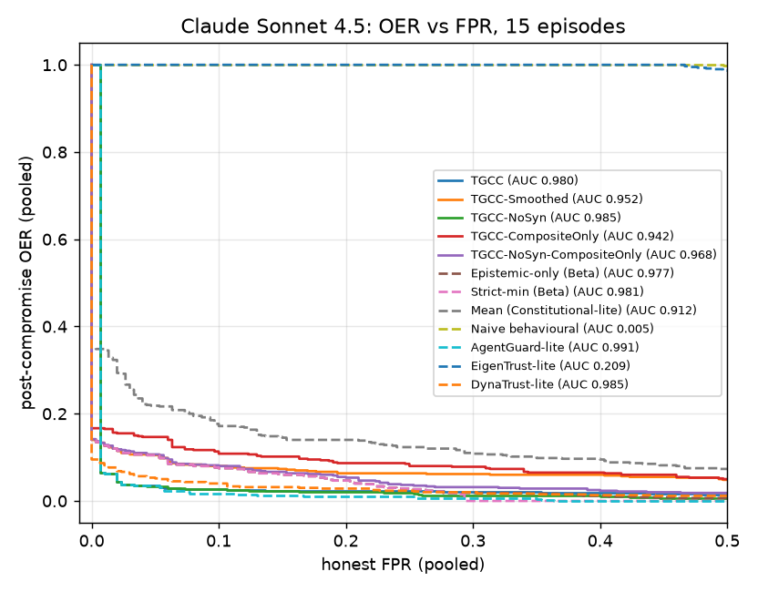
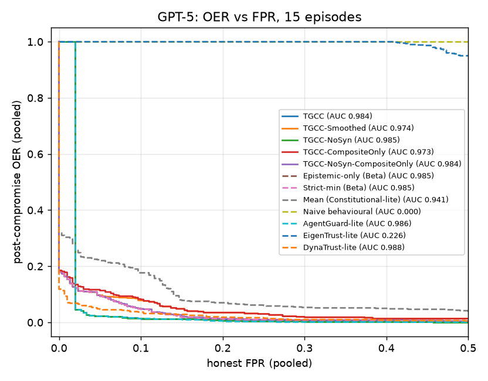

# Baselines at matched honest-agent admission

## Method
Same 15 independent E1 episodes per model. Gates:
TGCC; ablations TGCC-Smoothed (epistemic check on the Beta-smoothed trust),
TGCC-NoSyn (no coupling), TGCC-CompositeOnly (no epistemic check);
**Epistemic-only (Beta)** = the same Beta belief/forgetting/prewarm on the epistemic
layer alone; **Strict-min (Beta)** over the five layer trusts; Mean
(Constitutional-lite); Naive behavioural; AgentGuard-lite (memoryless per-turn
epistemic signal); EigenTrust-lite; DynaTrust-lite.

* Operating point: each gate calibrated by Algorithm 2 on the SAME honest pilot.
* Threshold-free: each gate's decision statistic is normalized by its pilot
  minimum and swept with a common multiplier; pooled honest FPR vs pooled OER.
  Detection AUC = area under (FPR, 1 - OER). OER@FPR<=x = best OER with honest
  FPR at most x (matched admission).

## Results
### Claude Sonnet 4.5
| Gate | OER @Alg.2 | FPR @Alg.2 | detection AUC | OER@FPR<=0 | OER@FPR<=0.05 | OER@FPR<=0.10 |
|---|---|---|---:|---:|---:|---:|
| TGCC | 0.02 [0.01, 0.02] | 0.12 [0.05, 0.21] | 0.980 | 1.00 | 0.04 | 0.03 |
| TGCC-Smoothed | 0.09 [0.06, 0.11] | 0.06 [0.00, 0.17] | 0.952 | 0.14 | 0.10 | 0.08 |
| TGCC-NoSyn | 0.02 [0.01, 0.02] | 0.16 [0.05, 0.30] | 0.985 | 1.00 | 0.03 | 0.03 |
| TGCC-CompositeOnly | 0.17 [0.14, 0.20] | 0.00 [0.00, 0.00] | 0.942 | 0.17 | 0.15 | 0.11 |
| TGCC-NoSyn-CompositeOnly | 0.11 [0.08, 0.14] | 0.04 [0.00, 0.12] | 0.968 | 0.14 | 0.11 | 0.08 |
| Epistemic-only (Beta) | 0.09 [0.06, 0.11] | 0.06 [0.00, 0.17] | 0.977 | 0.14 | 0.10 | 0.07 |
| Strict-min (Beta) | 0.09 [0.06, 0.11] | 0.06 [0.00, 0.17] | 0.981 | 0.14 | 0.10 | 0.07 |
| Mean (Constitutional-lite) | 0.78 [0.70, 0.86] | 0.00 [0.00, 0.00] | 0.912 | 0.35 | 0.22 | 0.17 |
| Naive behavioural | 1.00 [1.00, 1.00] | 0.00 [0.00, 0.00] | 0.005 | 1.00 | 1.00 | 1.00 |
| AgentGuard-lite | 0.02 [0.01, 0.02] | 0.12 [0.05, 0.21] | 0.991 | 1.00 | 0.04 | 0.02 |
| EigenTrust-lite | 1.00 [1.00, 1.00] | 0.00 [0.00, 0.00] | 0.209 | 1.00 | 1.00 | 1.00 |
| DynaTrust-lite | 0.04 [0.03, 0.05] | 0.10 [0.03, 0.17] | 0.985 | 0.10 | 0.05 | 0.04 |

### GPT-5
| Gate | OER @Alg.2 | FPR @Alg.2 | detection AUC | OER@FPR<=0 | OER@FPR<=0.05 | OER@FPR<=0.10 |
|---|---|---|---:|---:|---:|---:|
| TGCC | 0.01 [0.00, 0.01] | 0.27 [0.13, 0.43] | 0.984 | 1.00 | 0.02 | 0.01 |
| TGCC-Smoothed | 0.09 [0.06, 0.12] | 0.05 [0.00, 0.12] | 0.974 | 0.18 | 0.10 | 0.08 |
| TGCC-NoSyn | 0.01 [0.00, 0.01] | 0.27 [0.13, 0.43] | 0.985 | 1.00 | 0.02 | 0.01 |
| TGCC-CompositeOnly | 0.11 [0.08, 0.15] | 0.05 [0.00, 0.12] | 0.973 | 0.18 | 0.11 | 0.08 |
| TGCC-NoSyn-CompositeOnly | 0.09 [0.07, 0.12] | 0.05 [0.00, 0.11] | 0.984 | 0.18 | 0.09 | 0.05 |
| Epistemic-only (Beta) | 0.09 [0.06, 0.12] | 0.05 [0.00, 0.12] | 0.985 | 0.18 | 0.09 | 0.05 |
| Strict-min (Beta) | 0.09 [0.06, 0.12] | 0.05 [0.00, 0.12] | 0.985 | 0.18 | 0.09 | 0.05 |
| Mean (Constitutional-lite) | 0.84 [0.73, 0.94] | 0.00 [0.00, 0.00] | 0.941 | 0.32 | 0.22 | 0.18 |
| Naive behavioural | 1.00 [1.00, 1.00] | 0.00 [0.00, 0.00] | 0.000 | 1.00 | 1.00 | 1.00 |
| AgentGuard-lite | 0.01 [0.00, 0.01] | 0.26 [0.12, 0.40] | 0.986 | 1.00 | 0.02 | 0.01 |
| EigenTrust-lite | 1.00 [1.00, 1.00] | 0.00 [0.00, 0.00] | 0.226 | 1.00 | 1.00 | 1.00 |
| DynaTrust-lite | 0.02 [0.01, 0.03] | 0.19 [0.06, 0.36] | 0.988 | 0.12 | 0.05 | 0.04 |

## Figures

