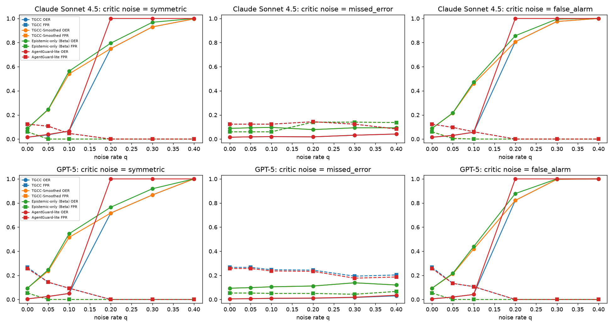

# Critic reliability

## Method
(a) The correctness label consumed by the epistemic probe is corrupted at rate q
in both the calibration pilot and the 15 E1 episodes: *symmetric* flips,
*missed_error* (wrong answers reported as correct - the adversary-friendly case)
and *false_alarm* (correct answers reported wrong).
(b) A reference-free LLM judge (no gold answer) replaces the reference critic,
both cross-model and self-judging.

## Results
### Claude Sonnet 4.5
**(a) Synthetic critic noise** - cells are OER / FPR (mean over 15 episodes)

| Noise | q | TGCC | TGCC-Smoothed | Epistemic-only (Beta) | AgentGuard-lite | Strict-min (Beta) |
|---|---|---|---|---|---|---|
| symmetric | 0.0 | 0.02 / 0.12 | 0.09 / 0.06 | 0.09 / 0.06 | 0.02 / 0.12 | 0.09 / 0.06 |
| symmetric | 0.05 | 0.04 / 0.11 | 0.24 / 0.00 | 0.25 / 0.00 | 0.04 / 0.11 | 0.25 / 0.00 |
| symmetric | 0.1 | 0.07 / 0.05 | 0.54 / 0.00 | 0.56 / 0.00 | 0.07 / 0.05 | 0.56 / 0.00 |
| symmetric | 0.2 | 0.75 / 0.00 | 0.75 / 0.00 | 0.80 / 0.00 | 1.00 / 0.00 | 0.80 / 0.00 |
| symmetric | 0.3 | 0.93 / 0.00 | 0.93 / 0.00 | 0.97 / 0.00 | 1.00 / 0.00 | 0.97 / 0.00 |
| symmetric | 0.4 | 1.00 / 0.00 | 1.00 / 0.00 | 1.00 / 0.00 | 1.00 / 0.00 | 1.00 / 0.00 |
| missed_error | 0.0 | 0.02 / 0.12 | 0.09 / 0.06 | 0.09 / 0.06 | 0.02 / 0.12 | 0.09 / 0.06 |
| missed_error | 0.05 | 0.02 / 0.12 | 0.09 / 0.06 | 0.09 / 0.06 | 0.02 / 0.12 | 0.09 / 0.06 |
| missed_error | 0.1 | 0.02 / 0.12 | 0.10 / 0.06 | 0.10 / 0.06 | 0.02 / 0.12 | 0.10 / 0.06 |
| missed_error | 0.2 | 0.02 / 0.14 | 0.08 / 0.14 | 0.08 / 0.14 | 0.02 / 0.14 | 0.09 / 0.08 |
| missed_error | 0.3 | 0.03 / 0.12 | 0.09 / 0.14 | 0.09 / 0.14 | 0.03 / 0.12 | 0.11 / 0.08 |
| missed_error | 0.4 | 0.04 / 0.08 | 0.09 / 0.14 | 0.09 / 0.14 | 0.04 / 0.08 | 0.13 / 0.06 |
| false_alarm | 0.0 | 0.02 / 0.12 | 0.09 / 0.06 | 0.09 / 0.06 | 0.02 / 0.12 | 0.09 / 0.06 |
| false_alarm | 0.05 | 0.03 / 0.10 | 0.21 / 0.01 | 0.22 / 0.00 | 0.03 / 0.10 | 0.22 / 0.00 |
| false_alarm | 0.1 | 0.06 / 0.06 | 0.46 / 0.00 | 0.47 / 0.00 | 0.06 / 0.06 | 0.47 / 0.00 |
| false_alarm | 0.2 | 0.81 / 0.00 | 0.81 / 0.00 | 0.86 / 0.00 | 1.00 / 0.00 | 0.86 / 0.00 |
| false_alarm | 0.3 | 0.97 / 0.00 | 0.97 / 0.00 | 0.99 / 0.00 | 1.00 / 0.00 | 0.99 / 0.00 |
| false_alarm | 0.4 | 1.00 / 0.00 | 1.00 / 0.00 | 1.00 / 0.00 | 1.00 / 0.00 | 1.00 / 0.00 |

**(a') Same noise, min-of-pilot calibration (ablation)** - OER / FPR

| Noise | q | TGCC | TGCC-Smoothed | Epistemic-only (Beta) | AgentGuard-lite | Strict-min (Beta) |
|---|---|---|---|---|---|---|
| symmetric | 0.0 | 0.04 / 0.05 | 0.10 / 0.05 | 0.10 / 0.05 | 0.04 / 0.05 | 0.10 / 0.05 |
| symmetric | 0.05 | 0.07 / 0.02 | 0.27 / 0.00 | 0.27 / 0.00 | 0.07 / 0.02 | 0.27 / 0.00 |
| symmetric | 0.1 | 0.57 / 0.00 | 0.57 / 0.00 | 0.60 / 0.00 | 1.00 / 0.00 | 0.60 / 0.00 |
| symmetric | 0.2 | 0.80 / 0.00 | 0.80 / 0.00 | 0.85 / 0.00 | 1.00 / 0.00 | 0.85 / 0.00 |
| symmetric | 0.3 | 0.96 / 0.00 | 0.96 / 0.00 | 0.99 / 0.00 | 1.00 / 0.00 | 0.99 / 0.00 |
| symmetric | 0.4 | 1.00 / 0.00 | 1.00 / 0.00 | 1.00 / 0.00 | 1.00 / 0.00 | 1.00 / 0.00 |
| missed_error | 0.0 | 0.04 / 0.05 | 0.10 / 0.05 | 0.10 / 0.05 | 0.04 / 0.05 | 0.10 / 0.05 |
| missed_error | 0.05 | 0.04 / 0.05 | 0.11 / 0.05 | 0.11 / 0.05 | 0.04 / 0.05 | 0.11 / 0.05 |
| missed_error | 0.1 | 0.04 / 0.05 | 0.11 / 0.05 | 0.11 / 0.05 | 0.04 / 0.05 | 0.11 / 0.05 |
| missed_error | 0.2 | 0.03 / 0.07 | 0.08 / 0.12 | 0.08 / 0.12 | 0.03 / 0.07 | 0.09 / 0.08 |
| missed_error | 0.3 | 0.04 / 0.06 | 0.10 / 0.12 | 0.10 / 0.12 | 0.04 / 0.06 | 0.11 / 0.08 |
| missed_error | 0.4 | 0.06 / 0.05 | 0.11 / 0.08 | 0.11 / 0.08 | 0.06 / 0.05 | 0.13 / 0.06 |
| false_alarm | 0.0 | 0.04 / 0.05 | 0.10 / 0.05 | 0.10 / 0.05 | 0.04 / 0.05 | 0.10 / 0.05 |
| false_alarm | 0.05 | 0.05 / 0.07 | 0.23 / 0.00 | 0.24 / 0.00 | 0.05 / 0.06 | 0.24 / 0.00 |
| false_alarm | 0.1 | 0.51 / 0.00 | 0.51 / 0.00 | 0.53 / 0.00 | 1.00 / 0.00 | 0.53 / 0.00 |
| false_alarm | 0.2 | 0.83 / 0.00 | 0.83 / 0.00 | 0.88 / 0.00 | 1.00 / 0.00 | 0.88 / 0.00 |
| false_alarm | 0.3 | 0.99 / 0.00 | 0.99 / 0.00 | 1.00 / 0.00 | 1.00 / 0.00 | 1.00 / 0.00 |
| false_alarm | 0.4 | 1.00 / 0.00 | 1.00 / 0.00 | 1.00 / 0.00 | 1.00 / 0.00 | 1.00 / 0.00 |

**(b) Reference-free LLM judge as the critic** (8 episodes; positive class = wrong answer)

| Judge | judge acc. | error recall | false-alarm rate | Gate | OER (judge critic) | FPR (judge critic) | OER (reference critic) |
|---|---:|---:|---:|---|---|---|---|
| Claude Sonnet 4.5 (self) | 0.94 | 0.95 | 0.09 | TGCC | 0.02 [0.02, 0.03] | 0.32 [0.13, 0.53] | 0.02 [0.01, 0.03] |
| Claude Sonnet 4.5 (self) | 0.94 | 0.95 | 0.09 | TGCC-Smoothed | 0.05 [0.03, 0.08] | 0.16 [0.03, 0.32] | 0.10 [0.06, 0.13] |
| Claude Sonnet 4.5 (self) | 0.94 | 0.95 | 0.09 | Epistemic-only (Beta) | 0.05 [0.03, 0.08] | 0.16 [0.03, 0.32] | 0.10 [0.06, 0.13] |
| Claude Sonnet 4.5 (self) | 0.94 | 0.95 | 0.09 | AgentGuard-lite | 0.02 [0.02, 0.03] | 0.28 [0.13, 0.44] | 0.02 [0.01, 0.03] |
| Claude Sonnet 4.5 (self) | 0.94 | 0.95 | 0.09 | Strict-min (Beta) | 0.07 [0.03, 0.10] | 0.13 [0.01, 0.28] | 0.10 [0.06, 0.13] |
| Claude Sonnet 4.5 (self) | 0.94 | 0.95 | 0.09 | TGCC-NoSyn | 0.02 [0.01, 0.03] | 0.33 [0.14, 0.55] | 0.02 [0.01, 0.03] |
| Claude Sonnet 4.5 (self) | 0.94 | 0.95 | 0.09 | Mean (Constitutional-lite) | 0.43 [0.35, 0.51] | 0.00 [0.00, 0.00] | 0.83 [0.74, 0.91] |
| Claude Sonnet 4.5 (self) | 0.94 | 0.95 | 0.09 | Naive behavioural | 1.00 [1.00, 1.00] | 0.00 [0.00, 0.00] | 1.00 [1.00, 1.00] |
| GPT-5 (cross) | 0.92 | 0.95 | 0.14 | TGCC | 0.05 [0.04, 0.07] | 0.01 [0.00, 0.03] | 0.02 [0.01, 0.03] |
| GPT-5 (cross) | 0.92 | 0.95 | 0.14 | TGCC-Smoothed | 0.13 [0.09, 0.17] | 0.00 [0.00, 0.00] | 0.10 [0.06, 0.13] |
| GPT-5 (cross) | 0.92 | 0.95 | 0.14 | Epistemic-only (Beta) | 0.13 [0.09, 0.17] | 0.00 [0.00, 0.00] | 0.10 [0.06, 0.13] |
| GPT-5 (cross) | 0.92 | 0.95 | 0.14 | AgentGuard-lite | 0.05 [0.04, 0.07] | 0.01 [0.00, 0.03] | 0.02 [0.01, 0.03] |
| GPT-5 (cross) | 0.92 | 0.95 | 0.14 | Strict-min (Beta) | 0.13 [0.09, 0.17] | 0.00 [0.00, 0.00] | 0.10 [0.06, 0.13] |
| GPT-5 (cross) | 0.92 | 0.95 | 0.14 | TGCC-NoSyn | 0.05 [0.04, 0.07] | 0.01 [0.00, 0.03] | 0.02 [0.01, 0.03] |
| GPT-5 (cross) | 0.92 | 0.95 | 0.14 | Mean (Constitutional-lite) | 0.77 [0.67, 0.88] | 0.00 [0.00, 0.00] | 0.83 [0.74, 0.91] |
| GPT-5 (cross) | 0.92 | 0.95 | 0.14 | Naive behavioural | 1.00 [1.00, 1.00] | 0.00 [0.00, 0.00] | 1.00 [1.00, 1.00] |

### GPT-5
**(a) Synthetic critic noise** - cells are OER / FPR (mean over 15 episodes)

| Noise | q | TGCC | TGCC-Smoothed | Epistemic-only (Beta) | AgentGuard-lite | Strict-min (Beta) |
|---|---|---|---|---|---|---|
| symmetric | 0.0 | 0.01 / 0.27 | 0.09 / 0.05 | 0.09 / 0.05 | 0.01 / 0.26 | 0.09 / 0.05 |
| symmetric | 0.05 | 0.03 / 0.14 | 0.24 / 0.00 | 0.25 / 0.00 | 0.03 / 0.14 | 0.25 / 0.00 |
| symmetric | 0.1 | 0.05 / 0.09 | 0.52 / 0.00 | 0.54 / 0.00 | 0.05 / 0.09 | 0.54 / 0.00 |
| symmetric | 0.2 | 0.72 / 0.00 | 0.72 / 0.00 | 0.77 / 0.00 | 1.00 / 0.00 | 0.77 / 0.00 |
| symmetric | 0.3 | 0.87 / 0.00 | 0.87 / 0.00 | 0.92 / 0.00 | 1.00 / 0.00 | 0.92 / 0.00 |
| symmetric | 0.4 | 1.00 / 0.00 | 1.00 / 0.00 | 1.00 / 0.00 | 1.00 / 0.00 | 1.00 / 0.00 |
| missed_error | 0.0 | 0.01 / 0.27 | 0.09 / 0.05 | 0.09 / 0.05 | 0.01 / 0.26 | 0.09 / 0.05 |
| missed_error | 0.05 | 0.01 / 0.27 | 0.10 / 0.05 | 0.10 / 0.05 | 0.01 / 0.26 | 0.10 / 0.05 |
| missed_error | 0.1 | 0.01 / 0.25 | 0.10 / 0.05 | 0.10 / 0.05 | 0.01 / 0.24 | 0.10 / 0.05 |
| missed_error | 0.2 | 0.01 / 0.24 | 0.11 / 0.05 | 0.11 / 0.05 | 0.01 / 0.23 | 0.11 / 0.05 |
| missed_error | 0.3 | 0.02 / 0.19 | 0.14 / 0.04 | 0.14 / 0.04 | 0.02 / 0.18 | 0.14 / 0.04 |
| missed_error | 0.4 | 0.03 / 0.20 | 0.12 / 0.07 | 0.12 / 0.07 | 0.04 / 0.19 | 0.12 / 0.07 |
| false_alarm | 0.0 | 0.01 / 0.27 | 0.09 / 0.05 | 0.09 / 0.05 | 0.01 / 0.26 | 0.09 / 0.05 |
| false_alarm | 0.05 | 0.02 / 0.13 | 0.21 / 0.00 | 0.22 / 0.00 | 0.02 / 0.13 | 0.22 / 0.00 |
| false_alarm | 0.1 | 0.04 / 0.11 | 0.42 / 0.00 | 0.44 / 0.00 | 0.04 / 0.11 | 0.44 / 0.00 |
| false_alarm | 0.2 | 0.82 / 0.00 | 0.82 / 0.00 | 0.88 / 0.00 | 1.00 / 0.00 | 0.88 / 0.00 |
| false_alarm | 0.3 | 1.00 / 0.00 | 1.00 / 0.00 | 1.00 / 0.00 | 1.00 / 0.00 | 1.00 / 0.00 |
| false_alarm | 0.4 | 1.00 / 0.00 | 1.00 / 0.00 | 1.00 / 0.00 | 1.00 / 0.00 | 1.00 / 0.00 |

**(a') Same noise, min-of-pilot calibration (ablation)** - OER / FPR

| Noise | q | TGCC | TGCC-Smoothed | Epistemic-only (Beta) | AgentGuard-lite | Strict-min (Beta) |
|---|---|---|---|---|---|---|
| symmetric | 0.0 | 0.01 / 0.15 | 0.10 / 0.05 | 0.10 / 0.05 | 0.01 / 0.13 | 0.10 / 0.05 |
| symmetric | 0.05 | 0.06 / 0.05 | 0.26 / 0.00 | 0.27 / 0.00 | 0.06 / 0.05 | 0.27 / 0.00 |
| symmetric | 0.1 | 0.55 / 0.00 | 0.55 / 0.00 | 0.58 / 0.00 | 1.00 / 0.00 | 0.58 / 0.00 |
| symmetric | 0.2 | 0.77 / 0.00 | 0.77 / 0.00 | 0.82 / 0.00 | 1.00 / 0.00 | 0.82 / 0.00 |
| symmetric | 0.3 | 0.91 / 0.00 | 0.91 / 0.00 | 0.95 / 0.00 | 1.00 / 0.00 | 0.95 / 0.00 |
| symmetric | 0.4 | 1.00 / 0.00 | 1.00 / 0.00 | 1.00 / 0.00 | 1.00 / 0.00 | 1.00 / 0.00 |
| missed_error | 0.0 | 0.01 / 0.15 | 0.10 / 0.05 | 0.10 / 0.05 | 0.01 / 0.13 | 0.10 / 0.05 |
| missed_error | 0.05 | 0.01 / 0.14 | 0.10 / 0.05 | 0.10 / 0.05 | 0.01 / 0.13 | 0.10 / 0.05 |
| missed_error | 0.1 | 0.02 / 0.14 | 0.11 / 0.04 | 0.11 / 0.04 | 0.02 / 0.13 | 0.11 / 0.04 |
| missed_error | 0.2 | 0.02 / 0.14 | 0.12 / 0.04 | 0.12 / 0.04 | 0.02 / 0.13 | 0.12 / 0.04 |
| missed_error | 0.3 | 0.03 / 0.12 | 0.14 / 0.04 | 0.14 / 0.04 | 0.04 / 0.10 | 0.14 / 0.04 |
| missed_error | 0.4 | 0.05 / 0.10 | 0.13 / 0.06 | 0.13 / 0.06 | 0.05 / 0.07 | 0.13 / 0.06 |
| false_alarm | 0.0 | 0.01 / 0.15 | 0.10 / 0.05 | 0.10 / 0.05 | 0.01 / 0.13 | 0.10 / 0.05 |
| false_alarm | 0.05 | 0.05 / 0.05 | 0.23 / 0.00 | 0.24 / 0.00 | 0.05 / 0.05 | 0.24 / 0.00 |
| false_alarm | 0.1 | 0.49 / 0.00 | 0.49 / 0.00 | 0.51 / 0.00 | 1.00 / 0.00 | 0.51 / 0.00 |
| false_alarm | 0.2 | 0.87 / 0.00 | 0.87 / 0.00 | 0.93 / 0.00 | 1.00 / 0.00 | 0.93 / 0.00 |
| false_alarm | 0.3 | 1.00 / 0.00 | 1.00 / 0.00 | 1.00 / 0.00 | 1.00 / 0.00 | 1.00 / 0.00 |
| false_alarm | 0.4 | 1.00 / 0.00 | 1.00 / 0.00 | 1.00 / 0.00 | 1.00 / 0.00 | 1.00 / 0.00 |

**(b) Reference-free LLM judge as the critic** (8 episodes; positive class = wrong answer)

| Judge | judge acc. | error recall | false-alarm rate | Gate | OER (judge critic) | FPR (judge critic) | OER (reference critic) |
|---|---:|---:|---:|---|---|---|---|
| Claude Sonnet 4.5 (cross) | 0.93 | 0.94 | 0.09 | TGCC | 0.02 [0.01, 0.02] | 0.42 [0.26, 0.58] | 0.00 [0.00, 0.01] |
| Claude Sonnet 4.5 (cross) | 0.93 | 0.94 | 0.09 | TGCC-Smoothed | 0.04 [0.02, 0.06] | 0.11 [0.01, 0.23] | 0.09 [0.06, 0.11] |
| Claude Sonnet 4.5 (cross) | 0.93 | 0.94 | 0.09 | Epistemic-only (Beta) | 0.04 [0.02, 0.06] | 0.11 [0.01, 0.23] | 0.09 [0.06, 0.11] |
| Claude Sonnet 4.5 (cross) | 0.93 | 0.94 | 0.09 | AgentGuard-lite | 0.02 [0.01, 0.02] | 0.38 [0.24, 0.49] | 0.00 [0.00, 0.01] |
| Claude Sonnet 4.5 (cross) | 0.93 | 0.94 | 0.09 | Strict-min (Beta) | 0.04 [0.02, 0.06] | 0.11 [0.01, 0.23] | 0.09 [0.06, 0.11] |
| Claude Sonnet 4.5 (cross) | 0.93 | 0.94 | 0.09 | TGCC-NoSyn | 0.01 [0.00, 0.02] | 0.43 [0.26, 0.61] | 0.00 [0.00, 0.01] |
| Claude Sonnet 4.5 (cross) | 0.93 | 0.94 | 0.09 | Mean (Constitutional-lite) | 0.42 [0.36, 0.49] | 0.00 [0.00, 0.00] | 0.86 [0.73, 0.95] |
| Claude Sonnet 4.5 (cross) | 0.93 | 0.94 | 0.09 | Naive behavioural | 1.00 [1.00, 1.00] | 0.00 [0.00, 0.00] | 1.00 [1.00, 1.00] |
| GPT-5 (self) | 0.94 | 0.96 | 0.09 | TGCC | 0.03 [0.02, 0.05] | 0.00 [0.00, 0.00] | 0.00 [0.00, 0.01] |
| GPT-5 (self) | 0.94 | 0.96 | 0.09 | TGCC-Smoothed | 0.12 [0.09, 0.15] | 0.00 [0.00, 0.00] | 0.09 [0.06, 0.11] |
| GPT-5 (self) | 0.94 | 0.96 | 0.09 | Epistemic-only (Beta) | 0.12 [0.09, 0.15] | 0.00 [0.00, 0.00] | 0.09 [0.06, 0.11] |
| GPT-5 (self) | 0.94 | 0.96 | 0.09 | AgentGuard-lite | 0.03 [0.02, 0.05] | 0.00 [0.00, 0.00] | 0.00 [0.00, 0.01] |
| GPT-5 (self) | 0.94 | 0.96 | 0.09 | Strict-min (Beta) | 0.12 [0.09, 0.15] | 0.00 [0.00, 0.00] | 0.09 [0.06, 0.11] |
| GPT-5 (self) | 0.94 | 0.96 | 0.09 | TGCC-NoSyn | 0.03 [0.02, 0.05] | 0.00 [0.00, 0.00] | 0.00 [0.00, 0.01] |
| GPT-5 (self) | 0.94 | 0.96 | 0.09 | Mean (Constitutional-lite) | 0.80 [0.71, 0.88] | 0.00 [0.00, 0.00] | 0.86 [0.73, 0.95] |
| GPT-5 (self) | 0.94 | 0.96 | 0.09 | Naive behavioural | 1.00 [1.00, 1.00] | 0.00 [0.00, 0.00] | 1.00 [1.00, 1.00] |

