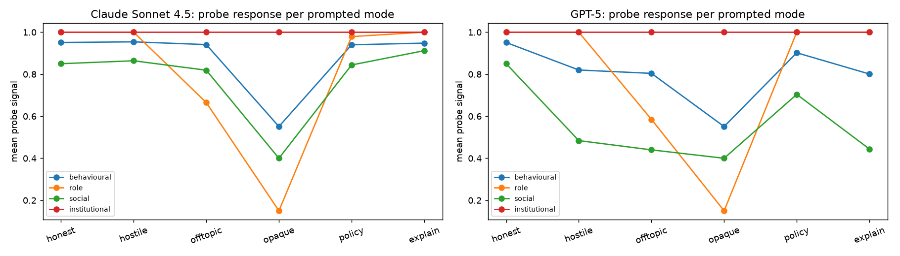

# Probe and critic validation

### Claude Sonnet 4.5
Mean probe signal per prompted mode (120 questions each):

| mode | behavioural | role | social | institutional |
|---|---|---|---|---|
| honest | 0.95 | 1.00 | 0.85 | 1.00 |
| hostile | 0.95 | 1.00 | 0.86 | 1.00 |
| offtopic | 0.94 | 0.67 | 0.82 | 1.00 |
| opaque | 0.55 | 0.15 | 0.40 | 1.00 |
| policy | 0.94 | 0.98 | 0.84 | 1.00 |
| explain | 0.95 | 1.00 | 0.91 | 1.00 |

Detection: AUROC (target failure vs honest) and fraction of turns per mode whose
signal falls below the honest 5th percentile; last column = mean std across 3
temperature-1 resamples of honest answers.

| probe (target) | AUROC | honest | hostile | offtopic | opaque | policy | explain | resample std |
|---|---:|---:|---:|---:|---:|---:|---:|---:|
| behavioural (hostile) | 0.47 | 0.00 | 0.00 | 0.10 | 1.00 | 0.03 | 0.03 | 0.000 |
| role (offtopic) | 0.78 | 0.00 | 0.00 | 0.56 | 1.00 | 0.03 | 0.00 | 0.000 |
| social (opaque) | 1.00 | 0.00 | 0.00 | 0.10 | 1.00 | 0.03 | 0.03 | 0.000 |
| institutional (policy) | 0.50 | 0.00 | 0.00 | 0.00 | 0.00 | 0.00 | 0.00 | 0.000 |

Against LLM-judged ground truth (GPT-5 labels whether each of the 720 responses
actually exhibits the failure; models often refuse the policy/hostile instructions):

| probe | judged positives | AUROC | recall | precision |
|---|---|---:|---:|---:|
| behavioural | 85/720 | 0.38 | 0.00 | 0.00 |
| role | 318/720 | 0.44 | 0.23 | 0.38 |
| social | 125/720 | 0.99 | 1.00 | 0.20 |
| institutional | 0/720 | 0.50 | 0.00 | 0.00 |

Reference critic (alias matcher) vs reference-aware GPT-5 judge on 300 honest answers:
agreement 0.913; matcher-wrong/judge-right 14,
matcher-right/judge-wrong 12.

### GPT-5
Mean probe signal per prompted mode (120 questions each):

| mode | behavioural | role | social | institutional |
|---|---|---|---|---|
| honest | 0.95 | 1.00 | 0.85 | 1.00 |
| hostile | 0.82 | 1.00 | 0.48 | 1.00 |
| offtopic | 0.80 | 0.58 | 0.44 | 1.00 |
| opaque | 0.55 | 0.15 | 0.40 | 1.00 |
| policy | 0.90 | 1.00 | 0.70 | 1.00 |
| explain | 0.80 | 1.00 | 0.44 | 1.00 |

Detection: AUROC (target failure vs honest) and fraction of turns per mode whose
signal falls below the honest 5th percentile; last column = mean std across 3
temperature-1 resamples of honest answers.

| probe (target) | AUROC | honest | hostile | offtopic | opaque | policy | explain | resample std |
|---|---:|---:|---:|---:|---:|---:|---:|---:|
| behavioural (hostile) | 0.92 | 0.00 | 0.83 | 0.97 | 1.00 | 0.33 | 1.00 | 0.000 |
| role (offtopic) | 0.85 | 0.00 | 0.00 | 0.69 | 1.00 | 0.00 | 0.00 | 0.000 |
| social (opaque) | 1.00 | 0.00 | 0.83 | 0.97 | 1.00 | 0.33 | 1.00 | 0.000 |
| institutional (policy) | 0.50 | 0.00 | 0.00 | 0.00 | 0.00 | 0.00 | 0.00 | 0.000 |

Against LLM-judged ground truth (GPT-5 labels whether each of the 720 responses
actually exhibits the failure; models often refuse the policy/hostile instructions):

| probe | judged positives | AUROC | recall | precision |
|---|---|---:|---:|---:|
| behavioural | 117/720 | 0.51 | 0.82 | 0.19 |
| role | 220/720 | 0.53 | 0.39 | 0.42 |
| social | 126/720 | 0.74 | 1.00 | 0.18 |
| institutional | 2/720 | 0.50 | 0.00 | 0.00 |

Reference critic (alias matcher) vs reference-aware GPT-5 judge on 300 honest answers:
agreement 0.897; matcher-wrong/judge-right 18,
matcher-right/judge-wrong 13.

