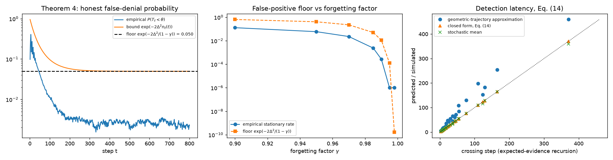
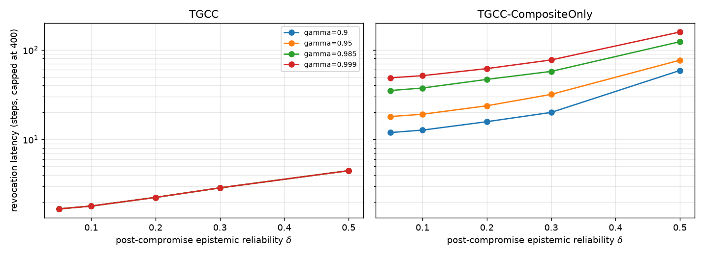

# Theory validation: Theorem 4 and Eq. (14)

## (a) Theorem 4: honest false-positive floor
Single honest layer, rho = 0.9, omega = 3.0, gamma = 0.985,
fixed point T* = 0.750, per-layer threshold theta = 0.6, 20,000 seeds.

* Floor L exp(-2 D^2/(1-gamma)) = **0.0498** (per layer, L = 1).
* Empirical false-denial probability over the last 100 of 800 steps: **0.0023**;
  the probability converges to a positive stationary value.

| gamma | empirical stationary P(false denial) | floor |
|---|---:|---:|
| 0.9 | 0.1277 | 0.6376 |
| 0.95 | 0.0585 | 0.4066 |
| 0.97 | 0.0226 | 0.2231 |
| 0.985 | 0.0024 | 0.0498 |
| 0.99 | 0.0003 | 0.0111 |
| 0.995 | 0.0000 | 0.0001 |
| 0.998 | 0.0000 | 0.0000 |

The floor upper-bounds the empirical stationary rate for every gamma tested.
The bound converges geometrically (rate gamma) to L exp(-2 D^2/(1-gamma)); the floor
shrinks with a larger margin D or a forgetting factor closer to one, at the cost of
slower revocation (Eq. 14).

## (b) Eq. (14): expected detection latency
Under the pseudo-count update the trust is a ratio of two geometric sequences,
T(k) = (u rho0 + (1-u) rho1) / (u D0 + (1-u) D1) with u = gamma^k and
D_i = rho_i + omega (1 - rho_i). Solving T(k) = x gives

    k* = ln[(rho0 - rho1 - x (D0 - D1)) / (x D1 - rho1)] / ln(1/gamma),

which reduces to ln[(T0 - T*)/(x - T*)]/ln(1/gamma) (geometric-trajectory
approximation) when omega = 1.

| gamma | rho post | x = theta/kappa | recursion | stochastic mean | Eq. (14) | geometric approx. |
|---|---|---|---:|---:|---:|---:|
| 0.95 | 0.1 | 0.3 | 11 | 11.3 | 10.7 | 19.4 |
| 0.95 | 0.1 | 0.45 | 6 | 5.6 | 5.3 | 10.6 |
| 0.95 | 0.1 | 0.6 | 3 | 2.3 | 2.1 | 4.6 |
| 0.95 | 0.3 | 0.3 | 17 | 16.4 | 16.1 | 24.8 |
| 0.95 | 0.3 | 0.45 | 8 | 7.8 | 7.4 | 12.7 |
| 0.95 | 0.3 | 0.6 | 3 | 3.4 | 2.9 | 5.4 |
| 0.95 | 0.5 | 0.3 | 37 | 32.1 | 36.2 | 44.9 |
| 0.95 | 0.5 | 0.45 | 13 | 12.9 | 12.5 | 17.9 |
| 0.95 | 0.5 | 0.6 | 5 | 5.3 | 4.5 | 7.0 |
| 0.985 | 0.1 | 0.3 | 37 | 36.8 | 36.3 | 65.8 |
| 0.985 | 0.1 | 0.45 | 18 | 18.4 | 17.9 | 36.0 |
| 0.985 | 0.1 | 0.6 | 8 | 7.8 | 7.1 | 15.6 |
| 0.985 | 0.3 | 0.3 | 55 | 55.1 | 54.7 | 84.2 |
| 0.985 | 0.3 | 0.45 | 26 | 25.7 | 25.1 | 43.3 |
| 0.985 | 0.3 | 0.6 | 10 | 10.2 | 9.7 | 18.2 |
| 0.985 | 0.5 | 0.3 | 123 | 115.7 | 122.8 | 152.4 |
| 0.985 | 0.5 | 0.45 | 43 | 43.1 | 42.5 | 60.6 |
| 0.985 | 0.5 | 0.6 | 16 | 15.9 | 15.1 | 23.6 |
| 0.995 | 0.1 | 0.3 | 110 | 109.9 | 109.3 | 198.4 |
| 0.995 | 0.1 | 0.45 | 54 | 54.5 | 53.9 | 108.7 |
| 0.995 | 0.1 | 0.6 | 22 | 22.3 | 21.5 | 47.0 |
| 0.995 | 0.3 | 0.3 | 165 | 165.1 | 164.9 | 254.0 |
| 0.995 | 0.3 | 0.45 | 76 | 76.3 | 75.7 | 130.5 |
| 0.995 | 0.3 | 0.6 | 30 | 29.9 | 29.2 | 54.8 |
| 0.995 | 0.5 | 0.3 | 371 | 359.6 | 370.3 | 459.4 |
| 0.995 | 0.5 | 0.45 | 129 | 128.4 | 128.0 | 182.8 |
| 0.995 | 0.5 | 0.6 | 46 | 46.7 | 45.7 | 71.2 |

* Eq. (14) matches the expected-evidence recursion to within one step and the
  stochastic mean closely.
* The geometric-trajectory approximation over-predicts latency by a factor
  1.21-2.14 at omega = 3, because each failure adds omega
  pseudo-counts.

## (c) Gate-level latency vs gamma and delta (simulation)
Honest reliabilities [0.92, 0.88, 0.82, 0.78, 0.9]; after step 80 only the epistemic layer drops to
delta. 40 seeds per cell; each (gate, gamma) calibrated by Algorithm 2 on its own honest pilot.
Mean revocation latency in steps (capped at 400):

| gate | gamma | delta=0.05 | delta=0.1 | delta=0.2 | delta=0.3 | delta=0.5 |
|---|---|---|---|---|---|---|
| TGCC | 0.9 | 1.7 | 1.8 | 2.2 | 2.9 | 4.5 |
| TGCC | 0.95 | 1.7 | 1.8 | 2.2 | 2.9 | 4.5 |
| TGCC | 0.985 | 1.7 | 1.8 | 2.2 | 2.9 | 4.5 |
| TGCC | 0.999 | 1.7 | 1.8 | 2.2 | 2.9 | 4.5 |
| TGCC-CompositeOnly | 0.9 | 11.9 | 12.7 | 15.8 | 20.0 | 58.9 |
| TGCC-CompositeOnly | 0.95 | 18.0 | 19.1 | 23.8 | 31.9 | 76.8 |
| TGCC-CompositeOnly | 0.985 | 35.1 | 37.5 | 46.8 | 57.5 | 123.5 |
| TGCC-CompositeOnly | 0.999 | 48.8 | 51.5 | 61.8 | 77.2 | 158.4 |

With the per-turn epistemic check, TGCC's latency is set by the 8-step probe window
(1.7-4.5 steps) and does not depend on gamma. The composite alone is 10-35x slower;
it slows as gamma -> 1 and as delta rises, as Eq. (14) predicts. Its growth is less
than proportional to 1/(1-gamma) because Algorithm 2 sets a tighter threshold when
the memory is longer.

