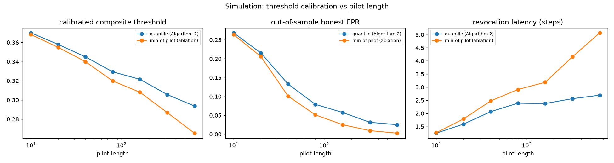
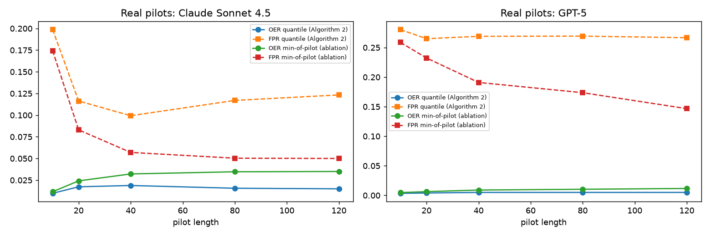

# Threshold calibration (Algorithm 2)

## Method
Algorithm 2 sets theta = Q_q(pilot after burn-in) - eps with q = delta = 0.05 and
increases eps if fewer than 1 - delta of pilot steps are admitted. The threshold
converges to a population quantile (DKW inequality, effective sample size about
N(1 - gamma)), so the honest FPR targets delta. The min-of-pilot ablation
(theta = min(pilot) - eps) can only decrease as the pilot grows.

## Simulation (TGCC, honest pilots of length N after burn-in, 15 pilots per N,
evaluation on 40 independent 300-step sleeper episodes)
**quantile (Algorithm 2)**

| N_pilot | theta | FPR | OER | latency |
|---|---:|---:|---:|---:|
| 10 | 0.370 | 0.269 | 0.009 | 1.2 |
| 20 | 0.358 | 0.215 | 0.011 | 1.6 |
| 40 | 0.345 | 0.133 | 0.015 | 2.1 |
| 80 | 0.329 | 0.079 | 0.018 | 2.4 |
| 160 | 0.322 | 0.058 | 0.017 | 2.4 |
| 320 | 0.306 | 0.031 | 0.019 | 2.6 |
| 640 | 0.294 | 0.025 | 0.020 | 2.7 |

**min-of-pilot (ablation)**

| N_pilot | theta | FPR | OER | latency |
|---|---:|---:|---:|---:|
| 10 | 0.368 | 0.264 | 0.009 | 1.3 |
| 20 | 0.355 | 0.206 | 0.013 | 1.8 |
| 40 | 0.340 | 0.101 | 0.019 | 2.5 |
| 80 | 0.320 | 0.051 | 0.023 | 2.9 |
| 160 | 0.308 | 0.025 | 0.025 | 3.2 |
| 320 | 0.287 | 0.010 | 0.055 | 4.2 |
| 640 | 0.265 | 0.003 | 0.093 | 5.1 |

## Real-LLM pilots (random N-step subsets of the 120-question pilot, 10 repeats,
evaluated on the 15 E1 episodes)
**Claude Sonnet 4.5 - quantile (Algorithm 2)**

| N_pilot | theta | FPR | OER |
|---|---:|---:|---:|
| 10 | 0.512 | 0.199 | 0.010 |
| 20 | 0.513 | 0.116 | 0.017 |
| 40 | 0.513 | 0.099 | 0.019 |
| 80 | 0.521 | 0.117 | 0.016 |
| 120 | 0.524 | 0.123 | 0.015 |

**Claude Sonnet 4.5 - min-of-pilot (ablation)**

| N_pilot | theta | FPR | OER |
|---|---:|---:|---:|
| 10 | 0.511 | 0.174 | 0.012 |
| 20 | 0.512 | 0.083 | 0.024 |
| 40 | 0.511 | 0.057 | 0.032 |
| 80 | 0.513 | 0.050 | 0.035 |
| 120 | 0.513 | 0.050 | 0.035 |

**GPT-5 - quantile (Algorithm 2)**

| N_pilot | theta | FPR | OER |
|---|---:|---:|---:|
| 10 | 0.509 | 0.280 | 0.004 |
| 20 | 0.509 | 0.265 | 0.004 |
| 40 | 0.510 | 0.269 | 0.005 |
| 80 | 0.511 | 0.269 | 0.005 |
| 120 | 0.508 | 0.267 | 0.005 |

**GPT-5 - min-of-pilot (ablation)**

| N_pilot | theta | FPR | OER |
|---|---:|---:|---:|
| 10 | 0.509 | 0.259 | 0.005 |
| 20 | 0.509 | 0.232 | 0.006 |
| 40 | 0.509 | 0.191 | 0.009 |
| 80 | 0.509 | 0.174 | 0.010 |
| 120 | 0.504 | 0.147 | 0.012 |

## Admitted fraction of pilot steps as eps changes
| eps (decreasing) | admitted | eps (increasing) | admitted |
|---|---:|---|---:|
| 0.05 | 0.98 | 0.05 | 0.98 |
| 0.04 | 0.96 | 0.06 | 0.99 |
| 0.03 | 0.93 | 0.07 | 1.00 |
| 0.02 | 0.90 | 0.08 | 1.00 |
| 0.01 | 0.86 | 0.1 | 1.00 |
| 0.0 | 0.80 | 0.12 | 1.00 |

