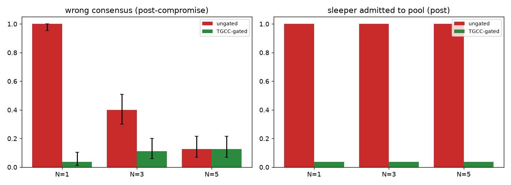

# Multi-agent debate (E2) with real LLMs

## Method
2 independent 60-question series per team size N in [1, 3, 5]; sleeper = agent 0
(compromised from question 20); honest agents alternate Claude Sonnet 4.5 / GPT-5; 2 rounds;
confidence-weighted moderator vote over admitted agents. Per-agent TGCC with Algorithm-2
thresholds from each model's honest pilot; the critic's verdict on question t only
affects admission from question t+1.

| N | Gate | wrong consensus (pre) | wrong consensus (post) | abstained (post) | sleeper admitted (post) | revocation latency per series | honest-agent denials (agent-questions) |
|---|---|---|---|---|---|---|---|
| 1 | none | 0.07 [0.03, 0.20] (3/40) | 1.00 [0.95, 1.00] (80/80) | 0.00 [0.00, 0.05] (0/80) | 1.00 [0.95, 1.00] (80/80) | [None, None] | 0 |
| 1 | TGCC | 0.07 [0.03, 0.20] (3/40) | 0.04 [0.01, 0.10] (3/80) | 0.96 [0.90, 0.99] (77/80) | 0.04 [0.01, 0.10] (3/80) | [1, 2] | 0 |
| 3 | none | 0.15 [0.07, 0.29] (6/40) | 0.40 [0.30, 0.51] (32/80) | 0.00 [0.00, 0.05] (0/80) | 1.00 [0.95, 1.00] (80/80) | [None, None] | 64 |
| 3 | TGCC | 0.17 [0.09, 0.32] (7/40) | 0.11 [0.06, 0.20] (9/80) | 0.14 [0.08, 0.23] (11/80) | 0.04 [0.01, 0.10] (3/80) | [1, 2] | 64 |
| 5 | none | 0.07 [0.03, 0.20] (3/40) | 0.12 [0.07, 0.22] (10/80) | 0.00 [0.00, 0.05] (0/80) | 1.00 [0.95, 1.00] (80/80) | [None, None] | 128 |
| 5 | TGCC | 0.17 [0.09, 0.32] (7/40) | 0.12 [0.07, 0.22] (10/80) | 0.14 [0.08, 0.23] (11/80) | 0.04 [0.01, 0.10] (3/80) | [1, 2] | 128 |

