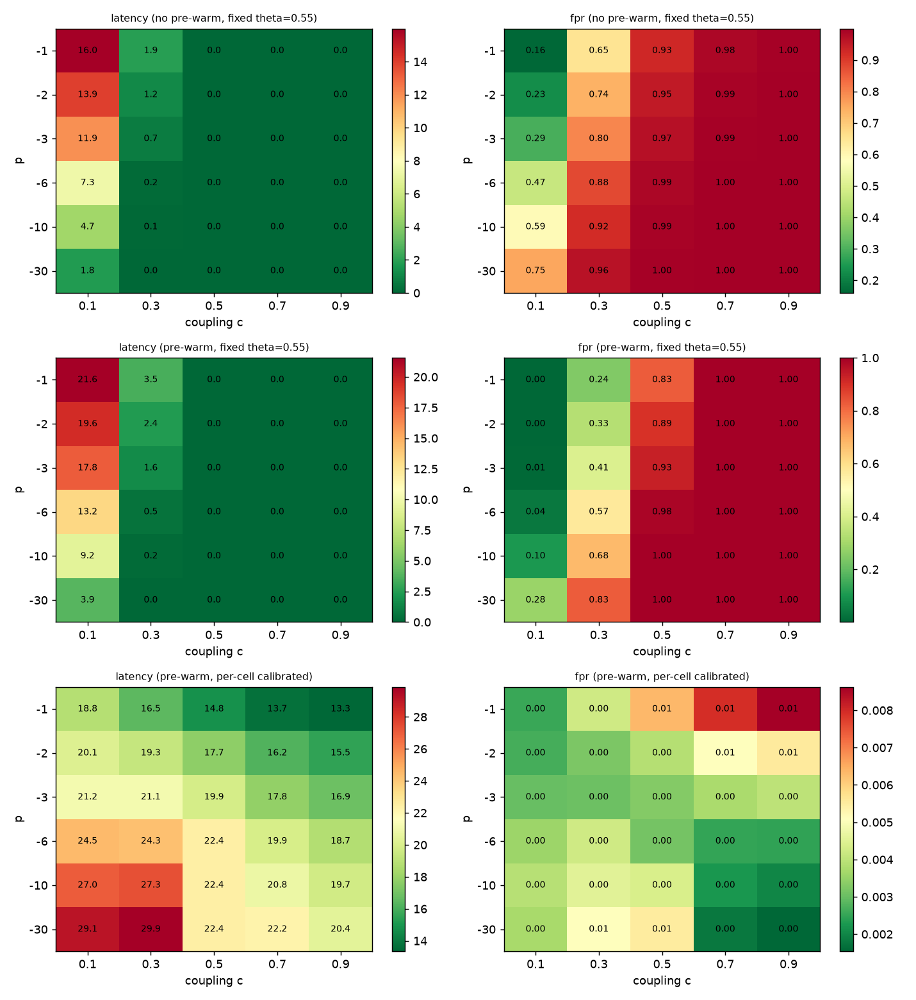
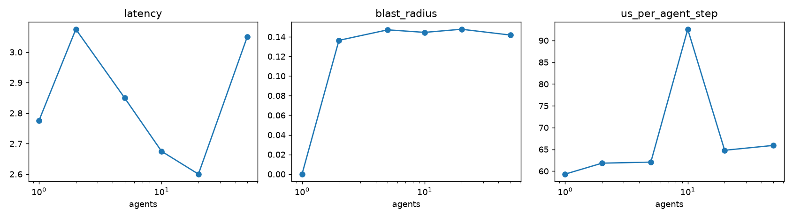

# Simulation: p x c ablation (E3) and scalability (E5)

## E3: p x uniform coupling c, 300 simulated episodes per cell (composite-only gate)
Latency (steps), no pre-warm, fixed theta 0.55:
| p \ c | 0.1 | 0.3 | 0.5 | 0.7 | 0.9 |
|---|---|---|---|---|---|
| -1 | 16.00 | 1.93 | 0.03 | 0.00 | 0.00 |
| -2 | 13.95 | 1.18 | 0.00 | 0.00 | 0.00 |
| -3 | 11.93 | 0.74 | 0.00 | 0.00 | 0.00 |
| -6 | 7.32 | 0.18 | 0.00 | 0.00 | 0.00 |
| -10 | 4.73 | 0.09 | 0.00 | 0.00 | 0.00 |
| -30 | 1.81 | 0.02 | 0.00 | 0.00 | 0.00 |

Warm-up FPR, no pre-warm, fixed theta:
| p \ c | 0.1 | 0.3 | 0.5 | 0.7 | 0.9 |
|---|---|---|---|---|---|
| -1 | 0.16 | 0.65 | 0.93 | 0.98 | 1.00 |
| -2 | 0.23 | 0.74 | 0.95 | 0.99 | 1.00 |
| -3 | 0.29 | 0.80 | 0.97 | 0.99 | 1.00 |
| -6 | 0.47 | 0.88 | 0.99 | 1.00 | 1.00 |
| -10 | 0.59 | 0.92 | 0.99 | 1.00 | 1.00 |
| -30 | 0.75 | 0.96 | 1.00 | 1.00 | 1.00 |

Latency, pre-warm + fixed theta:
| p \ c | 0.1 | 0.3 | 0.5 | 0.7 | 0.9 |
|---|---|---|---|---|---|
| -1 | 21.56 | 3.52 | 0.04 | 0.00 | 0.00 |
| -2 | 19.58 | 2.40 | 0.01 | 0.00 | 0.00 |
| -3 | 17.79 | 1.61 | 0.00 | 0.00 | 0.00 |
| -6 | 13.24 | 0.53 | 0.00 | 0.00 | 0.00 |
| -10 | 9.19 | 0.19 | 0.00 | 0.00 | 0.00 |
| -30 | 3.90 | 0.04 | 0.00 | 0.00 | 0.00 |

Warm-up FPR, pre-warm + fixed theta:
| p \ c | 0.1 | 0.3 | 0.5 | 0.7 | 0.9 |
|---|---|---|---|---|---|
| -1 | 0.00 | 0.24 | 0.83 | 1.00 | 1.00 |
| -2 | 0.00 | 0.33 | 0.89 | 1.00 | 1.00 |
| -3 | 0.01 | 0.41 | 0.93 | 1.00 | 1.00 |
| -6 | 0.04 | 0.57 | 0.98 | 1.00 | 1.00 |
| -10 | 0.10 | 0.68 | 1.00 | 1.00 | 1.00 |
| -30 | 0.28 | 0.83 | 1.00 | 1.00 | 1.00 |

Latency, pre-warm + per-cell calibration (Algorithm 2, honest pilot):
| p \ c | 0.1 | 0.3 | 0.5 | 0.7 | 0.9 |
|---|---|---|---|---|---|
| -1 | 18.77 | 16.49 | 14.79 | 13.71 | 13.35 |
| -2 | 20.15 | 19.32 | 17.71 | 16.19 | 15.53 |
| -3 | 21.15 | 21.10 | 19.86 | 17.81 | 16.87 |
| -6 | 24.46 | 24.27 | 22.43 | 19.88 | 18.71 |
| -10 | 26.97 | 27.34 | 22.39 | 20.82 | 19.70 |
| -30 | 29.10 | 29.87 | 22.43 | 22.19 | 20.40 |

FPR, pre-warm + per-cell calibration:
| p \ c | 0.1 | 0.3 | 0.5 | 0.7 | 0.9 |
|---|---|---|---|---|---|
| -1 | 0.00 | 0.00 | 0.01 | 0.01 | 0.01 |
| -2 | 0.00 | 0.00 | 0.00 | 0.01 | 0.01 |
| -3 | 0.00 | 0.00 | 0.00 | 0.00 | 0.00 |
| -6 | 0.00 | 0.00 | 0.00 | 0.00 | 0.00 |
| -10 | 0.00 | 0.00 | 0.00 | 0.00 | 0.00 |
| -30 | 0.00 | 0.01 | 0.01 | 0.00 | 0.00 |

With a fixed threshold, larger |p| and c mechanically lower the composite, so the
heatmap mostly measures distance to the threshold. With per-cell calibration
(FPR ~0 in every cell), latency spans ~13-30 steps; mild orders (p = -1..-3) with
strong coupling (c >= 0.7) are fastest.

## E5: scalability (one sleeper, 40 seeds per size, quantile-calibrated)
| agents | sleeper latency | blast radius | us / agent-step |
|---|---:|---:|---:|
| 1 | 2.8 | 0.000 | 59.3 |
| 2 | 3.1 | 0.136 | 61.8 |
| 5 | 2.9 | 0.147 | 62.1 |
| 10 | 2.7 | 0.144 | 92.6 |
| 20 | 2.6 | 0.148 | 64.8 |
| 50 | 3.0 | 0.142 | 65.9 |

