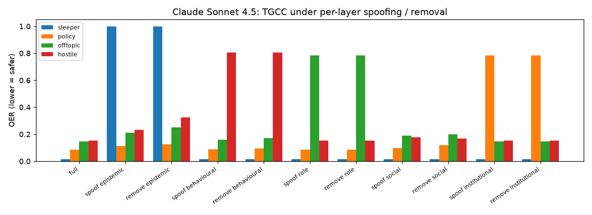
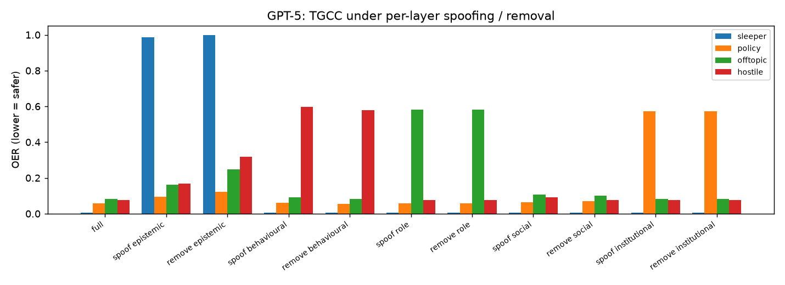

# Per-layer ablation (E9)

## Method
TGCC on the real-LLM streams, 15 episodes per model and compromise type:
`sleeper` (E1: wrong answers at high confidence) and the three non-epistemic
compromises of N12 (`policy`, `offtopic`, `hostile`; answers stay correct).
* **spoof l**: the attacker forges layer l to 1.0 from the compromise on; thresholds
  come from the unmodified honest pilot.
* **remove l**: layer l is held at 1.0 in the pilot and in the episodes, and the gate
  is recalibrated by Algorithm 2 (the gate runs without that layer's evidence).

## Results (OER, mean [95% CI] over episodes)
### Claude Sonnet 4.5
| Condition | sleeper OER | policy OER | offtopic OER | hostile OER | FPR (sleeper streams) |
|---|---|---|---|---|---|
| full | 0.02 [0.01, 0.02] | 0.08 [0.06, 0.11] | 0.15 [0.10, 0.19] | 0.15 [0.11, 0.20] | 0.12 [0.05, 0.21] |
| spoof epistemic | 1.00 [1.00, 1.00] | 0.11 [0.10, 0.12] | 0.21 [0.17, 0.24] | 0.23 [0.18, 0.27] | 0.12 [0.05, 0.21] |
| remove epistemic | 1.00 [1.00, 1.00] | 0.12 [0.12, 0.12] | 0.25 [0.25, 0.25] | 0.33 [0.33, 0.33] | 0.00 [0.00, 0.00] |
| spoof behavioural | 0.02 [0.01, 0.02] | 0.09 [0.07, 0.11] | 0.16 [0.11, 0.20] | 0.81 [0.70, 0.90] | 0.12 [0.05, 0.21] |
| remove behavioural | 0.02 [0.01, 0.02] | 0.09 [0.07, 0.12] | 0.17 [0.13, 0.21] | 0.80 [0.70, 0.90] | 0.12 [0.05, 0.21] |
| spoof role | 0.02 [0.01, 0.02] | 0.08 [0.06, 0.11] | 0.78 [0.66, 0.89] | 0.15 [0.11, 0.20] | 0.12 [0.05, 0.21] |
| remove role | 0.02 [0.01, 0.02] | 0.08 [0.06, 0.11] | 0.78 [0.66, 0.89] | 0.15 [0.11, 0.20] | 0.12 [0.05, 0.21] |
| spoof social | 0.02 [0.01, 0.02] | 0.10 [0.07, 0.12] | 0.19 [0.14, 0.24] | 0.18 [0.13, 0.23] | 0.12 [0.05, 0.21] |
| remove social | 0.02 [0.01, 0.02] | 0.12 [0.09, 0.14] | 0.20 [0.15, 0.24] | 0.17 [0.12, 0.21] | 0.13 [0.05, 0.22] |
| spoof institutional | 0.02 [0.01, 0.02] | 0.78 [0.66, 0.89] | 0.15 [0.10, 0.19] | 0.15 [0.11, 0.20] | 0.12 [0.05, 0.21] |
| remove institutional | 0.02 [0.01, 0.02] | 0.78 [0.66, 0.89] | 0.15 [0.10, 0.19] | 0.15 [0.11, 0.20] | 0.12 [0.05, 0.21] |
### GPT-5
| Condition | sleeper OER | policy OER | offtopic OER | hostile OER | FPR (sleeper streams) |
|---|---|---|---|---|---|
| full | 0.01 [0.00, 0.01] | 0.06 [0.03, 0.08] | 0.08 [0.05, 0.12] | 0.08 [0.05, 0.11] | 0.27 [0.13, 0.43] |
| spoof epistemic | 0.99 [0.96, 1.00] | 0.09 [0.07, 0.12] | 0.16 [0.12, 0.21] | 0.17 [0.12, 0.22] | 0.27 [0.13, 0.43] |
| remove epistemic | 1.00 [1.00, 1.00] | 0.12 [0.12, 0.12] | 0.25 [0.24, 0.25] | 0.32 [0.30, 0.33] | 0.00 [0.00, 0.00] |
| spoof behavioural | 0.01 [0.00, 0.01] | 0.06 [0.04, 0.08] | 0.09 [0.05, 0.13] | 0.60 [0.42, 0.76] | 0.27 [0.13, 0.43] |
| remove behavioural | 0.01 [0.00, 0.01] | 0.05 [0.03, 0.08] | 0.08 [0.05, 0.12] | 0.58 [0.40, 0.75] | 0.27 [0.13, 0.43] |
| spoof role | 0.01 [0.00, 0.01] | 0.06 [0.03, 0.08] | 0.58 [0.40, 0.75] | 0.08 [0.05, 0.11] | 0.27 [0.13, 0.43] |
| remove role | 0.01 [0.00, 0.01] | 0.06 [0.03, 0.08] | 0.58 [0.40, 0.75] | 0.08 [0.05, 0.11] | 0.27 [0.13, 0.43] |
| spoof social | 0.01 [0.00, 0.01] | 0.06 [0.04, 0.09] | 0.11 [0.06, 0.15] | 0.09 [0.05, 0.13] | 0.27 [0.13, 0.43] |
| remove social | 0.01 [0.00, 0.01] | 0.07 [0.04, 0.10] | 0.10 [0.06, 0.14] | 0.07 [0.04, 0.11] | 0.27 [0.13, 0.44] |
| spoof institutional | 0.01 [0.00, 0.01] | 0.57 [0.39, 0.75] | 0.08 [0.05, 0.12] | 0.08 [0.05, 0.11] | 0.27 [0.13, 0.43] |
| remove institutional | 0.01 [0.00, 0.01] | 0.57 [0.39, 0.75] | 0.08 [0.05, 0.12] | 0.08 [0.05, 0.11] | 0.27 [0.13, 0.43] |

## Reading
* Each compromise is carried by the layer it violates. Spoofing or removing that
  layer raises OER to 0.57-1.00, while spoofing any other layer changes OER by at
  most a few points:
  * epistemic layer -> sleeper;
  * institutional layer -> policy;
  * role layer -> off-topic;
  * behavioural layer -> hostile.
* So the stack is not "epistemic-only". The epistemic layer is load-bearing for the
  E1 sleeper, and the other layers for the compromises they monitor. An adversary has
  to forge the specific layer its compromise violates.
* Removing the epistemic layer also weakens detection of non-epistemic compromises
  (e.g. hostile 0.15 -> 0.33 on Claude), because the epistemic layer is a prerequisite
  in the coupling.

