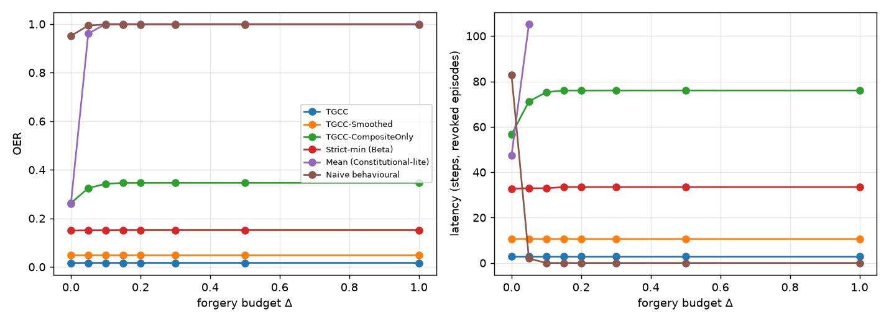

# Bounded forgery

## Method
Simulated streams (50 seeds, 300 steps, compromise at step 80).
Honest reliabilities [0.92, 0.88, 0.82, 0.78, 0.9]; after the compromise the epistemic layer drops
to 0.30 and every other layer is raised to min(0.99, honest + Delta), i.e. the
adversary forges the layers it does not control within a budget Delta. The
epistemic signal is a rolling 8-step rate, as for the real probe. All gates are
calibrated by Algorithm 2 on the same 600-step honest pilot.

## Results: OER (mean [95% CI] over seeds)
| Delta | TGCC | TGCC-Smoothed | TGCC-CompositeOnly | Strict-min (Beta) | Mean (Constitutional-lite) | Naive behavioural |
|---|---|---|---|---|---|---|
| 0.0 | 0.02 [0.01, 0.02] | 0.05 [0.04, 0.05] | 0.26 [0.24, 0.28] | 0.15 [0.14, 0.16] | 0.26 [0.22, 0.30] | 0.95 [0.92, 0.98] |
| 0.05 | 0.02 [0.01, 0.02] | 0.05 [0.04, 0.05] | 0.32 [0.31, 0.34] | 0.15 [0.14, 0.16] | 0.96 [0.94, 0.98] | 0.99 [0.98, 1.00] |
| 0.1 | 0.02 [0.01, 0.02] | 0.05 [0.04, 0.05] | 0.34 [0.33, 0.36] | 0.15 [0.14, 0.16] | 1.00 [1.00, 1.00] | 1.00 [0.99, 1.00] |
| 0.15 | 0.02 [0.01, 0.02] | 0.05 [0.04, 0.05] | 0.35 [0.33, 0.36] | 0.15 [0.14, 0.16] | 1.00 [1.00, 1.00] | 1.00 [0.99, 1.00] |
| 0.2 | 0.02 [0.01, 0.02] | 0.05 [0.04, 0.05] | 0.35 [0.33, 0.36] | 0.15 [0.14, 0.16] | 1.00 [1.00, 1.00] | 1.00 [0.99, 1.00] |
| 0.3 | 0.02 [0.01, 0.02] | 0.05 [0.04, 0.05] | 0.35 [0.33, 0.36] | 0.15 [0.14, 0.16] | 1.00 [1.00, 1.00] | 1.00 [0.99, 1.00] |
| 0.5 | 0.02 [0.01, 0.02] | 0.05 [0.04, 0.05] | 0.35 [0.33, 0.36] | 0.15 [0.14, 0.16] | 1.00 [1.00, 1.00] | 1.00 [0.99, 1.00] |
| 1.0 | 0.02 [0.01, 0.02] | 0.05 [0.04, 0.05] | 0.35 [0.33, 0.36] | 0.15 [0.14, 0.16] | 1.00 [1.00, 1.00] | 1.00 [0.99, 1.00] |

Honest FPR: TGCC 0.02 [0.01, 0.03] | TGCC-Smoothed 0.01 [0.00, 0.03] | TGCC-CompositeOnly 0.00 [0.00, 0.00] | Strict-min (Beta) 0.00 [0.00, 0.00] | Mean (Constitutional-lite) 0.00 [0.00, 0.00] | Naive behavioural 0.01 [0.00, 0.02]

## Reading
* TGCC's OER does not depend on Delta: the per-turn epistemic check reads the layer
  whose failure the adversary cannot hide, so forging the other layers cannot lift it.
* Without the check (TGCC-CompositeOnly) OER rises with Delta and then plateaus:
  the coupling caps how far forged downstream layers can lift the composite
  (cascade containment, Proposition 3).
* Averaging gates (Mean, Naive) fail from Delta = 0.05 on.

