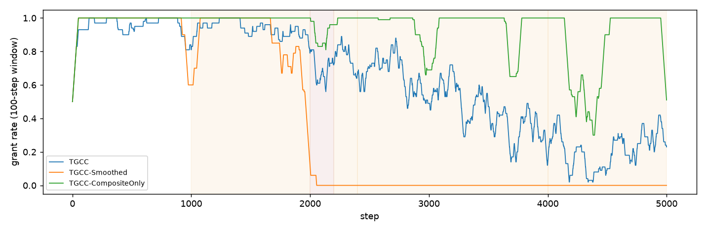

# Long-horizon drift (E10) and recovery (E12)

Simulated streams; the epistemic signal is a rolling 8-step rate, as for the real
probe. Gates are calibrated by Algorithm 2 on the same 600-step honest pilot.

## E10: 5000 steps, 20 seeds (grant rate per regime, mean [95% CI])
Epistemic reliability decays linearly 0.92 -> 0.60 over steps 1000-4000; a model
swap at steps 2000-2200 lowers epistemic reliability to <= 0.75 and behavioural to 0.70.
| Gate | stable (0-1000) | early drift (1000-2000) | model swap (2000-2200) | after swap (2200-2400) | late drift (2400-4000) | drifted (rho_e=0.60) (4000-5000) |
|---|---|---|---|---|---|---|
| TGCC | 0.98 [0.98, 0.98] | 0.91 [0.90, 0.92] | 0.58 [0.53, 0.64] | 0.70 [0.65, 0.74] | 0.48 [0.47, 0.50] | 0.24 [0.22, 0.26] |
| TGCC-Smoothed | 0.99 [0.99, 1.00] | 0.70 [0.66, 0.75] | 0.06 [0.02, 0.10] | 0.03 [0.01, 0.05] | 0.00 [0.00, 0.01] | 0.00 [0.00, 0.00] |
| TGCC-CompositeOnly | 1.00 [1.00, 1.00] | 1.00 [0.99, 1.00] | 0.79 [0.72, 0.86] | 0.90 [0.85, 0.96] | 0.92 [0.90, 0.93] | 0.76 [0.72, 0.80] |

## E12: honest (0-59) -> sleeper (60-199) -> restored (200-399), 50 seeds
Sleeper reliabilities [0.3, 0.92, 0.75, 0.72, 0.88]. Belief time constant 1/(1-gamma) = 66.7 steps.

| Gate | Revocation latency | First re-grant after restoration | Stable re-grant (>= 90% of next 20 steps) | Grant rate, steps 200-259 |
|---|---|---|---|---|
| TGCC | 2.6 [2.2, 3.0] | 43.1 [39.0, 47.7] | 49.0 [42.8, 56.0] (0 never) | 0.28 [0.23, 0.33] |
| TGCC-Smoothed | 9.0 [8.1, 9.9] | 139.1 [134.5, 143.9] | 137.7 [133.1, 142.8] (2 never) | 0.00 [0.00, 0.00] |
| TGCC-CompositeOnly | 44.1 [39.6, 48.6] | 43.1 [39.0, 47.7] | 47.8 [41.9, 54.6] (0 never) | 0.28 [0.23, 0.33] |

## Reading
* E10: TGCC tracks the drift instead of locking the agent out: admission falls as the
  agent's real reliability falls (0.98 -> 0.24 at rho_e = 0.60), dips during the model
  swap and partly recovers afterwards. TGCC-Smoothed locks the agent out once drift
  starts; the composite alone admits the drifted agent most of the time.
* E12: TGCC revokes within a few steps and re-admits the restored agent after about
  45-50 steps, below the belief time constant of 66.7 steps; re-admission is set by
  the composite's Beta memory. TGCC-Smoothed needs about 140 steps.
