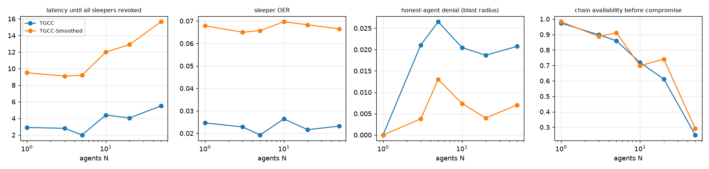

# Byzantine multi-agent chain (E13)

## Method
Simulated chain of N agents (20 seeds per N, 200 steps). K = max(1, round(0.2 N))
randomly chosen agents become sleepers at step 60 (epistemic reliability 0.30).
Each agent has its own gate, calibrated by Algorithm 2 on the same honest simulated pilot.
* Chain OER: fraction of post-compromise steps on which every agent (sleepers included) is admitted.
* Blast radius: post-compromise denial rate of the honest agents.
* Chain availability: fraction of pre-compromise steps on which every agent is admitted
  (weakest-link pipeline).

## Results (mean [95% CI] over seeds)
### TGCC
| N | K | First sleeper revoked | All sleepers revoked | Sleeper OER | Chain OER | Blast radius | Chain availability (pre) | us / agent-step |
|---|---|---|---|---|---|---|---|---|
| 1 | 1 | 2.9 [2.4, 3.5] | 2.9 [2.4, 3.5] | 0.02 [0.02, 0.03] | 0.02 [0.02, 0.03] | 0.00 [0.00, 0.00] | 0.97 [0.94, 0.99] | 78 |
| 3 | 1 | 2.8 [1.9, 3.8] | 2.8 [1.9, 3.8] | 0.02 [0.02, 0.03] | 0.02 [0.02, 0.03] | 0.02 [0.01, 0.03] | 0.90 [0.87, 0.93] | 68 |
| 5 | 1 | 2.0 [1.3, 2.7] | 2.0 [1.3, 2.7] | 0.02 [0.01, 0.03] | 0.02 [0.01, 0.03] | 0.03 [0.02, 0.03] | 0.86 [0.80, 0.91] | 64 |
| 10 | 2 | 2.1 [1.6, 2.7] | 4.4 [3.5, 5.3] | 0.03 [0.02, 0.03] | 0.01 [0.01, 0.02] | 0.02 [0.02, 0.03] | 0.72 [0.67, 0.77] | 61 |
| 20 | 4 | 1.2 [0.9, 1.6] | 4.0 [3.6, 4.5] | 0.02 [0.02, 0.02] | 0.01 [0.00, 0.01] | 0.02 [0.02, 0.02] | 0.61 [0.55, 0.68] | 64 |
| 50 | 10 | 0.5 [0.2, 0.7] | 5.5 [4.8, 6.2] | 0.02 [0.02, 0.03] | 0.00 [0.00, 0.00] | 0.02 [0.02, 0.02] | 0.25 [0.20, 0.30] | 62 |
### TGCC-Smoothed
| N | K | First sleeper revoked | All sleepers revoked | Sleeper OER | Chain OER | Blast radius | Chain availability (pre) | us / agent-step |
|---|---|---|---|---|---|---|---|---|
| 1 | 1 | 9.5 [8.0, 10.9] | 9.5 [8.0, 10.9] | 0.07 [0.06, 0.08] | 0.07 [0.06, 0.08] | 0.00 [0.00, 0.00] | 0.98 [0.95, 1.00] | 65 |
| 3 | 1 | 9.1 [6.8, 11.3] | 9.1 [6.8, 11.3] | 0.07 [0.05, 0.08] | 0.06 [0.04, 0.08] | 0.00 [0.00, 0.01] | 0.89 [0.80, 0.96] | 63 |
| 5 | 1 | 9.2 [8.2, 10.2] | 9.2 [8.2, 10.2] | 0.07 [0.06, 0.07] | 0.06 [0.05, 0.07] | 0.01 [0.00, 0.03] | 0.91 [0.82, 0.97] | 61 |
| 10 | 2 | 7.5 [6.2, 8.6] | 12.0 [10.8, 13.3] | 0.07 [0.06, 0.08] | 0.05 [0.04, 0.06] | 0.01 [0.00, 0.01] | 0.70 [0.56, 0.83] | 66 |
| 20 | 4 | 6.5 [5.4, 7.6] | 12.9 [11.8, 13.9] | 0.07 [0.06, 0.07] | 0.04 [0.03, 0.05] | 0.00 [0.00, 0.01] | 0.74 [0.64, 0.83] | 62 |
| 50 | 10 | 4.0 [3.0, 5.0] | 15.7 [14.6, 16.7] | 0.07 [0.06, 0.07] | 0.01 [0.01, 0.02] | 0.01 [0.00, 0.01] | 0.29 [0.19, 0.40] | 63 |

## Reading
* Per-sleeper detection does not degrade with team size: sleeper OER stays at
  0.02 for TGCC from N = 1 to 50, and the last sleeper is revoked within about 3-6 steps.
* Gates are per agent, so the honest agents' denial rate (blast radius) stays at the
  per-agent honest FPR (0.00-0.03) whatever N is.
* A strict weakest-link pipeline loses availability as N grows (0.97 -> 0.25 at N = 50),
  because some honest agent is falsely denied at almost every step. Large teams
  should route around denied agents rather than halt.

