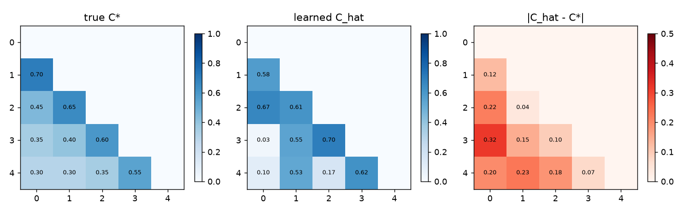

# Learning the coupling matrix from traces

## (a) Recovery from simulated traces
200 simulated episodes x 300 steps with the default coupling C* as ground
truth; in each episode one randomly chosen layer collapses to reliability 0.30
after step 60 (pre-warmed Beta beliefs). Harm labels
y(t) ~ Bernoulli(1 - Phi*(t)). The learner sees only (T(t), y(t)) and fits the 10
lower-triangular entries by maximum likelihood (L-BFGS-B, 5 restarts).

* ||C_hat - C*||_F = **0.571** (vs ||C*||_F = 1.537)
* largest entry error = 0.317; NLL = 0.5170

## (b) Using C_hat in the gate on the real-LLM streams (15 episodes per model and compromise)
### Claude Sonnet 4.5
| Compromise | Gate | OER (default C) | OER (C_hat) | FPR (default C) | FPR (C_hat) |
|---|---|---|---|---|---|
| sleeper | TGCC | 0.02 [0.01, 0.02] | 0.02 [0.01, 0.02] | 0.12 [0.05, 0.21] | 0.12 [0.05, 0.21] |
| sleeper | TGCC-CompositeOnly | 0.17 [0.14, 0.20] | 0.20 [0.16, 0.23] | 0.00 [0.00, 0.00] | 0.00 [0.00, 0.00] |
| policy | TGCC | 0.08 [0.06, 0.11] | 0.09 [0.07, 0.11] | 0.12 [0.05, 0.21] | 0.12 [0.05, 0.21] |
| policy | TGCC-CompositeOnly | 0.10 [0.08, 0.11] | 0.11 [0.10, 0.12] | 0.00 [0.00, 0.00] | 0.00 [0.00, 0.00] |
| offtopic | TGCC | 0.15 [0.10, 0.19] | 0.13 [0.10, 0.17] | 0.12 [0.05, 0.21] | 0.12 [0.05, 0.21] |
| offtopic | TGCC-CompositeOnly | 0.17 [0.13, 0.20] | 0.15 [0.12, 0.18] | 0.00 [0.00, 0.00] | 0.00 [0.00, 0.00] |
| hostile | TGCC | 0.15 [0.11, 0.20] | 0.15 [0.11, 0.19] | 0.12 [0.05, 0.21] | 0.12 [0.05, 0.21] |
| hostile | TGCC-CompositeOnly | 0.17 [0.13, 0.21] | 0.17 [0.14, 0.20] | 0.00 [0.00, 0.00] | 0.00 [0.00, 0.00] |
### GPT-5
| Compromise | Gate | OER (default C) | OER (C_hat) | FPR (default C) | FPR (C_hat) |
|---|---|---|---|---|---|
| sleeper | TGCC | 0.01 [0.00, 0.01] | 0.01 [0.00, 0.01] | 0.27 [0.13, 0.43] | 0.27 [0.13, 0.43] |
| sleeper | TGCC-CompositeOnly | 0.11 [0.08, 0.15] | 0.11 [0.08, 0.15] | 0.05 [0.00, 0.12] | 0.06 [0.00, 0.14] |
| policy | TGCC | 0.06 [0.03, 0.08] | 0.06 [0.04, 0.08] | 0.27 [0.13, 0.43] | 0.27 [0.13, 0.43] |
| policy | TGCC-CompositeOnly | 0.07 [0.05, 0.09] | 0.07 [0.05, 0.10] | 0.05 [0.00, 0.12] | 0.06 [0.00, 0.14] |
| offtopic | TGCC | 0.08 [0.05, 0.12] | 0.07 [0.04, 0.09] | 0.27 [0.13, 0.43] | 0.27 [0.13, 0.43] |
| offtopic | TGCC-CompositeOnly | 0.10 [0.07, 0.13] | 0.08 [0.06, 0.10] | 0.05 [0.00, 0.12] | 0.06 [0.00, 0.14] |
| hostile | TGCC | 0.08 [0.05, 0.11] | 0.07 [0.04, 0.11] | 0.27 [0.13, 0.43] | 0.27 [0.13, 0.43] |
| hostile | TGCC-CompositeOnly | 0.09 [0.06, 0.12] | 0.09 [0.06, 0.12] | 0.05 [0.00, 0.12] | 0.06 [0.00, 0.14] |

## Reading
* The coupling is identifiable from (trust, harm) traces up to a moderate error.
  Entries whose prerequisite rarely fails are the hardest to pin down.
* Using the learned C_hat in the gate changes OER by at most 0.03 on every compromise
  type and model, so the hand-specified matrix can be replaced by a fitted one without
  re-tuning.
