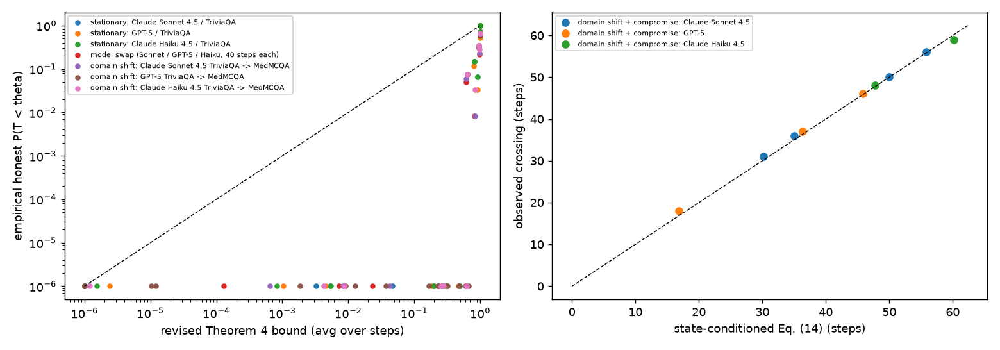

# N22 - Theorem 4 and Eq. (14) under real non-stationarity

## Reviewer issue
IEEE R1-1 (bounds assume stationary noise; real interactions are non-stationary) and R2-6 (Theorem 4 has a floor).

## Revised Theorem 4 (martingale form)
For any adapted signal process with E[s_t | past] >= rho_min at honest steps (no stationarity, no independence):
P(T_t < theta) <= exp(-2 (mu sum w - gamma^t P)_+^2 / (R^2 sum w^2)), with mu = rho_min (1 - theta + theta omega)
- theta omega, R = 1 - theta + theta omega, w_s = gamma^(t-s), and P = theta b0 - (1 - theta) a0 the prior's
contribution (pre-warm a0 = 30, b0 = 10). Floor as t -> inf: exp(-2 mu^2 (1+gamma) / (R^2 (1-gamma))). It
requires only that the worst regime's reliability rho_min keeps T*(rho_min) above theta; when theta exceeds the
pre-warmed trust the prior term delays the guarantee (the bound is 1 until the evidence outweighs the prior).

## (a) Bound vs empirical honest denial on real non-stationary streams
theta = T*(rho_min) - margin, per layer. The bound held in 145 of 145 cases.

| Stream | Layer | rho_min | margin | theta | empirical P(T < theta) | bound (avg over steps) | floor |
|---|---|---:|---:|---:|---:|---:|---:|
| stationary: Claude Sonnet 4.5 / TriviaQA | epistemic | 0.702 | 0.05 | 0.390 | 0.0000 | 0.0462 | 0.5878 |
| stationary: Claude Sonnet 4.5 / TriviaQA | epistemic | 0.702 | 0.10 | 0.340 | 0.0000 | 0.0033 | 0.0920 |
| stationary: Claude Sonnet 4.5 / TriviaQA | epistemic | 0.702 | 0.20 | 0.240 | 0.0000 | 0.0000 | 0.0000 |
| stationary: Claude Sonnet 4.5 / TriviaQA | behavioural | 0.950 | 0.05 | 0.814 | 0.5767 | 0.9977 | 0.8906 |
| stationary: Claude Sonnet 4.5 / TriviaQA | behavioural | 0.950 | 0.10 | 0.764 | 0.0667 | 0.9187 | 0.6061 |
| stationary: Claude Sonnet 4.5 / TriviaQA | behavioural | 0.950 | 0.20 | 0.664 | 0.0000 | 0.3113 | 0.0942 |
| stationary: Claude Sonnet 4.5 / TriviaQA | role | 1.000 | 0.05 | 0.950 | 1.0000 | 1.0000 | 0.9243 |
| stationary: Claude Sonnet 4.5 / TriviaQA | role | 1.000 | 0.10 | 0.900 | 0.7000 | 0.9975 | 0.7135 |
| stationary: Claude Sonnet 4.5 / TriviaQA | role | 1.000 | 0.20 | 0.800 | 0.1500 | 0.8191 | 0.2089 |
| stationary: Claude Sonnet 4.5 / TriviaQA | social | 0.850 | 0.05 | 0.604 | 0.0000 | 0.4853 | 0.7950 |
| stationary: Claude Sonnet 4.5 / TriviaQA | social | 0.850 | 0.10 | 0.554 | 0.0000 | 0.1951 | 0.3654 |
| stationary: Claude Sonnet 4.5 / TriviaQA | social | 0.850 | 0.20 | 0.454 | 0.0000 | 0.0053 | 0.0073 |
| stationary: Claude Sonnet 4.5 / TriviaQA | institutional | 1.000 | 0.05 | 0.950 | 1.0000 | 1.0000 | 0.9243 |
| stationary: Claude Sonnet 4.5 / TriviaQA | institutional | 1.000 | 0.10 | 0.900 | 0.7000 | 0.9975 | 0.7135 |
| stationary: Claude Sonnet 4.5 / TriviaQA | institutional | 1.000 | 0.20 | 0.800 | 0.1500 | 0.8191 | 0.2089 |
| stationary: GPT-5 / TriviaQA | epistemic | 0.543 | 0.05 | 0.234 | 0.0000 | 0.0010 | 0.3241 |
| stationary: GPT-5 / TriviaQA | epistemic | 0.543 | 0.10 | 0.184 | 0.0000 | 0.0000 | 0.0056 |
| stationary: GPT-5 / TriviaQA | epistemic | 0.543 | 0.20 | 0.084 | 0.0000 | 0.0000 | 0.0000 |
| stationary: GPT-5 / TriviaQA | behavioural | 0.947 | 0.05 | 0.806 | 0.5133 | 0.9966 | 0.8882 |
| stationary: GPT-5 / TriviaQA | behavioural | 0.947 | 0.10 | 0.756 | 0.0333 | 0.9049 | 0.5988 |
| stationary: GPT-5 / TriviaQA | behavioural | 0.947 | 0.20 | 0.656 | 0.0000 | 0.2828 | 0.0888 |
| stationary: GPT-5 / TriviaQA | role | 0.997 | 0.05 | 0.940 | 1.0000 | 1.0000 | 0.9223 |
| stationary: GPT-5 / TriviaQA | role | 0.997 | 0.10 | 0.890 | 0.6700 | 0.9964 | 0.7068 |
| stationary: GPT-5 / TriviaQA | role | 0.997 | 0.20 | 0.790 | 0.1167 | 0.7977 | 0.1996 |
| stationary: GPT-5 / TriviaQA | social | 0.847 | 0.05 | 0.599 | 0.0000 | 0.4683 | 0.7917 |
| stationary: GPT-5 / TriviaQA | social | 0.847 | 0.10 | 0.549 | 0.0000 | 0.1837 | 0.3587 |
| stationary: GPT-5 / TriviaQA | social | 0.847 | 0.20 | 0.449 | 0.0000 | 0.0046 | 0.0067 |
| stationary: GPT-5 / TriviaQA | institutional | 1.000 | 0.05 | 0.950 | 1.0000 | 1.0000 | 0.9243 |
| stationary: GPT-5 / TriviaQA | institutional | 1.000 | 0.10 | 0.900 | 0.7000 | 0.9975 | 0.7135 |
| stationary: GPT-5 / TriviaQA | institutional | 1.000 | 0.20 | 0.800 | 0.1500 | 0.8191 | 0.2089 |
| stationary: Claude Haiku 4.5 / TriviaQA | epistemic | 0.535 | 0.05 | 0.227 | 0.0000 | 0.0008 | 0.3119 |
| stationary: Claude Haiku 4.5 / TriviaQA | epistemic | 0.535 | 0.10 | 0.177 | 0.0000 | 0.0000 | 0.0046 |
| stationary: Claude Haiku 4.5 / TriviaQA | epistemic | 0.535 | 0.20 | 0.077 | 0.0000 | 0.0000 | 0.0000 |
| stationary: Claude Haiku 4.5 / TriviaQA | behavioural | 0.950 | 0.05 | 0.814 | 0.5767 | 0.9977 | 0.8906 |
| stationary: Claude Haiku 4.5 / TriviaQA | behavioural | 0.950 | 0.10 | 0.764 | 0.0667 | 0.9187 | 0.6061 |
| stationary: Claude Haiku 4.5 / TriviaQA | behavioural | 0.950 | 0.20 | 0.664 | 0.0000 | 0.3113 | 0.0942 |
| stationary: Claude Haiku 4.5 / TriviaQA | role | 1.000 | 0.05 | 0.950 | 1.0000 | 1.0000 | 0.9243 |
| stationary: Claude Haiku 4.5 / TriviaQA | role | 1.000 | 0.10 | 0.900 | 0.7000 | 0.9975 | 0.7135 |
| stationary: Claude Haiku 4.5 / TriviaQA | role | 1.000 | 0.20 | 0.800 | 0.1500 | 0.8191 | 0.2089 |
| stationary: Claude Haiku 4.5 / TriviaQA | social | 0.850 | 0.05 | 0.605 | 0.0000 | 0.4883 | 0.7956 |
| stationary: Claude Haiku 4.5 / TriviaQA | social | 0.850 | 0.10 | 0.555 | 0.0000 | 0.1972 | 0.3665 |
| stationary: Claude Haiku 4.5 / TriviaQA | social | 0.850 | 0.20 | 0.455 | 0.0000 | 0.0054 | 0.0075 |
| stationary: Claude Haiku 4.5 / TriviaQA | institutional | 1.000 | 0.05 | 0.950 | 1.0000 | 1.0000 | 0.9243 |
| stationary: Claude Haiku 4.5 / TriviaQA | institutional | 1.000 | 0.10 | 0.900 | 0.7000 | 0.9975 | 0.7135 |
| stationary: Claude Haiku 4.5 / TriviaQA | institutional | 1.000 | 0.20 | 0.800 | 0.1500 | 0.8191 | 0.2089 |
| model swap (Sonnet / GPT-5 / Haiku, 40 steps each) | epistemic | 0.528 | 0.05 | 0.222 | 0.0000 | 0.0230 | 0.3014 |
| model swap (Sonnet / GPT-5 / Haiku, 40 steps each) | epistemic | 0.528 | 0.10 | 0.172 | 0.0000 | 0.0001 | 0.0039 |
| model swap (Sonnet / GPT-5 / Haiku, 40 steps each) | epistemic | 0.528 | 0.20 | 0.072 | 0.0000 | 0.0000 | 0.0000 |
| model swap (Sonnet / GPT-5 / Haiku, 40 steps each) | behavioural | 0.946 | 0.05 | 0.804 | 0.2167 | 0.9763 | 0.8874 |
| model swap (Sonnet / GPT-5 / Haiku, 40 steps each) | behavioural | 0.946 | 0.10 | 0.754 | 0.0083 | 0.8213 | 0.5966 |
| model swap (Sonnet / GPT-5 / Haiku, 40 steps each) | behavioural | 0.946 | 0.20 | 0.654 | 0.0000 | 0.2288 | 0.0872 |
| model swap (Sonnet / GPT-5 / Haiku, 40 steps each) | role | 0.996 | 0.05 | 0.938 | 0.5889 | 0.9973 | 0.9218 |
| model swap (Sonnet / GPT-5 / Haiku, 40 steps each) | role | 0.996 | 0.10 | 0.888 | 0.3000 | 0.9480 | 0.7051 |
| model swap (Sonnet / GPT-5 / Haiku, 40 steps each) | role | 0.996 | 0.20 | 0.788 | 0.0500 | 0.6058 | 0.1973 |
| model swap (Sonnet / GPT-5 / Haiku, 40 steps each) | social | 0.846 | 0.05 | 0.598 | 0.0000 | 0.5986 | 0.7909 |
| model swap (Sonnet / GPT-5 / Haiku, 40 steps each) | social | 0.846 | 0.10 | 0.548 | 0.0000 | 0.2616 | 0.3570 |
| model swap (Sonnet / GPT-5 / Haiku, 40 steps each) | social | 0.846 | 0.20 | 0.448 | 0.0000 | 0.0072 | 0.0065 |
| model swap (Sonnet / GPT-5 / Haiku, 40 steps each) | institutional | 1.000 | 0.05 | 0.950 | 0.6667 | 0.9979 | 0.9243 |
| model swap (Sonnet / GPT-5 / Haiku, 40 steps each) | institutional | 1.000 | 0.10 | 0.900 | 0.3500 | 0.9537 | 0.7135 |
| model swap (Sonnet / GPT-5 / Haiku, 40 steps each) | institutional | 1.000 | 0.20 | 0.800 | 0.0750 | 0.6309 | 0.2089 |
| domain shift: Claude Sonnet 4.5 TriviaQA -> MedMCQA | epistemic | 0.575 | 0.05 | 0.261 | 0.0000 | 0.0426 | 0.3759 |
| domain shift: Claude Sonnet 4.5 TriviaQA -> MedMCQA | epistemic | 0.575 | 0.10 | 0.211 | 0.0000 | 0.0006 | 0.0113 |
| domain shift: Claude Sonnet 4.5 TriviaQA -> MedMCQA | epistemic | 0.575 | 0.20 | 0.111 | 0.0000 | 0.0000 | 0.0000 |
| domain shift: Claude Sonnet 4.5 TriviaQA -> MedMCQA | behavioural | 0.947 | 0.05 | 0.806 | 0.2300 | 0.9770 | 0.8880 |
| domain shift: Claude Sonnet 4.5 TriviaQA -> MedMCQA | behavioural | 0.947 | 0.10 | 0.756 | 0.0083 | 0.8247 | 0.5984 |
| domain shift: Claude Sonnet 4.5 TriviaQA -> MedMCQA | behavioural | 0.947 | 0.20 | 0.656 | 0.0000 | 0.2337 | 0.0885 |
| domain shift: Claude Sonnet 4.5 TriviaQA -> MedMCQA | role | 0.997 | 0.05 | 0.940 | 0.6367 | 0.9975 | 0.9223 |
| domain shift: Claude Sonnet 4.5 TriviaQA -> MedMCQA | role | 0.997 | 0.10 | 0.890 | 0.3083 | 0.9491 | 0.7068 |
| domain shift: Claude Sonnet 4.5 TriviaQA -> MedMCQA | role | 0.997 | 0.20 | 0.790 | 0.0583 | 0.6109 | 0.1996 |
| domain shift: Claude Sonnet 4.5 TriviaQA -> MedMCQA | social | 0.850 | 0.05 | 0.603 | 0.0000 | 0.6129 | 0.7946 |
| domain shift: Claude Sonnet 4.5 TriviaQA -> MedMCQA | social | 0.850 | 0.10 | 0.553 | 0.0000 | 0.2739 | 0.3646 |
| domain shift: Claude Sonnet 4.5 TriviaQA -> MedMCQA | social | 0.850 | 0.20 | 0.453 | 0.0000 | 0.0083 | 0.0072 |
| domain shift: Claude Sonnet 4.5 TriviaQA -> MedMCQA | institutional | 1.000 | 0.05 | 0.950 | 0.6667 | 0.9979 | 0.9243 |
| domain shift: Claude Sonnet 4.5 TriviaQA -> MedMCQA | institutional | 1.000 | 0.10 | 0.900 | 0.3500 | 0.9537 | 0.7135 |
| domain shift: Claude Sonnet 4.5 TriviaQA -> MedMCQA | institutional | 1.000 | 0.20 | 0.800 | 0.0750 | 0.6309 | 0.2089 |
| domain shift + compromise: Claude Sonnet 4.5 | epistemic | 0.423 | 0.05 | 0.146 | 0.0000 | 0.0008 | 0.1589 |
| domain shift + compromise: Claude Sonnet 4.5 | epistemic | 0.423 | 0.10 | 0.096 | 0.0000 | 0.0000 | 0.0002 |
| domain shift + compromise: Claude Sonnet 4.5 | behavioural | 0.934 | 0.05 | 0.775 | 0.1000 | 0.9754 | 0.8779 |
| domain shift + compromise: Claude Sonnet 4.5 | behavioural | 0.934 | 0.10 | 0.725 | 0.0000 | 0.7852 | 0.5688 |
| domain shift + compromise: Claude Sonnet 4.5 | behavioural | 0.934 | 0.20 | 0.625 | 0.0000 | 0.1780 | 0.0688 |
| domain shift + compromise: Claude Sonnet 4.5 | role | 0.983 | 0.05 | 0.902 | 0.4833 | 0.9992 | 0.9140 |
| domain shift + compromise: Claude Sonnet 4.5 | role | 0.983 | 0.10 | 0.852 | 0.2444 | 0.9594 | 0.6793 |
| domain shift + compromise: Claude Sonnet 4.5 | role | 0.983 | 0.20 | 0.752 | 0.0000 | 0.5931 | 0.1646 |
| domain shift + compromise: Claude Sonnet 4.5 | social | 0.836 | 0.05 | 0.579 | 0.0000 | 0.4959 | 0.7783 |
| domain shift + compromise: Claude Sonnet 4.5 | social | 0.836 | 0.10 | 0.529 | 0.0000 | 0.1931 | 0.3322 |
| domain shift + compromise: Claude Sonnet 4.5 | social | 0.836 | 0.20 | 0.429 | 0.0000 | 0.0039 | 0.0045 |
| domain shift + compromise: Claude Sonnet 4.5 | institutional | 1.000 | 0.05 | 0.950 | 0.8889 | 0.9999 | 0.9243 |
| domain shift + compromise: Claude Sonnet 4.5 | institutional | 1.000 | 0.10 | 0.900 | 0.4667 | 0.9795 | 0.7135 |
| domain shift + compromise: Claude Sonnet 4.5 | institutional | 1.000 | 0.20 | 0.800 | 0.1000 | 0.7130 | 0.2089 |
| domain shift: GPT-5 TriviaQA -> MedMCQA | epistemic | 0.465 | 0.05 | 0.175 | 0.0000 | 0.0091 | 0.2111 |
| domain shift: GPT-5 TriviaQA -> MedMCQA | epistemic | 0.465 | 0.10 | 0.125 | 0.0000 | 0.0000 | 0.0007 |
| domain shift: GPT-5 TriviaQA -> MedMCQA | epistemic | 0.465 | 0.20 | 0.025 | 0.0000 | 0.0000 | 0.0000 |
| domain shift: GPT-5 TriviaQA -> MedMCQA | behavioural | 0.817 | 0.05 | 0.548 | 0.0000 | 0.4780 | 0.7550 |
| domain shift: GPT-5 TriviaQA -> MedMCQA | behavioural | 0.817 | 0.10 | 0.498 | 0.0000 | 0.1680 | 0.2896 |
| domain shift: GPT-5 TriviaQA -> MedMCQA | behavioural | 0.817 | 0.20 | 0.398 | 0.0000 | 0.0019 | 0.0022 |
| domain shift: GPT-5 TriviaQA -> MedMCQA | role | 0.860 | 0.05 | 0.622 | 0.0000 | 0.6603 | 0.8063 |
| domain shift: GPT-5 TriviaQA -> MedMCQA | role | 0.860 | 0.10 | 0.572 | 0.0000 | 0.3166 | 0.3892 |
| domain shift: GPT-5 TriviaQA -> MedMCQA | role | 0.860 | 0.20 | 0.472 | 0.0000 | 0.0128 | 0.0101 |
| domain shift: GPT-5 TriviaQA -> MedMCQA | social | 0.732 | 0.05 | 0.427 | 0.0000 | 0.2314 | 0.6347 |
| domain shift: GPT-5 TriviaQA -> MedMCQA | social | 0.732 | 0.10 | 0.377 | 0.0000 | 0.0369 | 0.1311 |
| domain shift: GPT-5 TriviaQA -> MedMCQA | social | 0.732 | 0.20 | 0.277 | 0.0000 | 0.0000 | 0.0000 |
| domain shift: GPT-5 TriviaQA -> MedMCQA | institutional | 1.000 | 0.05 | 0.950 | 0.6667 | 0.9979 | 0.9243 |
| domain shift: GPT-5 TriviaQA -> MedMCQA | institutional | 1.000 | 0.10 | 0.900 | 0.3500 | 0.9537 | 0.7135 |
| domain shift: GPT-5 TriviaQA -> MedMCQA | institutional | 1.000 | 0.20 | 0.800 | 0.0750 | 0.6309 | 0.2089 |
| domain shift + compromise: GPT-5 | epistemic | 0.384 | 0.05 | 0.122 | 0.0000 | 0.0003 | 0.1184 |
| domain shift + compromise: GPT-5 | epistemic | 0.384 | 0.10 | 0.072 | 0.0000 | 0.0000 | 0.0000 |
| domain shift + compromise: GPT-5 | behavioural | 0.839 | 0.05 | 0.585 | 0.0000 | 0.5119 | 0.7823 |
| domain shift + compromise: GPT-5 | behavioural | 0.839 | 0.10 | 0.535 | 0.0000 | 0.2046 | 0.3399 |
| domain shift + compromise: GPT-5 | behavioural | 0.839 | 0.20 | 0.435 | 0.0000 | 0.0045 | 0.0050 |
| domain shift + compromise: GPT-5 | role | 0.883 | 0.05 | 0.666 | 0.0000 | 0.7530 | 0.8311 |
| domain shift + compromise: GPT-5 | role | 0.883 | 0.10 | 0.616 | 0.0000 | 0.4140 | 0.4458 |
| domain shift + compromise: GPT-5 | role | 0.883 | 0.20 | 0.516 | 0.0000 | 0.0306 | 0.0203 |
| domain shift + compromise: GPT-5 | social | 0.753 | 0.05 | 0.454 | 0.0000 | 0.2078 | 0.6670 |
| domain shift + compromise: GPT-5 | social | 0.753 | 0.10 | 0.404 | 0.0000 | 0.0375 | 0.1647 |
| domain shift + compromise: GPT-5 | social | 0.753 | 0.20 | 0.304 | 0.0000 | 0.0000 | 0.0001 |
| domain shift + compromise: GPT-5 | institutional | 1.000 | 0.05 | 0.950 | 0.8889 | 0.9999 | 0.9243 |
| domain shift + compromise: GPT-5 | institutional | 1.000 | 0.10 | 0.900 | 0.4667 | 0.9795 | 0.7135 |
| domain shift + compromise: GPT-5 | institutional | 1.000 | 0.20 | 0.800 | 0.1000 | 0.7130 | 0.2089 |
| domain shift: Claude Haiku 4.5 TriviaQA -> MedMCQA | epistemic | 0.419 | 0.05 | 0.144 | 0.0000 | 0.0042 | 0.1553 |
| domain shift: Claude Haiku 4.5 TriviaQA -> MedMCQA | epistemic | 0.419 | 0.10 | 0.094 | 0.0000 | 0.0000 | 0.0002 |
| domain shift: Claude Haiku 4.5 TriviaQA -> MedMCQA | behavioural | 0.950 | 0.05 | 0.814 | 0.2817 | 0.9795 | 0.8905 |
| domain shift: Claude Haiku 4.5 TriviaQA -> MedMCQA | behavioural | 0.950 | 0.10 | 0.764 | 0.0333 | 0.8375 | 0.6057 |
| domain shift: Claude Haiku 4.5 TriviaQA -> MedMCQA | behavioural | 0.950 | 0.20 | 0.664 | 0.0000 | 0.2539 | 0.0939 |
| domain shift: Claude Haiku 4.5 TriviaQA -> MedMCQA | role | 1.000 | 0.05 | 0.950 | 0.6667 | 0.9979 | 0.9243 |
| domain shift: Claude Haiku 4.5 TriviaQA -> MedMCQA | role | 1.000 | 0.10 | 0.900 | 0.3500 | 0.9537 | 0.7135 |
| domain shift: Claude Haiku 4.5 TriviaQA -> MedMCQA | role | 1.000 | 0.20 | 0.800 | 0.0750 | 0.6309 | 0.2089 |
| domain shift: Claude Haiku 4.5 TriviaQA -> MedMCQA | social | 0.850 | 0.05 | 0.605 | 0.0000 | 0.6167 | 0.7956 |
| domain shift: Claude Haiku 4.5 TriviaQA -> MedMCQA | social | 0.850 | 0.10 | 0.555 | 0.0000 | 0.2772 | 0.3665 |
| domain shift: Claude Haiku 4.5 TriviaQA -> MedMCQA | social | 0.850 | 0.20 | 0.455 | 0.0000 | 0.0086 | 0.0075 |
| domain shift: Claude Haiku 4.5 TriviaQA -> MedMCQA | institutional | 1.000 | 0.05 | 0.950 | 0.6667 | 0.9979 | 0.9243 |
| domain shift: Claude Haiku 4.5 TriviaQA -> MedMCQA | institutional | 1.000 | 0.10 | 0.900 | 0.3500 | 0.9537 | 0.7135 |
| domain shift: Claude Haiku 4.5 TriviaQA -> MedMCQA | institutional | 1.000 | 0.20 | 0.800 | 0.0750 | 0.6309 | 0.2089 |
| domain shift + compromise: Claude Haiku 4.5 | epistemic | 0.228 | 0.05 | 0.039 | 0.0000 | 0.0000 | 0.0252 |
| domain shift + compromise: Claude Haiku 4.5 | behavioural | 0.950 | 0.05 | 0.814 | 0.3778 | 0.9895 | 0.8905 |
| domain shift + compromise: Claude Haiku 4.5 | behavioural | 0.950 | 0.10 | 0.764 | 0.0444 | 0.8743 | 0.6057 |
| domain shift + compromise: Claude Haiku 4.5 | behavioural | 0.950 | 0.20 | 0.664 | 0.0000 | 0.2810 | 0.0939 |
| domain shift + compromise: Claude Haiku 4.5 | role | 1.000 | 0.05 | 0.950 | 0.8889 | 0.9999 | 0.9243 |
| domain shift + compromise: Claude Haiku 4.5 | role | 1.000 | 0.10 | 0.900 | 0.4667 | 0.9795 | 0.7135 |
| domain shift + compromise: Claude Haiku 4.5 | role | 1.000 | 0.20 | 0.800 | 0.1000 | 0.7130 | 0.2089 |
| domain shift + compromise: Claude Haiku 4.5 | social | 0.850 | 0.05 | 0.604 | 0.0000 | 0.5661 | 0.7950 |
| domain shift + compromise: Claude Haiku 4.5 | social | 0.850 | 0.10 | 0.554 | 0.0000 | 0.2457 | 0.3654 |
| domain shift + compromise: Claude Haiku 4.5 | social | 0.850 | 0.20 | 0.454 | 0.0000 | 0.0075 | 0.0073 |
| domain shift + compromise: Claude Haiku 4.5 | institutional | 1.000 | 0.05 | 0.950 | 0.8889 | 0.9999 | 0.9243 |
| domain shift + compromise: Claude Haiku 4.5 | institutional | 1.000 | 0.10 | 0.900 | 0.4667 | 0.9795 | 0.7135 |
| domain shift + compromise: Claude Haiku 4.5 | institutional | 1.000 | 0.20 | 0.800 | 0.1000 | 0.7130 | 0.2089 |

## (b) Why the per-turn epistemic check needs conformal calibration (window W = 8)
Denial iff the windowed calibration error exceeds 0.5 (1 - theta_e). An Azuma bound exp(-2 W (threshold - e_max)^2)
exists only if the honest regime-level mean error e_max is below the threshold; on real streams it is not
(e_max 0.19-0.39 against 0.18 at the Claude-calibrated theta_e), so no distribution-free per-step bound is
available and the bound column is vacuous. The per-turn check's honest FPR is therefore controlled by conformal
risk control on deployment sessions (N29, N32), which needs no such assumption. The rate is constant in t: the
per-turn check trades a fixed honest false-denial rate for one-step detection.

| Stream | e_max | error threshold | empirical denial | bound |
|---|---:|---:|---:|---:|
| stationary: Claude Sonnet 4.5 / TriviaQA | 0.191 | 0.176 | 0.350 | 1.000 |
| stationary: GPT-5 / TriviaQA | 0.312 | 0.176 | 0.600 | 1.000 |
| stationary: Claude Haiku 4.5 / TriviaQA | 0.290 | 0.176 | 0.667 | 1.000 |
| model swap (Sonnet / GPT-5 / Haiku, 40 steps each) | 0.330 | 0.176 | 0.544 | 1.000 |
| domain shift: Claude Sonnet 4.5 TriviaQA -> MedMCQA | 0.335 | 0.176 | 0.450 | 1.000 |
| domain shift + compromise: Claude Sonnet 4.5 | 0.329 | 0.176 | 0.578 | 1.000 |
| domain shift: GPT-5 TriviaQA -> MedMCQA | 0.312 | 0.176 | 0.738 | 1.000 |
| domain shift + compromise: GPT-5 | 0.340 | 0.176 | 0.778 | 1.000 |
| domain shift: Claude Haiku 4.5 TriviaQA -> MedMCQA | 0.392 | 0.176 | 0.732 | 1.000 |
| domain shift + compromise: Claude Haiku 4.5 | 0.378 | 0.176 | 0.844 | 1.000 |

## (c) Eq. (14) on real compromised streams after a domain shift
rho0 / rho1 = mean epistemic signal over the 30 steps before / all steps after the compromise; x lies a quarter
(0.25) or half (0.5) of the way from T*(rho0) to T*(rho1); observed = steps until the epistemic Beta trust first
falls below x (inf = not within the post-compromise horizon).

"Eq. (14)" assumes the trust starts at the stationary point T*(rho0) of the latest regime; "state-conditioned"
starts from the actual evidence (a, b) at compromise, which the controller knows, and needs no assumption about
the history.

| Stream | rho0 | rho1 | trust at compromise | T*(rho0) | level | x | Eq. (14) | state-conditioned | observed (horizon) |
|---|---:|---:|---:|---:|---:|---:|---:|---:|---:|
| domain shift + compromise: Claude Sonnet 4.5 | 0.46 | 0.02 | 0.350 | 0.223 | 0.25 | 0.169 | 13.9 | 30.2 | 31 (60) |
| domain shift + compromise: Claude Sonnet 4.5 | 0.46 | 0.02 | 0.350 | 0.223 | 0.5 | 0.115 | 35.1 | 49.9 | 50 (60) |
| domain shift + compromise: Claude Sonnet 4.5 | 0.38 | 0.00 | 0.289 | 0.171 | 0.25 | 0.129 | 14.7 | 35.0 | 36 (60) |
| domain shift + compromise: Claude Sonnet 4.5 | 0.38 | 0.00 | 0.289 | 0.171 | 0.5 | 0.086 | 36.9 | 55.8 | 56 (60) |
| domain shift + compromise: GPT-5 | 0.32 | 0.01 | 0.283 | 0.138 | 0.25 | 0.105 | 15.5 | 45.9 | 46 (60) |
| domain shift + compromise: GPT-5 | 0.32 | 0.01 | 0.283 | 0.138 | 0.5 | 0.071 | 38.6 | 67.7 | inf (60) |
| domain shift + compromise: GPT-5 | 0.44 | 0.00 | 0.233 | 0.209 | 0.25 | 0.157 | 14.0 | 16.8 | 18 (60) |
| domain shift + compromise: GPT-5 | 0.44 | 0.00 | 0.233 | 0.209 | 0.5 | 0.105 | 35.4 | 36.4 | 37 (60) |
| domain shift + compromise: Claude Haiku 4.5 | 0.21 | 0.02 | 0.200 | 0.083 | 0.25 | 0.064 | 16.8 | 60.2 | 59 (60) |
| domain shift + compromise: Claude Haiku 4.5 | 0.21 | 0.02 | 0.200 | 0.083 | 0.5 | 0.044 | 41.3 | 83.6 | inf (60) |
| domain shift + compromise: Claude Haiku 4.5 | 0.24 | 0.01 | 0.191 | 0.096 | 0.25 | 0.073 | 16.4 | 47.7 | 48 (60) |
| domain shift + compromise: Claude Haiku 4.5 | 0.24 | 0.01 | 0.191 | 0.096 | 0.5 | 0.049 | 40.4 | 70.5 | inf (60) |

