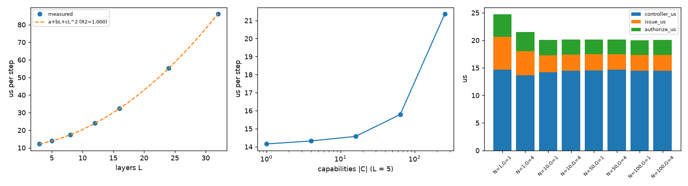

# N24 - System overhead

## Reviewer issue
IEEE R2-8: the overhead claim omitted the dominant costs (critic calls, token issuance, enforcement,
revocation propagation), and varied the number of agents N although Proposition 5 is about the number of layers L.

## (a) Controller cost vs layers L and capabilities |C| (pure Python, real E1 signals, median of 5 runs)

| L | 3 | 5 | 8 | 12 | 16 | 24 | 32 |
|---|---|---|---|---|---|---|---|
| us/step | 12 | 14 | 17 | 24 | 32 | 55 | 86 |

Least-squares fit a + bL + cL^2: a = 10.5, b = 0.37, c = 0.062
(R^2 = 1.0000; a linear fit gives R^2 = 0.9605), consistent with O(L^2).

| |C| (L = 5) | 1 | 4 | 16 | 64 | 256 |
|---|---|---|---|---|---|
| us/step | 14 | 14 | 15 | 16 | 21 |

## (b) Full authorization path on real E1 streams
Controller step + grant rule, HMAC-SHA256 capability token issuance, gateway verification (signature, expiry,
revocation epoch), and revocation propagation (epoch broadcast to every gateway). Per-operation means in us.
"stale tokens accepted" counts, after every revocation, how many gateways still accepted the agent's last token
(must be 0).

| Setting | controller | issue | authorize | revoke + propagate | total per agent-step | tokens issued | revocations | stale tokens accepted |
|---|---:|---:|---:|---:|---:|---:|---:|---:|
| N=1,G=1 | 15 | 6.0 | 4.1 | 3.6 | 17 | 16 | 1 | 0 |
| N=1,G=4 | 14 | 4.4 | 3.5 | 3.1 | 16 | 16 | 1 | 0 |
| N=10,G=1 | 14 | 3.1 | 2.8 | 0.7 | 16 | 177 | 15 | 0 |
| N=10,G=4 | 14 | 3.0 | 2.7 | 0.9 | 16 | 177 | 15 | 0 |
| N=50,G=1 | 15 | 2.9 | 2.7 | 0.5 | 16 | 911 | 73 | 0 |
| N=50,G=4 | 15 | 2.9 | 2.7 | 0.9 | 16 | 911 | 73 | 0 |
| N=100,G=1 | 14 | 2.8 | 2.7 | 0.5 | 16 | 1809 | 147 | 0 |
| N=100,G=4 | 15 | 2.9 | 2.7 | 0.8 | 16 | 1809 | 147 | 0 |

## (c) End to end
The full authorization path costs at most 17 us per agent-step. The measured LLM latencies per step (N06,
medians) are 1.45 s (Claude Sonnet 4.5) and 1.91 s (GPT-5) for the agent call, plus 1.3-2.0 s when the epistemic
critic is an LLM judge (about 0.9x the agent's tokens). The controller and token path is therefore below
0.001% of a step with a reference critic and below 0.001% with an LLM-judge critic;
the critic call, not the controller, is the dominant cost of the framework.

