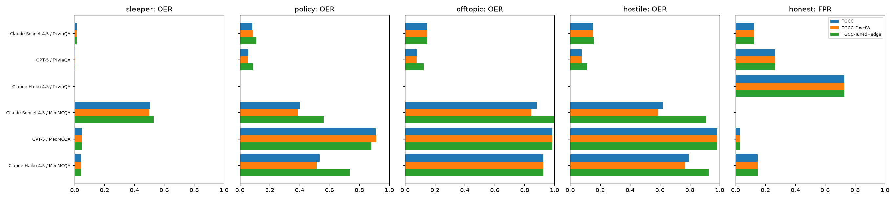

# N26 - Adaptive layer weighting

## Reviewer issues
IEEE R1-3 and R2-6 (Lemma 3 applies standard Hedge to an EWMA + softmax update without justification) and
R2-3 (no fixed-weight baseline isolates adaptive weighting).

## The update and the corrected lemma
The weighting is exponential weights on *discounted* cumulative layer losses q_t = 1 - T_t in [0,1]^L,
with discount beta = 1 - lam and effective rate eta' = eta * lam. The loss of a weighting, <alpha, q_t>,
is linear in alpha and bounded in [0,1] by construction, so no convexity or boundedness assumption about
the semantics of LLM interactions is needed, and no stationarity is assumed.

Discounted regret of the predictive weighting p_t: at most ln L / eta' + eta' / (8 (1 - beta)).

**Proof of the corrected Lemma 3.** Let G_t = beta G_{t-1} + q_t, G_0 = 0, and
Phi_t = (1/eta') ln sum_i exp(eta' G_{t,i}). Write p_t = softmax(eta' beta G_{t-1}). Then

eta' Phi_t = LSE(eta' beta G_{t-1}) + ln sum_i p_{t,i} exp(eta' q_{t,i})
           <= LSE(eta' beta G_{t-1}) + eta' <p_t, q_t> + eta'^2 / 8          (Hoeffding's lemma, q in [0,1])
           <= beta * eta' Phi_{t-1} + (1 - beta) ln L + eta' <p_t, q_t> + eta'^2 / 8,

using sum_i e^{beta x_i} <= (sum_i e^{x_i})^beta L^{1-beta} (Hoelder). Unrolling from eta' Phi_0 = ln L
and using eta' Phi_T >= eta' max_i G_{T,i}:
max_i sum_t beta^{T-t} q_{t,i} - sum_t beta^{T-t} <p_t, q_t> <= ln L / eta' + eta' (1 - beta^T) / (8 (1 - beta)).
Only q_t in [0,1]^L is used: no stationarity, independence or convexity beyond linearity of <p, q>.

## (a) Measured discounted regret on real streams
Cells: worst-case (over episodes and time) discounted regret / bound. The effective horizon is 1/(1-beta),
so regret below the horizon means the weighting tracks the most-failing layer.

| Stream | Scenario | default (lam=0.5, eta=0.5) | tuned (lam=0.05, eta'=opt) |
|---|---|---|---|
| Claude Sonnet 4.5 / TriviaQA | sleeper | 1.06 / 6.50 (horizon 2) | 1.61 / 4.01 (horizon 20) |
| Claude Sonnet 4.5 / TriviaQA | policy | 0.92 / 6.50 (horizon 2) | 1.59 / 4.01 (horizon 20) |
| Claude Sonnet 4.5 / TriviaQA | offtopic | 0.66 / 6.50 (horizon 2) | 1.43 / 4.01 (horizon 20) |
| Claude Sonnet 4.5 / TriviaQA | hostile | 0.74 / 6.50 (horizon 2) | 1.44 / 4.01 (horizon 20) |
| Claude Sonnet 4.5 / TriviaQA | honest | 0.64 / 6.50 (horizon 2) | 1.43 / 4.01 (horizon 20) |
| GPT-5 / TriviaQA | sleeper | 1.09 / 6.50 (horizon 2) | 1.61 / 4.01 (horizon 20) |
| GPT-5 / TriviaQA | policy | 0.86 / 6.50 (horizon 2) | 1.57 / 4.01 (horizon 20) |
| GPT-5 / TriviaQA | offtopic | 0.63 / 6.50 (horizon 2) | 1.57 / 4.01 (horizon 20) |
| GPT-5 / TriviaQA | hostile | 0.68 / 6.50 (horizon 2) | 1.57 / 4.01 (horizon 20) |
| GPT-5 / TriviaQA | honest | 0.84 / 6.50 (horizon 2) | 1.58 / 4.01 (horizon 20) |
| Claude Haiku 4.5 / TriviaQA | sleeper | 1.10 / 6.50 (horizon 2) | 1.61 / 4.01 (horizon 20) |
| Claude Haiku 4.5 / TriviaQA | policy | 0.78 / 6.50 (horizon 2) | 1.61 / 4.01 (horizon 20) |
| Claude Haiku 4.5 / TriviaQA | offtopic | 0.63 / 6.50 (horizon 2) | 1.61 / 4.01 (horizon 20) |
| Claude Haiku 4.5 / TriviaQA | hostile | 0.64 / 6.50 (horizon 2) | 1.61 / 4.01 (horizon 20) |
| Claude Haiku 4.5 / TriviaQA | honest | 0.81 / 6.50 (horizon 2) | 1.61 / 4.01 (horizon 20) |
| Claude Sonnet 4.5 / MedMCQA | sleeper | 1.10 / 6.50 (horizon 2) | 1.61 / 4.01 (horizon 20) |
| Claude Sonnet 4.5 / MedMCQA | policy | 0.83 / 6.50 (horizon 2) | 1.61 / 4.01 (horizon 20) |
| Claude Sonnet 4.5 / MedMCQA | offtopic | 0.72 / 6.50 (horizon 2) | 1.61 / 4.01 (horizon 20) |
| Claude Sonnet 4.5 / MedMCQA | hostile | 0.73 / 6.50 (horizon 2) | 1.61 / 4.01 (horizon 20) |
| Claude Sonnet 4.5 / MedMCQA | honest | 0.93 / 6.50 (horizon 2) | 1.61 / 4.01 (horizon 20) |
| GPT-5 / MedMCQA | sleeper | 1.10 / 6.50 (horizon 2) | 1.61 / 4.01 (horizon 20) |
| GPT-5 / MedMCQA | policy | 0.64 / 6.50 (horizon 2) | 1.61 / 4.01 (horizon 20) |
| GPT-5 / MedMCQA | offtopic | 0.62 / 6.50 (horizon 2) | 1.61 / 4.01 (horizon 20) |
| GPT-5 / MedMCQA | hostile | 0.62 / 6.50 (horizon 2) | 1.61 / 4.01 (horizon 20) |
| GPT-5 / MedMCQA | honest | 0.74 / 6.50 (horizon 2) | 1.61 / 4.01 (horizon 20) |
| Claude Haiku 4.5 / MedMCQA | sleeper | 1.11 / 6.50 (horizon 2) | 1.65 / 4.01 (horizon 20) |
| Claude Haiku 4.5 / MedMCQA | policy | 0.80 / 6.50 (horizon 2) | 1.65 / 4.01 (horizon 20) |
| Claude Haiku 4.5 / MedMCQA | offtopic | 0.76 / 6.50 (horizon 2) | 1.65 / 4.01 (horizon 20) |
| Claude Haiku 4.5 / MedMCQA | hostile | 0.78 / 6.50 (horizon 2) | 1.65 / 4.01 (horizon 20) |
| Claude Haiku 4.5 / MedMCQA | honest | 0.97 / 6.50 (horizon 2) | 1.65 / 4.01 (horizon 20) |

At the default lam = 0.5 the memory is two steps and the bound (about 6.5) exceeds the horizon, so the
guarantee is formally valid but uninformative; the tuned setting gives a non-vacuous bound.

## (b) Does adaptive weighting matter? (OER per compromise; FPR on honest streams)

| Stream | Gate | sleeper OER | policy OER | offtopic OER | hostile OER | honest FPR |
|---|---|---|---|---|---|---|
| Claude Sonnet 4.5 / TriviaQA | TGCC | 0.02 [0.01, 0.02] | 0.08 [0.06, 0.11] | 0.15 [0.10, 0.19] | 0.15 [0.11, 0.20] | 0.12 [0.05, 0.21] |
| Claude Sonnet 4.5 / TriviaQA | TGCC-FixedW | 0.02 [0.01, 0.02] | 0.09 [0.07, 0.11] | 0.15 [0.10, 0.19] | 0.15 [0.11, 0.20] | 0.12 [0.05, 0.21] |
| Claude Sonnet 4.5 / TriviaQA | TGCC-TunedHedge | 0.02 [0.01, 0.02] | 0.11 [0.09, 0.13] | 0.15 [0.11, 0.19] | 0.16 [0.12, 0.20] | 0.12 [0.05, 0.21] |
| GPT-5 / TriviaQA | TGCC | 0.01 [0.00, 0.01] | 0.06 [0.03, 0.08] | 0.08 [0.05, 0.12] | 0.08 [0.05, 0.11] | 0.27 [0.13, 0.43] |
| GPT-5 / TriviaQA | TGCC-FixedW | 0.01 [0.00, 0.01] | 0.06 [0.03, 0.08] | 0.08 [0.05, 0.11] | 0.07 [0.04, 0.11] | 0.27 [0.13, 0.43] |
| GPT-5 / TriviaQA | TGCC-TunedHedge | 0.01 [0.00, 0.01] | 0.09 [0.05, 0.12] | 0.12 [0.07, 0.17] | 0.11 [0.07, 0.16] | 0.27 [0.13, 0.43] |
| Claude Haiku 4.5 / TriviaQA | TGCC | 0.00 [0.00, 0.00] | 0.00 [0.00, 0.00] | 0.00 [0.00, 0.00] | 0.00 [0.00, 0.00] | 0.73 [0.52, 0.94] |
| Claude Haiku 4.5 / TriviaQA | TGCC-FixedW | 0.00 [0.00, 0.00] | 0.00 [0.00, 0.00] | 0.00 [0.00, 0.00] | 0.00 [0.00, 0.00] | 0.73 [0.52, 0.94] |
| Claude Haiku 4.5 / TriviaQA | TGCC-TunedHedge | 0.00 [0.00, 0.00] | 0.00 [0.00, 0.00] | 0.00 [0.00, 0.00] | 0.00 [0.00, 0.00] | 0.73 [0.52, 0.94] |
| Claude Sonnet 4.5 / MedMCQA | TGCC | 0.51 [0.42, 0.61] | 0.40 [0.38, 0.42] | 0.88 [0.76, 0.98] | 0.62 [0.53, 0.71] | 0.00 [0.00, 0.00] |
| Claude Sonnet 4.5 / MedMCQA | TGCC-FixedW | 0.50 [0.41, 0.61] | 0.39 [0.37, 0.41] | 0.84 [0.72, 0.96] | 0.59 [0.51, 0.68] | 0.00 [0.00, 0.00] |
| Claude Sonnet 4.5 / MedMCQA | TGCC-TunedHedge | 0.53 [0.45, 0.64] | 0.56 [0.53, 0.58] | 1.00 [1.00, 1.00] | 0.91 [0.84, 0.97] | 0.00 [0.00, 0.00] |
| GPT-5 / MedMCQA | TGCC | 0.05 [0.03, 0.07] | 0.91 [0.88, 0.94] | 0.98 [0.96, 1.00] | 0.98 [0.96, 1.00] | 0.03 [0.00, 0.07] |
| GPT-5 / MedMCQA | TGCC-FixedW | 0.05 [0.03, 0.07] | 0.91 [0.88, 0.94] | 0.98 [0.96, 1.00] | 0.98 [0.96, 1.00] | 0.03 [0.00, 0.07] |
| GPT-5 / MedMCQA | TGCC-TunedHedge | 0.05 [0.03, 0.07] | 0.88 [0.84, 0.92] | 0.98 [0.96, 1.00] | 0.98 [0.96, 1.00] | 0.03 [0.00, 0.07] |
| Claude Haiku 4.5 / MedMCQA | TGCC | 0.04 [0.03, 0.06] | 0.53 [0.47, 0.60] | 0.93 [0.87, 0.98] | 0.80 [0.63, 0.97] | 0.15 [0.00, 0.31] |
| Claude Haiku 4.5 / MedMCQA | TGCC-FixedW | 0.04 [0.03, 0.06] | 0.52 [0.45, 0.59] | 0.93 [0.87, 0.98] | 0.77 [0.59, 0.94] | 0.15 [0.00, 0.31] |
| Claude Haiku 4.5 / MedMCQA | TGCC-TunedHedge | 0.04 [0.03, 0.06] | 0.73 [0.69, 0.78] | 0.93 [0.87, 0.98] | 0.93 [0.87, 0.98] | 0.15 [0.00, 0.31] |

