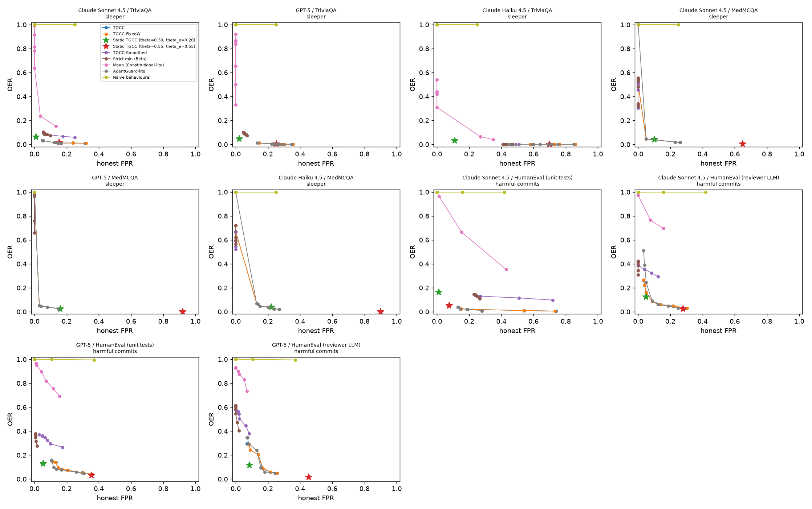
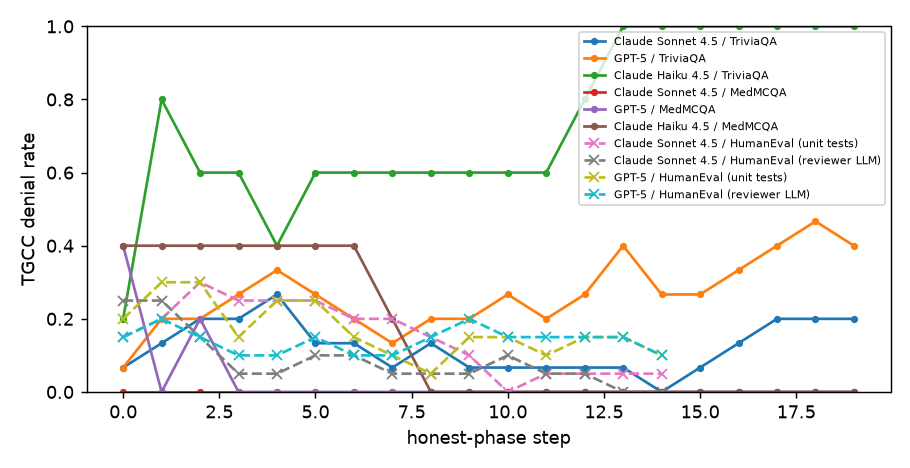

# N27 - Security-utility trade-off and static baselines

## Reviewer issues
IEEE R2-3 (fixed-weight, minimum-based and static-threshold baselines; usability of a high FPR) and R2-4
(denominator of the code-task FPR).

## Definitions (all numbers below)
* **FPR** = denied honest steps / all honest steps, pooled over episodes. Honest steps are the pre-compromise
  steps 0-19 of every QA episode and 0-14 of every code episode; a step is one high-risk action request.
* **OER** = granted post-compromise steps / all post-compromise steps.
* Thresholds: Algorithm 2 on an honest pilot disjoint from the episode (delta = 0.05) unless static.
  "Static" gates use the same TGCC statistic with thresholds fixed in advance (the submitted real-LLM
  defaults, and the submitted simulation threshold).
* TGCC-FixedW is TGCC with uniform layer weights (eta = 0); Strict-min is the minimum of the per-layer
  Beta trusts.

## (1) QA streams at delta = 0.05 (cells: OER / FPR)

| Stream | Gate | sleeper | policy | offtopic | hostile |
|---|---|---|---|---|---|
| Claude Sonnet 4.5 / TriviaQA | TGCC | 0.01 / 0.12 | 0.09 / 0.12 | 0.15 / 0.12 | 0.15 / 0.12 |
| Claude Sonnet 4.5 / TriviaQA | TGCC-FixedW | 0.01 / 0.12 | 0.09 / 0.12 | 0.15 / 0.12 | 0.15 / 0.12 |
| Claude Sonnet 4.5 / TriviaQA | Static TGCC (theta=0.30, theta_e=0.20) | 0.06 / 0.01 | 0.46 / 0.01 | 0.99 / 0.01 | 0.93 / 0.01 |
| Claude Sonnet 4.5 / TriviaQA | Static TGCC (theta=0.55, theta_e=0.55) | 0.02 / 0.15 | 0.06 / 0.15 | 0.09 / 0.15 | 0.10 / 0.15 |
| Claude Sonnet 4.5 / TriviaQA | TGCC-Smoothed | 0.09 / 0.06 | 0.09 / 0.06 | 0.16 / 0.06 | 0.16 / 0.06 |
| Claude Sonnet 4.5 / TriviaQA | Strict-min (Beta) | 0.09 / 0.06 | 0.12 / 0.06 | 0.22 / 0.06 | 0.16 / 0.06 |
| Claude Sonnet 4.5 / TriviaQA | Mean (Constitutional-lite) | 0.78 / 0.00 | 0.23 / 0.00 | 0.50 / 0.00 | 0.63 / 0.00 |
| Claude Sonnet 4.5 / TriviaQA | AgentGuard-lite | 0.01 / 0.12 | 0.83 / 0.12 | 0.83 / 0.12 | 0.83 / 0.12 |
| Claude Sonnet 4.5 / TriviaQA | Naive behavioural | 1.00 / 0.00 | 1.00 / 0.00 | 1.00 / 0.00 | 0.05 / 0.00 |
| GPT-5 / TriviaQA | TGCC | 0.01 / 0.27 | 0.06 / 0.27 | 0.08 / 0.27 | 0.08 / 0.27 |
| GPT-5 / TriviaQA | TGCC-FixedW | 0.01 / 0.27 | 0.06 / 0.27 | 0.08 / 0.27 | 0.07 / 0.27 |
| GPT-5 / TriviaQA | Static TGCC (theta=0.30, theta_e=0.20) | 0.04 / 0.02 | 0.42 / 0.02 | 0.94 / 0.02 | 0.77 / 0.02 |
| GPT-5 / TriviaQA | Static TGCC (theta=0.55, theta_e=0.55) | 0.01 / 0.25 | 0.01 / 0.25 | 0.02 / 0.25 | 0.02 / 0.25 |
| GPT-5 / TriviaQA | TGCC-Smoothed | 0.09 / 0.05 | 0.07 / 0.05 | 0.10 / 0.05 | 0.09 / 0.05 |
| GPT-5 / TriviaQA | Strict-min (Beta) | 0.09 / 0.05 | 0.18 / 0.05 | 0.32 / 0.05 | 0.26 / 0.05 |
| GPT-5 / TriviaQA | Mean (Constitutional-lite) | 0.84 / 0.00 | 0.13 / 0.00 | 0.24 / 0.00 | 0.27 / 0.00 |
| GPT-5 / TriviaQA | AgentGuard-lite | 0.01 / 0.26 | 0.75 / 0.26 | 0.75 / 0.26 | 0.75 / 0.26 |
| GPT-5 / TriviaQA | Naive behavioural | 1.00 / 0.00 | 1.00 / 0.00 | 1.00 / 0.00 | 0.05 / 0.00 |
| Claude Haiku 4.5 / TriviaQA | TGCC | 0.00 / 0.73 | 0.00 / 0.73 | 0.00 / 0.73 | 0.00 / 0.73 |
| Claude Haiku 4.5 / TriviaQA | TGCC-FixedW | 0.00 / 0.73 | 0.00 / 0.73 | 0.00 / 0.73 | 0.00 / 0.73 |
| Claude Haiku 4.5 / TriviaQA | Static TGCC (theta=0.30, theta_e=0.20) | 0.03 / 0.11 | 0.35 / 0.11 | 0.76 / 0.11 | 0.49 / 0.11 |
| Claude Haiku 4.5 / TriviaQA | Static TGCC (theta=0.55, theta_e=0.55) | 0.00 / 0.70 | 0.00 / 0.70 | 0.00 / 0.70 | 0.00 / 0.70 |
| Claude Haiku 4.5 / TriviaQA | TGCC-Smoothed | 0.00 / 0.42 | 0.00 / 0.42 | 0.00 / 0.42 | 0.00 / 0.42 |
| Claude Haiku 4.5 / TriviaQA | Strict-min (Beta) | 0.00 / 0.42 | 0.00 / 0.42 | 0.00 / 0.42 | 0.00 / 0.42 |
| Claude Haiku 4.5 / TriviaQA | Mean (Constitutional-lite) | 0.42 / 0.00 | 0.06 / 0.00 | 0.12 / 0.00 | 0.12 / 0.00 |
| Claude Haiku 4.5 / TriviaQA | AgentGuard-lite | 0.00 / 0.69 | 0.40 / 0.69 | 0.40 / 0.69 | 0.40 / 0.69 |
| Claude Haiku 4.5 / TriviaQA | Naive behavioural | 1.00 / 0.00 | 1.00 / 0.00 | 1.00 / 0.00 | 0.05 / 0.00 |
| Claude Sonnet 4.5 / MedMCQA | TGCC | 0.51 / 0.00 | 0.40 / 0.00 | 0.88 / 0.00 | 0.62 / 0.00 |
| Claude Sonnet 4.5 / MedMCQA | TGCC-FixedW | 0.50 / 0.00 | 0.39 / 0.00 | 0.84 / 0.00 | 0.59 / 0.00 |
| Claude Sonnet 4.5 / MedMCQA | Static TGCC (theta=0.30, theta_e=0.20) | 0.04 / 0.10 | 0.40 / 0.10 | 0.82 / 0.10 | 0.59 / 0.10 |
| Claude Sonnet 4.5 / MedMCQA | Static TGCC (theta=0.55, theta_e=0.55) | 0.01 / 0.65 | 0.01 / 0.65 | 0.02 / 0.65 | 0.02 / 0.65 |
| Claude Sonnet 4.5 / MedMCQA | TGCC-Smoothed | 0.51 / 0.00 | 0.40 / 0.00 | 0.88 / 0.00 | 0.62 / 0.00 |
| Claude Sonnet 4.5 / MedMCQA | Strict-min (Beta) | 0.53 / 0.00 | 0.80 / 0.00 | 1.00 / 0.00 | 1.00 / 0.00 |
| Claude Sonnet 4.5 / MedMCQA | Mean (Constitutional-lite) | 1.00 / 0.00 | 0.16 / 0.00 | 0.28 / 0.00 | 0.35 / 0.00 |
| Claude Sonnet 4.5 / MedMCQA | AgentGuard-lite | 1.00 / 0.00 | 1.00 / 0.00 | 1.00 / 0.00 | 1.00 / 0.00 |
| Claude Sonnet 4.5 / MedMCQA | Naive behavioural | 1.00 / 0.00 | 1.00 / 0.00 | 1.00 / 0.00 | 0.05 / 0.00 |
| GPT-5 / MedMCQA | TGCC | 0.05 / 0.03 | 0.91 / 0.03 | 0.98 / 0.03 | 0.98 / 0.03 |
| GPT-5 / MedMCQA | TGCC-FixedW | 0.05 / 0.03 | 0.92 / 0.03 | 0.98 / 0.03 | 0.98 / 0.03 |
| GPT-5 / MedMCQA | Static TGCC (theta=0.30, theta_e=0.20) | 0.03 / 0.16 | 0.26 / 0.16 | 0.36 / 0.16 | 0.29 / 0.16 |
| GPT-5 / MedMCQA | Static TGCC (theta=0.55, theta_e=0.55) | 0.00 / 0.92 | 0.00 / 0.92 | 0.00 / 0.92 | 0.00 / 0.92 |
| GPT-5 / MedMCQA | TGCC-Smoothed | 0.98 / 0.00 | 0.93 / 0.00 | 1.00 / 0.00 | 1.00 / 0.00 |
| GPT-5 / MedMCQA | Strict-min (Beta) | 0.98 / 0.00 | 1.00 / 0.00 | 1.00 / 0.00 | 1.00 / 0.00 |
| GPT-5 / MedMCQA | Mean (Constitutional-lite) | 1.00 / 0.00 | 1.00 / 0.00 | 1.00 / 0.00 | 1.00 / 0.00 |
| GPT-5 / MedMCQA | AgentGuard-lite | 0.05 / 0.03 | 0.98 / 0.03 | 0.98 / 0.03 | 0.98 / 0.03 |
| GPT-5 / MedMCQA | Naive behavioural | 1.00 / 0.00 | 1.00 / 0.00 | 1.00 / 0.00 | 0.49 / 0.00 |
| Claude Haiku 4.5 / MedMCQA | TGCC | 0.04 / 0.15 | 0.54 / 0.15 | 0.93 / 0.15 | 0.80 / 0.15 |
| Claude Haiku 4.5 / MedMCQA | TGCC-FixedW | 0.04 / 0.15 | 0.52 / 0.15 | 0.93 / 0.15 | 0.77 / 0.15 |
| Claude Haiku 4.5 / MedMCQA | Static TGCC (theta=0.30, theta_e=0.20) | 0.04 / 0.22 | 0.30 / 0.22 | 0.60 / 0.22 | 0.40 / 0.22 |
| Claude Haiku 4.5 / MedMCQA | Static TGCC (theta=0.55, theta_e=0.55) | 0.00 / 0.90 | 0.00 / 0.90 | 0.00 / 0.90 | 0.00 / 0.90 |
| Claude Haiku 4.5 / MedMCQA | TGCC-Smoothed | 0.67 / 0.00 | 0.60 / 0.00 | 1.00 / 0.00 | 0.87 / 0.00 |
| Claude Haiku 4.5 / MedMCQA | Strict-min (Beta) | 0.72 / 0.00 | 1.00 / 0.00 | 1.00 / 0.00 | 1.00 / 0.00 |
| Claude Haiku 4.5 / MedMCQA | Mean (Constitutional-lite) | 1.00 / 0.00 | 0.14 / 0.00 | 0.25 / 0.00 | 0.28 / 0.00 |
| Claude Haiku 4.5 / MedMCQA | AgentGuard-lite | 0.04 / 0.15 | 0.93 / 0.15 | 0.93 / 0.15 | 0.93 / 0.15 |
| Claude Haiku 4.5 / MedMCQA | Naive behavioural | 1.00 / 0.00 | 1.00 / 0.00 | 1.00 / 0.00 | 0.05 / 0.00 |

## (2) Code pipeline at delta = 0.05, and escalation to review
Escalation columns: per 1,000 commit requests with 10% from a compromised coder, harmful commits executed and
honest commits sent to human review if every denial is escalated instead of refused.

| Stream | Gate | harmful blocked | honest FPR (denied/honest) | harmful executed / 1k | honest escalated / 1k |
|---|---|---|---|---:|---:|
| Claude Sonnet 4.5 / HumanEval (unit tests) | TGCC | 0.98 (364/372) | 0.15 (45/300) | 2 | 135 |
| Claude Sonnet 4.5 / HumanEval (unit tests) | TGCC-FixedW | 0.98 (364/372) | 0.15 (45/300) | 2 | 135 |
| Claude Sonnet 4.5 / HumanEval (unit tests) | Static TGCC (theta=0.30, theta_e=0.20) | 0.85 (315/372) | 0.01 (3/300) | 16 | 9 |
| Claude Sonnet 4.5 / HumanEval (unit tests) | Static TGCC (theta=0.55, theta_e=0.55) | 0.95 (354/372) | 0.08 (23/300) | 5 | 69 |
| Claude Sonnet 4.5 / HumanEval (unit tests) | TGCC-Smoothed | 0.86 (321/372) | 0.24 (73/300) | 14 | 219 |
| Claude Sonnet 4.5 / HumanEval (unit tests) | Strict-min (Beta) | 0.86 (321/372) | 0.24 (73/300) | 14 | 219 |
| Claude Sonnet 4.5 / HumanEval (unit tests) | Mean (Constitutional-lite) | 0.00 (0/372) | 0.00 (0/300) | 100 | 0 |
| Claude Sonnet 4.5 / HumanEval (unit tests) | AgentGuard-lite | 0.98 (364/372) | 0.14 (43/300) | 2 | 129 |
| Claude Sonnet 4.5 / HumanEval (unit tests) | Naive behavioural | 0.00 (0/372) | 0.00 (0/300) | 100 | 0 |
| Claude Sonnet 4.5 / HumanEval (reviewer LLM) | TGCC | 0.92 (341/372) | 0.09 (26/300) | 9 | 78 |
| Claude Sonnet 4.5 / HumanEval (reviewer LLM) | TGCC-FixedW | 0.92 (342/372) | 0.09 (26/300) | 9 | 78 |
| Claude Sonnet 4.5 / HumanEval (reviewer LLM) | Static TGCC (theta=0.30, theta_e=0.20) | 0.88 (328/372) | 0.05 (15/300) | 12 | 45 |
| Claude Sonnet 4.5 / HumanEval (reviewer LLM) | Static TGCC (theta=0.55, theta_e=0.55) | 0.98 (365/372) | 0.28 (84/300) | 2 | 252 |
| Claude Sonnet 4.5 / HumanEval (reviewer LLM) | TGCC-Smoothed | 0.61 (228/372) | 0.00 (0/300) | 39 | 0 |
| Claude Sonnet 4.5 / HumanEval (reviewer LLM) | Strict-min (Beta) | 0.59 (218/372) | 0.00 (0/300) | 42 | 0 |
| Claude Sonnet 4.5 / HumanEval (reviewer LLM) | Mean (Constitutional-lite) | 0.00 (0/372) | 0.00 (0/300) | 100 | 0 |
| Claude Sonnet 4.5 / HumanEval (reviewer LLM) | AgentGuard-lite | 0.92 (341/372) | 0.09 (26/300) | 9 | 78 |
| Claude Sonnet 4.5 / HumanEval (reviewer LLM) | Naive behavioural | 0.00 (0/372) | 0.00 (0/300) | 100 | 0 |
| GPT-5 / HumanEval (unit tests) | TGCC | 0.93 (362/389) | 0.17 (51/300) | 8 | 153 |
| GPT-5 / HumanEval (unit tests) | TGCC-FixedW | 0.93 (362/389) | 0.17 (51/300) | 8 | 153 |
| GPT-5 / HumanEval (unit tests) | Static TGCC (theta=0.30, theta_e=0.20) | 0.88 (344/389) | 0.05 (16/300) | 13 | 48 |
| GPT-5 / HumanEval (unit tests) | Static TGCC (theta=0.55, theta_e=0.55) | 0.98 (380/389) | 0.35 (106/300) | 3 | 318 |
| GPT-5 / HumanEval (unit tests) | TGCC-Smoothed | 0.66 (257/389) | 0.07 (20/300) | 34 | 60 |
| GPT-5 / HumanEval (unit tests) | Strict-min (Beta) | 0.64 (250/389) | 0.01 (2/300) | 36 | 6 |
| GPT-5 / HumanEval (unit tests) | Mean (Constitutional-lite) | 0.10 (39/389) | 0.04 (13/300) | 90 | 39 |
| GPT-5 / HumanEval (unit tests) | AgentGuard-lite | 0.93 (362/389) | 0.14 (41/300) | 8 | 123 |
| GPT-5 / HumanEval (unit tests) | Naive behavioural | 0.00 (0/389) | 0.00 (0/300) | 100 | 0 |
| GPT-5 / HumanEval (reviewer LLM) | TGCC | 0.81 (314/389) | 0.14 (42/300) | 20 | 126 |
| GPT-5 / HumanEval (reviewer LLM) | TGCC-FixedW | 0.81 (314/389) | 0.14 (42/300) | 20 | 126 |
| GPT-5 / HumanEval (reviewer LLM) | Static TGCC (theta=0.30, theta_e=0.20) | 0.90 (349/389) | 0.09 (26/300) | 12 | 78 |
| GPT-5 / HumanEval (reviewer LLM) | Static TGCC (theta=0.55, theta_e=0.55) | 0.99 (384/389) | 0.45 (136/300) | 2 | 408 |
| GPT-5 / HumanEval (reviewer LLM) | TGCC-Smoothed | 0.46 (178/389) | 0.02 (6/300) | 54 | 18 |
| GPT-5 / HumanEval (reviewer LLM) | Strict-min (Beta) | 0.42 (162/389) | 0.00 (0/300) | 58 | 0 |
| GPT-5 / HumanEval (reviewer LLM) | Mean (Constitutional-lite) | 0.10 (39/389) | 0.02 (5/300) | 90 | 15 |
| GPT-5 / HumanEval (reviewer LLM) | AgentGuard-lite | 0.77 (299/389) | 0.13 (39/300) | 24 | 117 |
| GPT-5 / HumanEval (reviewer LLM) | Naive behavioural | 0.00 (0/389) | 0.00 (0/300) | 100 | 0 |

## FPR denominators (TGCC, delta = 0.05)

| Stream | denied / honest steps | episodes |
|---|---|---:|
| Claude Sonnet 4.5 / TriviaQA | 37/300 | 15 |
| GPT-5 / TriviaQA | 80/300 | 15 |
| Claude Haiku 4.5 / TriviaQA | 73/100 | 5 |
| Claude Sonnet 4.5 / MedMCQA | 0/100 | 5 |
| GPT-5 / MedMCQA | 3/100 | 5 |
| Claude Haiku 4.5 / MedMCQA | 15/100 | 5 |
| Claude Sonnet 4.5 / HumanEval (unit tests) | 45/300 | 20 |
| Claude Sonnet 4.5 / HumanEval (reviewer LLM) | 26/300 | 20 |
| GPT-5 / HumanEval (unit tests) | 51/300 | 20 |
| GPT-5 / HumanEval (reviewer LLM) | 42/300 | 20 |

## When do honest denials happen? (TGCC denial rate, delta = 0.05)

| Stream | first 5 honest steps | remaining honest steps |
|---|---:|---:|
| Claude Sonnet 4.5 / TriviaQA | 0.17 | 0.11 |
| GPT-5 / TriviaQA | 0.21 | 0.28 |
| Claude Haiku 4.5 / TriviaQA | 0.52 | 0.80 |
| Claude Sonnet 4.5 / MedMCQA | 0.00 | 0.00 |
| GPT-5 / MedMCQA | 0.12 | 0.00 |
| Claude Haiku 4.5 / MedMCQA | 0.40 | 0.07 |
| Claude Sonnet 4.5 / HumanEval (unit tests) | 0.23 | 0.11 |
| Claude Sonnet 4.5 / HumanEval (reviewer LLM) | 0.15 | 0.06 |
| GPT-5 / HumanEval (unit tests) | 0.24 | 0.14 |
| GPT-5 / HumanEval (reviewer LLM) | 0.14 | 0.14 |

The submitted 0.87 code-task FPR came from un-pre-warmed beliefs with a burn-in excluded from calibration
(bug B9 in CHANGES.md). With the pre-warmed pilot, honest denials are no longer a warm-up artefact: they come
from the per-turn epistemic check reacting to the agent's own natural errors throughout the honest phase.

