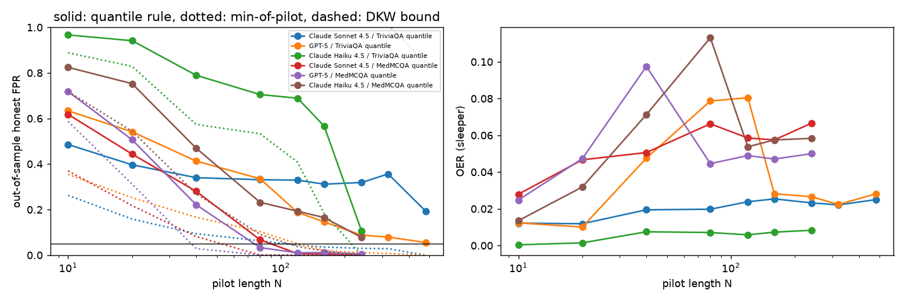

# N29 - Threshold calibration on real streams

## Reviewer issue
IEEE R2-7: verify-by-construction in Algorithm 2, wrong numbers in Remark 3, and a sample-complexity
result disconnected from the experiments.

## Corrected numbers for Remark 3
With gamma = 0.985 the burn-in 1/(1-gamma) is 66.7 steps (not 13); Eq. (14) with epsilon = delta = 0.05
asks for 1/(1-gamma) + ln(2/delta)/(2 epsilon^2) = 66.7 + 737.8 = 804 pilot steps (not 300). In the revised
protocol the beliefs are pre-warmed and the pilot keeps every step (no burn-in, CHANGES.md B9), and the
bound below replaces Eq. (14).

## Method
Pilots are contiguous blocks of a real honest run (target delta = 0.05); out-of-sample FPR is measured on
held-out honest episodes and OER on the matching sleeper episodes; 40 pilots per N.
* quantile eps=0: theta = delta-quantile of the pilot (no margin);
* quantile eps=0.05: the default Algorithm 2 (margin 0.05);
* min-of-pilot: the submitted rule.
* DKW bound: K (delta + sqrt(ln(2K/beta)/(2 N/tau_int))) with K = 2 conjuncts, beta = 0.05; coverage =
  fraction of pilots whose out-of-sample FPR (quantile, eps=0) is below it.
* Validation MAE: |FPR estimated on the held-out last third of the pilot - out-of-sample FPR|.

| Stream | N | quantile eps=0: FPR mean (95th pct) | quantile eps=0.05: FPR | min-of-pilot: FPR | OER (quantile eps=0) | DKW bound | coverage | validation MAE |
|---|---:|---|---:|---:|---:|---:|---:|---:|
| Claude Sonnet 4.5 / TriviaQA | 10 | 0.486 (0.85) | 0.286 | 0.262 | 0.012 | 5.25 | 1.00 | 0.383 |
| Claude Sonnet 4.5 / TriviaQA | 20 | 0.397 (0.53) | 0.170 | 0.158 | 0.012 | 3.74 | 1.00 | 0.315 |
| Claude Sonnet 4.5 / TriviaQA | 40 | 0.340 (0.47) | 0.132 | 0.094 | 0.019 | 2.68 | 1.00 | 0.307 |
| Claude Sonnet 4.5 / TriviaQA | 80 | 0.331 (0.51) | 0.148 | 0.063 | 0.020 | 1.92 | 1.00 | 0.289 |
| Claude Sonnet 4.5 / TriviaQA | 120 | 0.329 (0.49) | 0.120 | 0.044 | 0.024 | 1.59 | 1.00 | 0.242 |
| Claude Sonnet 4.5 / TriviaQA | 160 | 0.312 (0.50) | 0.100 | 0.036 | 0.025 | 1.39 | 1.00 | 0.231 |
| Claude Sonnet 4.5 / TriviaQA | 240 | 0.319 (0.47) | 0.086 | 0.030 | 0.023 | 1.15 | 1.00 | 0.281 |
| Claude Sonnet 4.5 / TriviaQA | 320 | 0.356 (0.49) | 0.117 | 0.029 | 0.022 | 1.01 | 1.00 | 0.318 |
| Claude Sonnet 4.5 / TriviaQA | 480 | 0.194 (0.38) | 0.037 | 0.000 | 0.025 | 0.84 | 1.00 | 0.124 |
| GPT-5 / TriviaQA | 10 | 0.633 (0.88) | 0.366 | 0.354 | 0.012 | 6.72 | 1.00 | 0.428 |
| GPT-5 / TriviaQA | 20 | 0.542 (0.77) | 0.273 | 0.252 | 0.010 | 4.78 | 1.00 | 0.367 |
| GPT-5 / TriviaQA | 40 | 0.413 (0.75) | 0.194 | 0.166 | 0.048 | 3.41 | 1.00 | 0.407 |
| GPT-5 / TriviaQA | 80 | 0.335 (0.90) | 0.138 | 0.103 | 0.079 | 2.44 | 1.00 | 0.380 |
| GPT-5 / TriviaQA | 120 | 0.188 (0.63) | 0.090 | 0.050 | 0.080 | 2.01 | 1.00 | 0.260 |
| GPT-5 / TriviaQA | 160 | 0.146 (0.38) | 0.068 | 0.021 | 0.028 | 1.76 | 1.00 | 0.311 |
| GPT-5 / TriviaQA | 240 | 0.088 (0.21) | 0.056 | 0.011 | 0.027 | 1.45 | 1.00 | 0.373 |
| GPT-5 / TriviaQA | 320 | 0.079 (0.10) | 0.055 | 0.007 | 0.022 | 1.27 | 1.00 | 0.353 |
| GPT-5 / TriviaQA | 480 | 0.056 (0.06) | 0.037 | 0.000 | 0.028 | 1.06 | 1.00 | 0.271 |
| Claude Haiku 4.5 / TriviaQA | 10 | 0.967 (1.00) | 0.894 | 0.888 | 0.000 | 7.29 | 1.00 | 0.389 |
| Claude Haiku 4.5 / TriviaQA | 20 | 0.941 (1.00) | 0.847 | 0.828 | 0.001 | 5.18 | 1.00 | 0.358 |
| Claude Haiku 4.5 / TriviaQA | 40 | 0.790 (1.00) | 0.611 | 0.574 | 0.007 | 3.69 | 1.00 | 0.401 |
| Claude Haiku 4.5 / TriviaQA | 80 | 0.705 (1.00) | 0.597 | 0.533 | 0.007 | 2.64 | 1.00 | 0.543 |
| Claude Haiku 4.5 / TriviaQA | 120 | 0.689 (1.00) | 0.513 | 0.408 | 0.006 | 2.18 | 1.00 | 0.346 |
| Claude Haiku 4.5 / TriviaQA | 160 | 0.567 (0.96) | 0.361 | 0.183 | 0.007 | 1.90 | 1.00 | 0.145 |
| Claude Haiku 4.5 / TriviaQA | 240 | 0.106 (0.11) | 0.056 | 0.000 | 0.008 | 1.57 | 1.00 | 0.006 |
| Claude Sonnet 4.5 / MedMCQA | 10 | 0.618 (0.82) | 0.382 | 0.370 | 0.028 | 4.68 | 1.00 | 0.400 |
| Claude Sonnet 4.5 / MedMCQA | 20 | 0.444 (0.86) | 0.238 | 0.217 | 0.047 | 3.34 | 1.00 | 0.446 |
| Claude Sonnet 4.5 / MedMCQA | 40 | 0.280 (0.50) | 0.110 | 0.082 | 0.051 | 2.39 | 1.00 | 0.392 |
| Claude Sonnet 4.5 / MedMCQA | 80 | 0.067 (0.23) | 0.005 | 0.001 | 0.066 | 1.72 | 1.00 | 0.540 |
| Claude Sonnet 4.5 / MedMCQA | 120 | 0.007 (0.01) | 0.006 | 0.000 | 0.059 | 1.42 | 1.00 | 0.497 |
| Claude Sonnet 4.5 / MedMCQA | 160 | 0.004 (0.01) | 0.004 | 0.000 | 0.057 | 1.25 | 1.00 | 0.345 |
| Claude Sonnet 4.5 / MedMCQA | 240 | 0.000 (0.00) | 0.000 | 0.000 | 0.067 | 1.03 | 1.00 | 0.287 |
| GPT-5 / MedMCQA | 10 | 0.718 (0.95) | 0.597 | 0.587 | 0.025 | 5.68 | 1.00 | 0.316 |
| GPT-5 / MedMCQA | 20 | 0.507 (0.74) | 0.329 | 0.312 | 0.047 | 4.05 | 1.00 | 0.362 |
| GPT-5 / MedMCQA | 40 | 0.221 (0.52) | 0.054 | 0.029 | 0.098 | 2.89 | 1.00 | 0.425 |
| GPT-5 / MedMCQA | 80 | 0.033 (0.13) | 0.006 | 0.001 | 0.045 | 2.07 | 1.00 | 0.705 |
| GPT-5 / MedMCQA | 120 | 0.010 (0.02) | 0.005 | 0.000 | 0.049 | 1.71 | 1.00 | 0.417 |
| GPT-5 / MedMCQA | 160 | 0.011 (0.02) | 0.004 | 0.000 | 0.047 | 1.50 | 1.00 | 0.104 |
| GPT-5 / MedMCQA | 240 | 0.006 (0.01) | 0.006 | 0.000 | 0.050 | 1.24 | 1.00 | 0.064 |
| Claude Haiku 4.5 / MedMCQA | 10 | 0.824 (0.92) | 0.729 | 0.718 | 0.014 | 5.27 | 1.00 | 0.142 |
| Claude Haiku 4.5 / MedMCQA | 20 | 0.753 (0.96) | 0.568 | 0.544 | 0.032 | 3.76 | 1.00 | 0.251 |
| Claude Haiku 4.5 / MedMCQA | 40 | 0.470 (0.84) | 0.308 | 0.269 | 0.071 | 2.68 | 1.00 | 0.370 |
| Claude Haiku 4.5 / MedMCQA | 80 | 0.232 (0.28) | 0.152 | 0.091 | 0.113 | 1.93 | 1.00 | 0.504 |
| Claude Haiku 4.5 / MedMCQA | 120 | 0.193 (0.24) | 0.093 | 0.037 | 0.054 | 1.59 | 1.00 | 0.509 |
| Claude Haiku 4.5 / MedMCQA | 160 | 0.165 (0.20) | 0.068 | 0.019 | 0.057 | 1.39 | 1.00 | 0.311 |
| Claude Haiku 4.5 / MedMCQA | 240 | 0.078 (0.08) | 0.056 | 0.000 | 0.058 | 1.16 | 1.00 | 0.268 |

## Autocorrelation and the pilot length the bound requires

| Stream | tau_int (steps) | pilot for slack 0.05 | pilot for slack 0.10 |
|---|---:|---:|---:|
| Claude Sonnet 4.5 / TriviaQA | 30.3 | 26536 | 6634 |
| GPT-5 / TriviaQA | 50.1 | 43869 | 10967 |
| Claude Haiku 4.5 / TriviaQA | 59.0 | 51690 | 12923 |
| Claude Sonnet 4.5 / MedMCQA | 23.9 | 20978 | 5245 |
| GPT-5 / MedMCQA | 35.5 | 31138 | 7785 |
| Claude Haiku 4.5 / MedMCQA | 30.5 | 26721 | 6680 |

## Conformal risk control: a finite-sample FPR guarantee that holds on real streams
Calibrate on m honest pilot *sessions* (20 steps each, disjoint items, each from the pre-warmed state).
Thresholds are theta_k = ref_k c (ref_k fixed from the separate 120-item pool); L_j(c) is the fraction of
session j's steps denied. The largest c with (m mean_j L_j(c) + 1)/(m + 1) <= delta guarantees
E[per-step honest FPR of a new session] <= delta for exchangeable sessions, finite-sample and for ANY
dependence inside a session (so the autocorrelation that makes the DKW bound vacuous does not matter).
It needs only m >= 1/delta - 1 sessions. Checked over 50 random splits of the real honest streams.

(A session-level variant that bounds P(an honest session is ever denied) also holds empirically, but forces
the threshold to about zero (OER 0.83-1.00): honest models occasionally produce 8-step windows as badly
calibrated as a sleeper's, so "never deny an honest session" is incompatible with security.)

| Stream | delta | pilot sessions m | splits | honest sessions ever denied | (90th pct) | per-step FPR (guarantee: <= delta) | OER | latency (steps) |
|---|---:|---:|---:|---:|---:|---:|---:|---:|
| Claude Sonnet 4.5 / TriviaQA | 0.05 | 19 | 50 | 0.020 | 0.01 | 0.002 | 0.907 | 36.3 |
| Claude Sonnet 4.5 / TriviaQA | 0.05 | 24 | 50 | 0.112 | 0.24 | 0.013 | 0.400 | 16.0 |
| Claude Sonnet 4.5 / TriviaQA | 0.05 | 29 | 50 | 0.182 | 0.31 | 0.019 | 0.193 | 7.7 |
| Claude Sonnet 4.5 / TriviaQA | 0.05 | 34 | 50 | 0.229 | 0.37 | 0.028 | 0.057 | 2.3 |
| Claude Sonnet 4.5 / TriviaQA | 0.05 | 39 | 50 | 0.260 | 0.50 | 0.034 | 0.050 | 2.0 |
| Claude Sonnet 4.5 / TriviaQA | 0.1 | 9 | 50 | 0.037 | 0.20 | 0.005 | 0.830 | 33.2 |
| Claude Sonnet 4.5 / TriviaQA | 0.1 | 14 | 50 | 0.283 | 0.42 | 0.048 | 0.044 | 1.8 |
| Claude Sonnet 4.5 / TriviaQA | 0.1 | 19 | 50 | 0.338 | 0.50 | 0.062 | 0.037 | 1.5 |
| Claude Sonnet 4.5 / TriviaQA | 0.1 | 24 | 50 | 0.349 | 0.48 | 0.061 | 0.035 | 1.4 |
| Claude Sonnet 4.5 / TriviaQA | 0.1 | 29 | 50 | 0.372 | 0.50 | 0.070 | 0.034 | 1.3 |
| Claude Sonnet 4.5 / TriviaQA | 0.1 | 34 | 50 | 0.384 | 0.55 | 0.079 | 0.031 | 1.2 |
| Claude Sonnet 4.5 / TriviaQA | 0.1 | 39 | 50 | 0.427 | 0.67 | 0.088 | 0.032 | 1.3 |
| GPT-5 / TriviaQA | 0.05 | 19 | 50 | 0.015 | 0.00 | 0.002 | 0.943 | 37.7 |
| GPT-5 / TriviaQA | 0.05 | 24 | 50 | 0.112 | 0.29 | 0.010 | 0.510 | 20.4 |
| GPT-5 / TriviaQA | 0.05 | 29 | 50 | 0.164 | 0.38 | 0.018 | 0.396 | 15.9 |
| GPT-5 / TriviaQA | 0.05 | 34 | 50 | 0.245 | 0.37 | 0.030 | 0.092 | 3.7 |
| GPT-5 / TriviaQA | 0.05 | 39 | 50 | 0.223 | 0.50 | 0.025 | 0.074 | 3.0 |
| GPT-5 / TriviaQA | 0.1 | 9 | 50 | 0.033 | 0.17 | 0.005 | 0.886 | 35.4 |
| GPT-5 / TriviaQA | 0.1 | 14 | 50 | 0.289 | 0.42 | 0.039 | 0.047 | 1.9 |
| GPT-5 / TriviaQA | 0.1 | 19 | 50 | 0.391 | 0.54 | 0.066 | 0.035 | 1.4 |
| GPT-5 / TriviaQA | 0.1 | 24 | 50 | 0.412 | 0.58 | 0.067 | 0.032 | 1.3 |
| GPT-5 / TriviaQA | 0.1 | 29 | 50 | 0.421 | 0.57 | 0.074 | 0.032 | 1.3 |
| GPT-5 / TriviaQA | 0.1 | 34 | 50 | 0.467 | 0.64 | 0.083 | 0.029 | 1.2 |
| GPT-5 / TriviaQA | 0.1 | 39 | 50 | 0.423 | 0.67 | 0.079 | 0.030 | 1.2 |
| Claude Haiku 4.5 / TriviaQA | 0.1 | 9 | 50 | 0.010 | 0.00 | 0.002 | 0.982 | 39.3 |
| Claude Sonnet 4.5 / MedMCQA | 0.1 | 9 | 50 | 0.020 | 0.00 | 0.002 | 0.963 | 38.5 |
| GPT-5 / MedMCQA | 0.1 | 9 | 50 | 0.000 | 0.00 | 0.000 | 1.000 | 40.0 |
| Claude Haiku 4.5 / MedMCQA | 0.1 | 9 | 50 | 0.000 | 0.00 | 0.000 | 1.000 | 40.0 |
