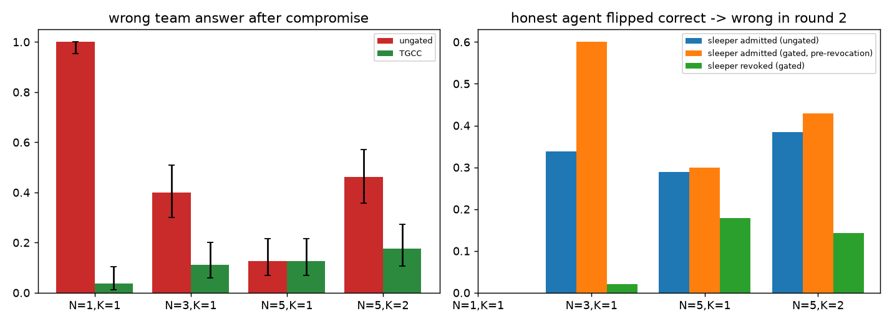

# N30 - Debate: harm prevented and influence before revocation

## Reviewer issue
IEEE R2-2: report harmful outcomes prevented, not only revocation; address influence that happens before revocation.

## Method
The N10 protocol (identical prompts; N10's calls are reused from the cache) with K sleepers among N agents,
2 series of 60 questions each, compromise at question 20. Harm = a wrong team answer written to the pool.

## Harm prevented (paired, same questions and agents)
"prevented / caused" counts post-compromise questions where only the ungated / only the gated team was wrong;
McNemar exact p-value on those discordant pairs.

| Condition | wrong pre (ungated) | wrong pre (TGCC) | wrong post (ungated) | wrong post (TGCC) | prevented / caused | McNemar p | pool abstains (TGCC) | honest agents denied |
|---|---|---|---|---|---|---:|---|---|
| N=1,K=1 | 0.07 [0.03, 0.20] (3/40) | 0.07 [0.03, 0.20] (3/40) | 1.00 [0.95, 1.00] (80/80) | 0.04 [0.01, 0.10] (3/80) | 77 / 0 | 1.3e-23 | 0.96 [0.90, 0.99] (77/80) | 0/0 |
| N=3,K=1 | 0.15 [0.07, 0.29] (6/40) | 0.17 [0.09, 0.32] (7/40) | 0.40 [0.30, 0.51] (32/80) | 0.11 [0.06, 0.20] (9/80) | 24 / 1 | 1.5e-06 | 0.14 [0.08, 0.23] (11/80) | 64/241 |
| N=5,K=1 | 0.07 [0.03, 0.20] (3/40) | 0.17 [0.09, 0.32] (7/40) | 0.12 [0.07, 0.22] (10/80) | 0.12 [0.07, 0.22] (10/80) | 3 / 3 | 1 | 0.14 [0.08, 0.23] (11/80) | 128/482 |
| N=5,K=2 | 0.07 [0.03, 0.20] (3/40) | 0.17 [0.09, 0.32] (7/40) | 0.46 [0.36, 0.57] (37/80) | 0.17 [0.11, 0.27] (14/80) | 24 / 1 | 1.5e-06 | 0.14 [0.08, 0.23] (11/80) | 107/362 |

## Influence and timing
Influence = P(an honest agent correct in round 1 gives a wrong final answer after seeing peers). Timing splits the
gated team's wrong answers into the window between compromise and revocation and the period after revocation.

| Condition | influence, sleeper admitted (ungated) | influence, sleeper admitted (TGCC, before revocation) | influence, sleeper revoked (TGCC) | wrong answers before revocation | wrong answers after revocation |
|---|---|---|---|---|---|
| N=1,K=1 | n/a | n/a | n/a | 1.00 [0.44, 1.00] (3/3) | 0.00 [0.00, 0.05] (0/77) |
| N=3,K=1 | 0.34 [0.27, 0.42] (49/145) | 0.60 [0.23, 0.88] (3/5) | 0.02 [0.01, 0.07] (2/95) | 1.00 [0.44, 1.00] (3/3) | 0.08 [0.04, 0.16] (6/77) |
| N=5,K=1 | 0.29 [0.24, 0.34] (84/290) | 0.30 [0.11, 0.60] (3/10) | 0.18 [0.13, 0.24] (34/190) | 0.33 [0.06, 0.79] (1/3) | 0.12 [0.06, 0.21] (9/77) |
| N=5,K=2 | 0.38 [0.32, 0.45] (83/216) | 0.43 [0.16, 0.75] (3/7) | 0.14 [0.09, 0.21] (19/133) | 0.67 [0.21, 0.94] (2/3) | 0.16 [0.09, 0.25] (12/77) |

