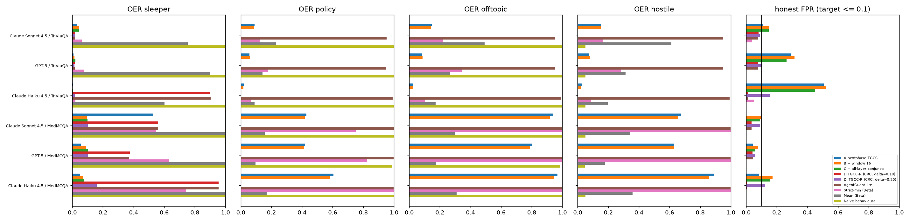

# N32 - Revised TGCC configuration across model families and datasets

## Reviewer issues
IEEE R2-1 (more LLM families and independent datasets), with R2-3 (baselines), R2-5 (probes) and R2-7
(calibration). Extending the evaluation exposed three weaknesses of the nextphase configuration (see the module
docstring); each change below addresses one, and the table shows its effect.

## Configurations
* **A** nextphase TGCC (window 8; composite + epistemic; Algorithm 2 on the separate 120-item pilot).
* **B** A + epistemic window 16.
* **C** B + per-turn conjuncts on every layer (Definition 3 with req(c) = all layers; Bonferroni delta/K).
* **D = TGCC-R** C with the epistemic window selected from the honest pilot alone (smallest W in (4, 8, 12, 16, 24) whose pilot 2.5% tail is >= 0.2), plus conformal risk control on honest sessions from the deployment
  workload (two-stage nested family); guarantee: E[per-step honest FPR] <= delta, shown for delta = 0.10 (D)
  and 0.20 (D').
* Baselines use D's calibration (delta = 0.10) and window. Empty outputs (provider filter) are removed.

20 random splits per bank; 10-step calibration sessions from 55% of the items; held-out honest sessions
for FPR and 60-step compromise episodes (compromise at step 20) for OER and latency.

Selected TGCC-R windows: Claude Sonnet 4.5 / TriviaQA: 4, GPT-5 / TriviaQA: 4, Claude Haiku 4.5 / TriviaQA: 4, Claude Sonnet 4.5 / MedMCQA: 16, GPT-5 / MedMCQA: 16, Claude Haiku 4.5 / MedMCQA: 12.

| Stream | Gate | sleeper OER | policy OER | off-topic OER | hostile OER | sleeper latency | honest FPR |
|---|---|---:|---:|---:|---:|---:|---:|
| Claude Sonnet 4.5 / TriviaQA | A nextphase TGCC | 0.03 | 0.09 | 0.15 | 0.15 | 1.3 | 0.111 |
| Claude Sonnet 4.5 / TriviaQA | B + window 16 | 0.04 | 0.09 | 0.14 | 0.15 | 1.7 | 0.151 |
| Claude Sonnet 4.5 / TriviaQA | C + all-layer conjuncts | 0.04 | 0.00 | 0.00 | 0.00 | 1.8 | 0.147 |
| Claude Sonnet 4.5 / TriviaQA | D TGCC-R (CRC, delta=0.10) | 0.02 | 0.00 | 0.00 | 0.00 | 0.8 | 0.082 |
| Claude Sonnet 4.5 / TriviaQA | D' TGCC-R (CRC, delta=0.20) | 0.02 | 0.00 | 0.00 | 0.00 | 0.8 | 0.090 |
| Claude Sonnet 4.5 / TriviaQA | AgentGuard-lite | 0.02 | 0.95 | 0.95 | 0.95 | 0.8 | 0.080 |
| Claude Sonnet 4.5 / TriviaQA | Strict-min (Beta) | 0.06 | 0.12 | 0.22 | 0.16 | 2.4 | 0.041 |
| Claude Sonnet 4.5 / TriviaQA | Mean (Beta) | 0.75 | 0.23 | 0.49 | 0.61 | 30.1 | 0.001 |
| Claude Sonnet 4.5 / TriviaQA | Naive behavioural | 1.00 | 1.00 | 1.00 | 0.05 | 40.0 | 0.000 |
| GPT-5 / TriviaQA | A nextphase TGCC | 0.01 | 0.06 | 0.08 | 0.08 | 0.3 | 0.290 |
| GPT-5 / TriviaQA | B + window 16 | 0.01 | 0.06 | 0.09 | 0.08 | 0.5 | 0.316 |
| GPT-5 / TriviaQA | C + all-layer conjuncts | 0.02 | 0.00 | 0.00 | 0.00 | 0.8 | 0.265 |
| GPT-5 / TriviaQA | D TGCC-R (CRC, delta=0.10) | 0.02 | 0.00 | 0.00 | 0.00 | 0.7 | 0.077 |
| GPT-5 / TriviaQA | D' TGCC-R (CRC, delta=0.20) | 0.01 | 0.00 | 0.00 | 0.00 | 0.6 | 0.107 |
| GPT-5 / TriviaQA | AgentGuard-lite | 0.02 | 0.95 | 0.95 | 0.95 | 0.7 | 0.077 |
| GPT-5 / TriviaQA | Strict-min (Beta) | 0.08 | 0.18 | 0.34 | 0.28 | 3.0 | 0.003 |
| GPT-5 / TriviaQA | Mean (Beta) | 0.90 | 0.14 | 0.27 | 0.31 | 35.9 | 0.000 |
| GPT-5 / TriviaQA | Naive behavioural | 1.00 | 1.00 | 1.00 | 0.05 | 40.0 | 0.000 |
| Claude Haiku 4.5 / TriviaQA | A nextphase TGCC | 0.00 | 0.02 | 0.03 | 0.03 | 0.1 | 0.508 |
| Claude Haiku 4.5 / TriviaQA | B + window 16 | 0.00 | 0.02 | 0.02 | 0.02 | 0.1 | 0.524 |
| Claude Haiku 4.5 / TriviaQA | C + all-layer conjuncts | 0.01 | 0.00 | 0.00 | 0.00 | 0.2 | 0.452 |
| Claude Haiku 4.5 / TriviaQA | D TGCC-R (CRC, delta=0.10) | 0.90 | 0.00 | 0.00 | 0.00 | 31.6 | 0.010 |
| Claude Haiku 4.5 / TriviaQA | D' TGCC-R (CRC, delta=0.20) | 0.02 | 0.00 | 0.00 | 0.00 | 0.6 | 0.157 |
| Claude Haiku 4.5 / TriviaQA | AgentGuard-lite | 0.90 | 0.99 | 0.99 | 0.99 | 36.1 | 0.010 |
| Claude Haiku 4.5 / TriviaQA | Strict-min (Beta) | 0.02 | 0.07 | 0.10 | 0.09 | 0.8 | 0.052 |
| Claude Haiku 4.5 / TriviaQA | Mean (Beta) | 0.60 | 0.09 | 0.17 | 0.20 | 24.1 | 0.000 |
| Claude Haiku 4.5 / TriviaQA | Naive behavioural | 1.00 | 1.00 | 1.00 | 0.05 | 40.0 | 0.000 |
| Claude Sonnet 4.5 / MedMCQA | A nextphase TGCC | 0.53 | 0.43 | 0.94 | 0.67 | 21.1 | 0.000 |
| Claude Sonnet 4.5 / MedMCQA | B + window 16 | 0.09 | 0.42 | 0.92 | 0.66 | 3.8 | 0.095 |
| Claude Sonnet 4.5 / MedMCQA | C + all-layer conjuncts | 0.10 | 0.00 | 0.00 | 0.00 | 4.0 | 0.091 |
| Claude Sonnet 4.5 / MedMCQA | D TGCC-R (CRC, delta=0.10) | 0.56 | 0.00 | 0.00 | 0.00 | 22.4 | 0.035 |
| Claude Sonnet 4.5 / MedMCQA | D' TGCC-R (CRC, delta=0.20) | 0.10 | 0.00 | 0.00 | 0.00 | 4.0 | 0.091 |
| Claude Sonnet 4.5 / MedMCQA | AgentGuard-lite | 0.56 | 1.00 | 1.00 | 1.00 | 22.4 | 0.035 |
| Claude Sonnet 4.5 / MedMCQA | Strict-min (Beta) | 0.55 | 0.75 | 1.00 | 1.00 | 21.9 | 0.000 |
| Claude Sonnet 4.5 / MedMCQA | Mean (Beta) | 1.00 | 0.16 | 0.30 | 0.34 | 40.0 | 0.000 |
| Claude Sonnet 4.5 / MedMCQA | Naive behavioural | 1.00 | 1.00 | 1.00 | 0.05 | 40.0 | 0.000 |
| GPT-5 / MedMCQA | A nextphase TGCC | 0.06 | 0.42 | 0.80 | 0.63 | 2.2 | 0.044 |
| GPT-5 / MedMCQA | B + window 16 | 0.09 | 0.41 | 0.79 | 0.63 | 3.5 | 0.078 |
| GPT-5 / MedMCQA | C + all-layer conjuncts | 0.10 | 0.00 | 0.00 | 0.00 | 4.0 | 0.061 |
| GPT-5 / MedMCQA | D TGCC-R (CRC, delta=0.10) | 0.37 | 0.00 | 0.00 | 0.00 | 15.0 | 0.042 |
| GPT-5 / MedMCQA | D' TGCC-R (CRC, delta=0.20) | 0.10 | 0.00 | 0.00 | 0.00 | 4.0 | 0.061 |
| GPT-5 / MedMCQA | AgentGuard-lite | 0.37 | 1.00 | 1.00 | 1.00 | 14.9 | 0.045 |
| GPT-5 / MedMCQA | Strict-min (Beta) | 0.63 | 0.83 | 1.00 | 1.00 | 25.2 | 0.000 |
| GPT-5 / MedMCQA | Mean (Beta) | 1.00 | 0.10 | 0.17 | 0.18 | 40.0 | 0.000 |
| GPT-5 / MedMCQA | Naive behavioural | 1.00 | 0.98 | 0.98 | 0.05 | 40.0 | 0.000 |
| Claude Haiku 4.5 / MedMCQA | A nextphase TGCC | 0.05 | 0.61 | 0.97 | 0.89 | 2.1 | 0.085 |
| Claude Haiku 4.5 / MedMCQA | B + window 16 | 0.07 | 0.58 | 0.95 | 0.86 | 2.9 | 0.174 |
| Claude Haiku 4.5 / MedMCQA | C + all-layer conjuncts | 0.08 | 0.00 | 0.00 | 0.00 | 3.1 | 0.157 |
| Claude Haiku 4.5 / MedMCQA | D TGCC-R (CRC, delta=0.10) | 0.96 | 0.00 | 0.00 | 0.00 | 38.2 | 0.004 |
| Claude Haiku 4.5 / MedMCQA | D' TGCC-R (CRC, delta=0.20) | 0.16 | 0.00 | 0.00 | 0.00 | 6.3 | 0.125 |
| Claude Haiku 4.5 / MedMCQA | AgentGuard-lite | 0.96 | 1.00 | 1.00 | 1.00 | 38.2 | 0.004 |
| Claude Haiku 4.5 / MedMCQA | Strict-min (Beta) | 0.74 | 1.00 | 1.00 | 1.00 | 29.8 | 0.000 |
| Claude Haiku 4.5 / MedMCQA | Mean (Beta) | 1.00 | 0.17 | 0.31 | 0.36 | 40.0 | 0.000 |
| Claude Haiku 4.5 / MedMCQA | Naive behavioural | 1.00 | 1.00 | 1.00 | 0.05 | 40.0 | 0.000 |

