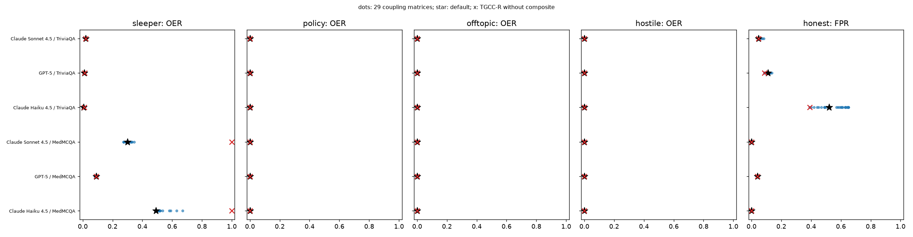

# N34 - Coupling structure under TGCC-R

## Reviewer issue
IEEE R2-5: the coupling matrix is hand-specified; the sweep only varied its overall strength.

## Method
TGCC-R (pilot-selected window, all-layer conjuncts, CRC delta = 0.10) on every real bank, with 26 matrices from N02,
the matrix learned in simulation (N21), a matrix **learned from real traces of the other dataset** (no leakage),
permuted layer orders, and TGCC-R without its composite conjunct. Cells: OER sleeper / policy / off-topic / hostile
/ honest FPR.

| Bank | window | default C | C learned from real data | without composite | range over 29 matrices | range over layer orders |
|---|---:|---|---|---|---|---|
| Claude Sonnet 4.5 / TriviaQA | 4 | 0.02 / 0.00 / 0.00 / 0.00 / 0.05 | 0.02 / 0.00 / 0.00 / 0.00 / 0.07 | 0.02 / 0.00 / 0.00 / 0.00 / 0.05 | 0.02-0.02 / 0.00-0.00 / 0.00-0.00 / 0.00-0.00 / 0.05-0.08 | 0.02-0.02 / 0.00-0.00 / 0.00-0.00 / 0.00-0.00 / 0.05-0.07 |
| GPT-5 / TriviaQA | 4 | 0.01 / 0.00 / 0.00 / 0.00 / 0.11 | 0.01 / 0.00 / 0.00 / 0.00 / 0.11 | 0.01 / 0.00 / 0.00 / 0.00 / 0.09 | 0.01-0.01 / 0.00-0.00 / 0.00-0.00 / 0.00-0.00 / 0.09-0.14 | 0.01-0.01 / 0.00-0.00 / 0.00-0.00 / 0.00-0.00 / 0.11-0.13 |
| Claude Haiku 4.5 / TriviaQA | 4 | 0.01 / 0.00 / 0.00 / 0.00 / 0.52 | 0.00 / 0.00 / 0.00 / 0.00 / 0.65 | 0.01 / 0.00 / 0.00 / 0.00 / 0.39 | 0.00-0.01 / 0.00-0.00 / 0.00-0.00 / 0.00-0.00 / 0.39-0.65 | 0.00-0.01 / 0.00-0.00 / 0.00-0.00 / 0.00-0.00 / 0.52-0.65 |
| Claude Sonnet 4.5 / MedMCQA | 16 | 0.30 / 0.00 / 0.00 / 0.00 / 0.00 | 0.28 / 0.00 / 0.00 / 0.00 / 0.00 | 1.00 / 0.00 / 0.00 / 0.00 / 0.00 | 0.28-0.34 / 0.00-0.00 / 0.00-0.00 / 0.00-0.00 / 0.00-0.00 | 0.25-0.33 / 0.00-0.00 / 0.00-0.00 / 0.00-0.00 / 0.00-0.00 |
| GPT-5 / MedMCQA | 16 | 0.09 / 0.00 / 0.00 / 0.00 / 0.04 | 0.08 / 0.00 / 0.00 / 0.00 / 0.04 | 0.09 / 0.00 / 0.00 / 0.00 / 0.04 | 0.08-0.09 / 0.00-0.00 / 0.00-0.00 / 0.00-0.00 / 0.04-0.04 | 0.08-0.09 / 0.00-0.00 / 0.00-0.00 / 0.00-0.00 / 0.04-0.04 |
| Claude Haiku 4.5 / MedMCQA | 12 | 0.49 / 0.00 / 0.00 / 0.00 / 0.00 | 0.50 / 0.00 / 0.00 / 0.00 / 0.00 | 1.00 / 0.00 / 0.00 / 0.00 / 0.00 | 0.49-0.67 / 0.00-0.00 / 0.00-0.00 / 0.00-0.00 / 0.00-0.00 | 0.47-0.54 / 0.00-0.00 / 0.00-0.00 / 0.00-0.00 / 0.00-0.00 |

## Matrices learned from real traces (maximum likelihood, rows = dependent layer l, columns = prerequisite k)
Layers: 0 epistemic, 1 behavioural, 2 role, 3 social, 4 institutional.

**triviaqa**

| | k=0 | k=1 | k=2 | k=3 | k=4 |
|---|---|---|---|---|---|
| l=0 | - | - | - | - | - |
| l=1 | 0.83 | - | - | - | - |
| l=2 | 1.00 | 0.00 | - | - | - |
| l=3 | 0.00 | 0.00 | 0.00 | - | - |
| l=4 | 0.84 | 0.00 | 0.00 | 0.00 | - |
**medmcqa**

| | k=0 | k=1 | k=2 | k=3 | k=4 |
|---|---|---|---|---|---|
| l=0 | - | - | - | - | - |
| l=1 | 0.67 | - | - | - | - |
| l=2 | 0.74 | 0.00 | - | - | - |
| l=3 | 0.00 | 0.00 | 0.00 | - | - |
| l=4 | 0.69 | 0.00 | 0.00 | 0.00 | - |
**simulation**

| | k=0 | k=1 | k=2 | k=3 | k=4 |
|---|---|---|---|---|---|
| l=0 | - | - | - | - | - |
| l=1 | 0.58 | - | - | - | - |
| l=2 | 0.67 | 0.61 | - | - | - |
| l=3 | 0.03 | 0.55 | 0.70 | - | - |
| l=4 | 0.10 | 0.53 | 0.17 | 0.62 | - |

