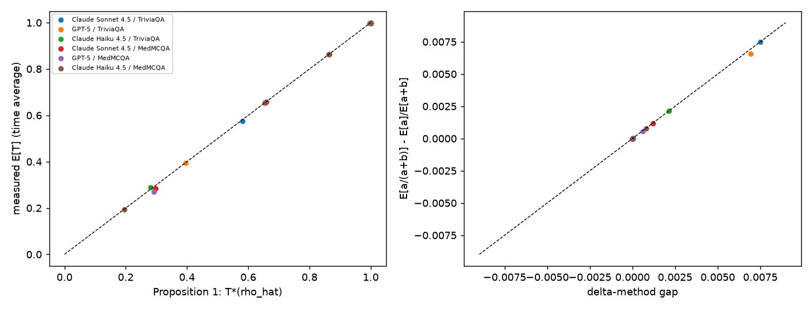

# N35 - Proposition 1 on real streams

## Reviewer issue
IEEE R2-6: Proposition 1 uses the ratio of expected pseudo-counts, not the expected trust.

## Result
On every layer of every real honest stream (after a 199-step burn-in), the expected trust E[T] = E[a/(a+b)]
is within **0.0226** of the closed form T*(rho_hat) (mean 0.0028); the "ratio of expectations"
gap the reviewer points to is at most **0.00749** and follows its second-order (delta-method) value. The
revised proposition states T* as the fixed point of the expected-evidence recursion and bounds the gap by the
delta-method term, which is O(1 - gamma).

| Stream | Layer | steps | rho_hat | T*(rho_hat) | E[T] | abs. error | E[a/n] - E[a]/E[n] | delta-method |
|---|---|---:|---:|---:|---:|---:|---:|---:|
| Claude Sonnet 4.5 / TriviaQA | epistemic | 821 | 0.807 | 0.5819 | 0.5750 | 0.0069 | +0.00749 | +0.00751 |
| Claude Sonnet 4.5 / TriviaQA | behavioural | 821 | 0.950 | 0.8629 | 0.8627 | 0.0002 | +0.00000 | +0.00000 |
| Claude Sonnet 4.5 / TriviaQA | role | 821 | 0.999 | 0.9969 | 0.9963 | 0.0006 | +0.00003 | +0.00003 |
| Claude Sonnet 4.5 / TriviaQA | social | 821 | 0.849 | 0.6529 | 0.6531 | 0.0002 | +0.00001 | +0.00001 |
| Claude Sonnet 4.5 / TriviaQA | institutional | 821 | 1.000 | 1.0000 | 0.9994 | 0.0006 | -0.00000 | -0.00000 |
| GPT-5 / TriviaQA | epistemic | 820 | 0.663 | 0.3964 | 0.3934 | 0.0030 | +0.00658 | +0.00692 |
| GPT-5 / TriviaQA | behavioural | 820 | 0.950 | 0.8639 | 0.8638 | 0.0002 | -0.00000 | -0.00000 |
| GPT-5 / TriviaQA | role | 820 | 1.000 | 1.0000 | 0.9994 | 0.0006 | -0.00000 | -0.00000 |
| GPT-5 / TriviaQA | social | 820 | 0.850 | 0.6538 | 0.6540 | 0.0002 | +0.00000 | +0.00000 |
| GPT-5 / TriviaQA | institutional | 820 | 1.000 | 1.0000 | 0.9994 | 0.0006 | -0.00000 | -0.00000 |
| Claude Haiku 4.5 / TriviaQA | epistemic | 221 | 0.538 | 0.2800 | 0.2889 | 0.0089 | +0.00214 | +0.00212 |
| Claude Haiku 4.5 / TriviaQA | behavioural | 221 | 0.950 | 0.8642 | 0.8632 | 0.0010 | -0.00000 | -0.00000 |
| Claude Haiku 4.5 / TriviaQA | role | 221 | 1.000 | 1.0000 | 0.9979 | 0.0021 | -0.00001 | -0.00001 |
| Claude Haiku 4.5 / TriviaQA | social | 221 | 0.851 | 0.6551 | 0.6555 | 0.0005 | +0.00000 | +0.00000 |
| Claude Haiku 4.5 / TriviaQA | institutional | 221 | 1.000 | 1.0000 | 0.9979 | 0.0021 | -0.00001 | -0.00001 |
| Claude Sonnet 4.5 / MedMCQA | epistemic | 220 | 0.559 | 0.2972 | 0.2855 | 0.0117 | +0.00117 | +0.00119 |
| Claude Sonnet 4.5 / MedMCQA | behavioural | 220 | 0.950 | 0.8636 | 0.8627 | 0.0009 | -0.00000 | -0.00000 |
| Claude Sonnet 4.5 / MedMCQA | role | 220 | 1.000 | 1.0000 | 0.9978 | 0.0022 | -0.00001 | -0.00001 |
| Claude Sonnet 4.5 / MedMCQA | social | 220 | 0.853 | 0.6587 | 0.6583 | 0.0004 | +0.00000 | +0.00000 |
| Claude Sonnet 4.5 / MedMCQA | institutional | 220 | 1.000 | 1.0000 | 0.9978 | 0.0022 | -0.00001 | -0.00001 |
| GPT-5 / MedMCQA | epistemic | 154 | 0.552 | 0.2914 | 0.2688 | 0.0226 | +0.00058 | +0.00059 |
| GPT-5 / MedMCQA | behavioural | 154 | 0.950 | 0.8636 | 0.8624 | 0.0012 | -0.00000 | -0.00000 |
| GPT-5 / MedMCQA | role | 154 | 1.000 | 1.0000 | 0.9971 | 0.0029 | -0.00001 | -0.00001 |
| GPT-5 / MedMCQA | social | 154 | 0.851 | 0.6556 | 0.6564 | 0.0008 | +0.00001 | +0.00001 |
| GPT-5 / MedMCQA | institutional | 154 | 1.000 | 1.0000 | 0.9971 | 0.0029 | -0.00001 | -0.00001 |
| Claude Haiku 4.5 / MedMCQA | epistemic | 221 | 0.422 | 0.1959 | 0.1931 | 0.0028 | +0.00079 | +0.00080 |
| Claude Haiku 4.5 / MedMCQA | behavioural | 221 | 0.950 | 0.8636 | 0.8627 | 0.0009 | -0.00000 | -0.00000 |
| Claude Haiku 4.5 / MedMCQA | role | 221 | 1.000 | 1.0000 | 0.9979 | 0.0021 | -0.00001 | -0.00001 |
| Claude Haiku 4.5 / MedMCQA | social | 221 | 0.852 | 0.6575 | 0.6562 | 0.0013 | -0.00000 | -0.00000 |
| Claude Haiku 4.5 / MedMCQA | institutional | 221 | 1.000 | 1.0000 | 0.9979 | 0.0021 | -0.00001 | -0.00001 |

